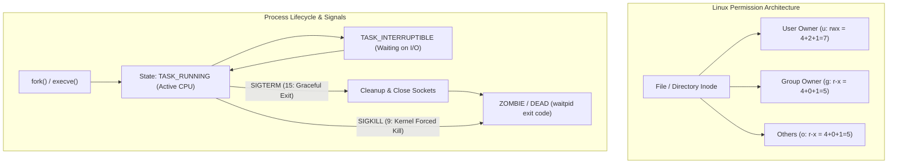

# Linux and Bash for DevOps & Backend Engineering

A practical, production-oriented guide to Linux systems, command-line tooling, permissions, process management, and robust Bash automation for software engineers.

---

## Architecture: Linux Permission & Process Lifecycle



---

## Interview Questions & Answers

### LNX-BAS-001: How do Linux file permissions and `chmod` / `chown` work?

#### 1. Simple Explanation
Every file and directory in Linux has an owner user and an owner group, with three categories of access:
- **User (u):** The user account that owns the file.
- **Group (g):** Members of the group assigned to the file.
- **Others (o):** Anyone else with an account on the machine.

Each category has three fundamental permissions:
- **Read (`r` = 4):** View file contents or list directory files.
- **Write (`w` = 2):** Modify or delete file contents; create or delete files inside a directory.
- **Execute (`x` = 1):** Execute a script/binary; or traverse/enter a directory (`cd`).

#### 2. Easy Example
`chmod 755 app.sh` sets:
- User = `7` (`4+2+1` -> `rwx` - can read, edit, execute)
- Group = `5` (`4+0+1` -> `r-x` - can read and execute)
- Others = `5` (`4+0+1` -> `r-x` - can read and execute)

#### 3. One-Line Interview Answer
Linux file permissions use a 3-digit octal bitmask (`r=4, w=2, x=1`) applied across user, group, and others to enforce POSIX discretionary access control (DAC) managed via `chmod` and `chown`.

#### 4. Detailed Technical Explanation
In Linux inode metadata, permissions are stored in a 16-bit integer mode:
1. **Special bits (High 4 bits):**
   - **SUID (`4000`):** Runs the executable with the file owner's privileges (e.g., `/usr/bin/passwd`).
   - **SGID (`2000`):** Runs executable with group privileges; on directories, newly created files inherit the parent directory's group.
   - **Sticky Bit (`1000`):** On shared directories like `/tmp`, only the file owner or root can delete or rename the file, regardless of write permissions.
2. **Standard octal representation:**
   - `644` (`rw-r--r--`): Default for configuration files and source code.
   - `755` (`rwxr-xr-x`): Default for directories and executable binaries/scripts.
   - `600` (`rw-------`): Secure files such as SSH private keys (`~/.ssh/id_rsa`) and environment files (`.env`).
   - `400` (`r--------`): Read-only secrets for the application user.

#### 5. Practical Implementation
```bash
#!/usr/bin/env bash
# Securing production backend directory and credentials

APP_DIR="/opt/myapp"
APP_USER="deploy"
APP_GROUP="deploy"

# 1. Transfer ownership recursively
chown -R "$APP_USER:$APP_GROUP" "$APP_DIR"

# 2. Set directories to 750 (owner full, group read-execute, others none)
find "$APP_DIR" -type d -exec chmod 750 {} +

# 3. Set standard code files to 640 (owner read-write, group read, others none)
find "$APP_DIR" -type f -exec chmod 640 {} +

# 4. Make executable scripts 750
chmod 750 "$APP_DIR/bin/start.sh"

# 5. Lock down secret env file to 600 (owner only)
chmod 600 "$APP_DIR/.env"
```

#### 6. Real-World Scenarios
- **SSH Key Rejection:** When connecting via SSH, OpenSSH fails with `Permissions 0644 for id_rsa are too open. It is recommended that your private key files are NOT accessible by others.` Fix: `chmod 600 ~/.ssh/id_rsa`.
- **Shared Team Workspace:** A shared directory on a build server where multiple developers in group `devs` collaborate. Solution: `chmod 2775 /shared/repo` (SGID bit set so all newly created files inherit group `devs`).

---

### LNX-INT-002: How do process management tools work in Linux production environments?

#### 1. Simple Explanation
When a Python or web application runs on Linux, it executes as a process with a unique Process ID (`PID`). If an app hangs or leaks memory, engineers must inspect running processes (`ps`, `top`), diagnose resource consumption, send termination signals (`kill`), and manage persistent services via `systemctl`.

#### 2. Easy Example
- `ps aux | grep gunicorn`: Find running Gunicorn master and worker PIDs.
- `kill -15 1234`: Request PID 1234 to shut down cleanly (`SIGTERM`).
- `kill -9 1234`: Forcibly terminate unresponsive PID 1234 (`SIGKILL`).

#### 3. One-Line Interview Answer
Process management combines kernel signal dispatching (`kill`) with process table inspection (`ps`, `htop`, `/proc`) and declarative service supervisors like `systemd` (`systemctl`, `journalctl`) for automatic restarts and health monitoring.

#### 4. Detailed Technical Explanation
1. **Core Kernel Signals:**
   - **`SIGTERM` (Signal 15):** Default graceful termination. The application intercepts it, finishes ongoing HTTP requests, closes database pools, flushes logs, and exits with code 0.
   - **`SIGKILL` (Signal 9):** Uncatchable kernel kill. The kernel immediately destroys the address space and releases file descriptors. Uncommitted database transactions are aborted.
   - **`SIGHUP` (Signal 1):** Hangup signal. Conventionally used by web servers (Nginx, Gunicorn) to reload configuration and rotate worker processes without downtime.
   - **`SIGINT` (Signal 2):** Terminal interrupt (Ctrl+C).
2. **Inspection Commands:**
   - `ps aux --sort=-%mem | head -n 10`: Top 10 memory-consuming processes.
   - `top -b -n 1`: Batch snapshot of CPU and memory utilization.
   - `lsof -i :8000`: Find which PID is bound to TCP port 8000.
3. **`systemd` Service Supervision:**
   `systemd` acts as PID 1, managing daemons, dependency ordering, restart policies (`Restart=on-failure`), cgroup resource quotas, and unified logging via `journalctl`.

#### 5. Practical Implementation
```ini
# /etc/systemd/system/fastapi-app.service
[Unit]
Description=Production FastAPI Backend Service
After=network.target postgresql.service
Wants=postgresql.service

[Service]
Type=simple
User=deploy
Group=deploy
WorkingDirectory=/opt/myapp
Environment="PATH=/opt/myapp/venv/bin"
EnvironmentFile=/opt/myapp/.env
ExecStart=/opt/myapp/venv/bin/uvicorn app.main:app --host 0.0.0.0 --port 8000 --workers 4

# Fault tolerance and resource limits
Restart=always
RestartSec=5s
KillMode=mixed
TimeoutStopSec=30s
MemoryMax=2G
CPUQuota=200%

[Install]
WantedBy=multi-user.target
```

```bash
# Managing and inspecting the service
sudo systemctl daemon-reload
sudo systemctl enable --now fastapi-app.service
sudo systemctl status fastapi-app.service

# Live log streaming with journalctl
journalctl -u fastapi-app.service -f --since "10 minutes ago"
```

#### 6. Real-World Scenarios
- **Port Conflict on Startup:** `uvicorn` fails with `Errno 98 Address already in use`. The engineer uses `ss -tulpn | grep 8000` or `fuser -k 8000/tcp` to immediately locate and terminate the orphaned previous worker holding the socket open.

---

### LNX-ADV-003: How do you write robust, production-grade Bash automation scripts?

#### 1. Simple Explanation
Bash scripts often fail silently: if a command fails in the middle of a script, bash by default continues executing subsequent commands, potentially executing catastrophic operations like deleting files or writing corrupted data. Production Bash scripts must fail fast, handle traps, and validate arguments.

#### 2. Easy Example
Always start production scripts with:
```bash
set -euo pipefail
```
If any command fails, any unset variable is referenced, or any piped command errors, the script terminates immediately with an error.

#### 3. One-Line Interview Answer
Production Bash uses defensive directives (`set -euo pipefail`), signal traps (`trap 'cleanup' EXIT INT TERM`), strict argument parsing, idempotent operations, and structured logging.

#### 4. Detailed Technical Explanation
- **`set -e` (`errexit`):** Exit immediately if a pipeline, list, or compound command exits with a non-zero status.
- **`set -u` (`nounset`):** Treat unset variables as errors when performing parameter expansion. Prevents deadly bugs like `rm -rf "$TARGET_DIR/"` when `$TARGET_DIR` is empty or typo'd.
- **`set -o pipefail`:** Prevents masked errors in pipelines. Normally, the exit status of `cmd1 | cmd2` is the exit code of `cmd2`. With `pipefail`, if `cmd1` fails, the pipeline returns `cmd1`'s non-zero exit code.
- **`trap` Functionality:** Registers a handler function for POSIX signals or the pseudo-signal `EXIT`. Ensures temporary files, lockfiles, and background tunnels are destroyed even on abnormal termination.

#### 5. Practical Implementation
```bash
#!/usr/bin/env bash
# ==============================================================================
# Production Database Backup and S3 Export Script
# ==============================================================================
set -euo pipefail
IFS=$'\n\t'

readonly SCRIPT_DIR="$(cd "$(dirname "${BASH_SOURCE[0]}")" && pwd)"
readonly TEMP_DIR="$(mktemp -d -t db_backup_XXXXXX)"
readonly TIMESTAMP="$(date +'%Y%m%d_%H%M%S')"
readonly BACKUP_FILE="${TEMP_DIR}/db_dump_${TIMESTAMP}.sql.gz"

# Structured loggers
log_info()  { echo "[$(date +'%Y-%m-%d %H:%M:%S')] [INFO]  $*" >&2; }
log_error() { echo "[$(date +'%Y-%m-%d %H:%M:%S')] [ERROR] $*" >&2; }

# Trap to guarantee cleanup of temporary storage on any exit
cleanup() {
    local exit_code=$?
    log_info "Executing cleanup handler for: ${TEMP_DIR}"
    rm -rf "${TEMP_DIR}"
    if [[ ${exit_code} -ne 0 ]]; then
        log_error "Script failed with exit code: ${exit_code}"
    fi
    exit "${exit_code}"
}
trap cleanup EXIT INT TERM

main() {
    local db_host="${1:-localhost}"
    local db_name="${2:-mydb}"

    log_info "Initiating pg_dump for database '${db_name}' on '${db_host}'..."
    pg_dump -h "${db_host}" -U postgres "${db_name}" | gzip > "${BACKUP_FILE}"

    local file_size
    file_size="$(du -h "${BACKUP_FILE}" | cut -f1)"
    log_info "Backup created successfully (${file_size}): ${BACKUP_FILE}"

    log_info "Syncing to cold storage bucket..."
    # aws s3 cp "${BACKUP_FILE}" "s3://my-backups/${db_name}/"
    log_info "Backup workflow completed successfully."
}

main "$@"
```

#### 6. Real-World Scenarios
- **Accidental Root Directory Deletion:** A script ran `rm -rf "$CACHE_DIR/*"`. Because `$CACHE_DIR` was not defined in the cron environment, it expanded to `rm -rf /*`. Using `set -u` halts the script immediately before variable expansion, protecting production hosts.
