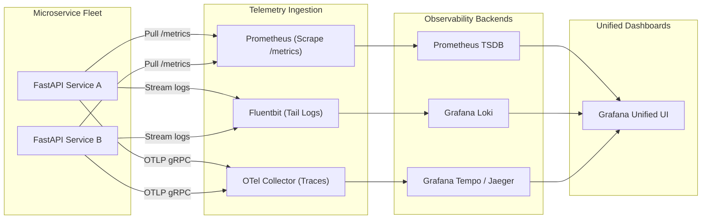

# Monitoring, Observability, and Centralized Logging

A comprehensive architectural and practical guide to monitoring, telemetry, Prometheus, Grafana, OpenTelemetry, and centralized logging in enterprise systems.

---

## Architecture: Observability Pipeline (Metrics, Logs, Traces)



---

## Interview Questions & Answers

### MON-BAS-001: What are the "Four Golden Signals" of monitoring?

#### 1. Simple Explanation
The Google SRE handbook defines four primary metrics for monitoring user-facing systems:
1. **Latency:** Time taken to service a request (differentiating successful requests from errors).
2. **Traffic:** Demand placed on the system (HTTP requests/second, concurrent active users).
3. **Errors:** Rate of requests that fail explicitly (HTTP 500s) or implicitly.
4. **Saturation:** How full the service is (CPU, RAM, DB connection pool utilization).

#### 2. Easy Example
Think of a highway:
- Traffic = Number of cars entering per minute.
- Latency = Travel time from entrance to exit.
- Errors = Number of vehicle collisions or breakdowns.
- Saturation = How close the lanes are to complete bumper-to-bumper gridlock.

#### 3. One-Line Interview Answer
The Four Golden Signals are Latency, Traffic, Errors, and Saturation, providing comprehensive insight into user experience and system capacity.

#### 4. Detailed Technical Explanation
- Track percentiles (p50, p95, p99, p99.9) rather than arithmetic averages for latency to expose edge-case degradation.
- Error rate is calculated as: (HTTP 5xx Errors / Total HTTP Requests) * 100.
- Saturation metrics predict impending service collapse before latency increases (e.g., memory reaching 92% or DB connection pool at 98%).

#### 5. Practical Implementation
```python
import time
from fastapi import FastAPI, Request, Response
from prometheus_client import Counter, Histogram, Gauge, generate_latest, CONTENT_TYPE_LATEST

app = FastAPI()

HTTP_REQUESTS_TOTAL = Counter("http_requests_total", "Total requests", ["method", "endpoint", "status"])
HTTP_LATENCY_SECONDS = Histogram("http_latency_seconds", "Latency in seconds", ["method", "endpoint"])
ACTIVE_REQUESTS = Gauge("http_active_requests", "In-flight requests")

@app.middleware("http")
async def monitor_requests(request: Request, call_next):
    ACTIVE_REQUESTS.inc()
    start = time.perf_counter()
    status_code = 500
    try:
        response: Response = await call_next(request)
        status_code = response.status_code
        return response
    finally:
        ACTIVE_REQUESTS.dec()
        HTTP_LATENCY_SECONDS.labels(method=request.method, endpoint=request.url.path).observe(time.perf_counter() - start)
        HTTP_REQUESTS_TOTAL.labels(method=request.method, endpoint=request.url.path, status=status_code).inc()

@app.get("/metrics")
def metrics():
    return Response(content=generate_latest(), media_type=CONTENT_TYPE_LATEST)
```

#### 6. Real-World Scenarios
- **Silent Degradation:** 99% of requests complete in 15ms, but 1% timeout after 30 seconds. Averages show ~315ms, which looks acceptable, while p99 graphs show a flat 30s spike indicating database deadlocks.

---

### MON-INT-002: How does Prometheus pull-based metrics collection work with Grafana?

#### 1. Simple Explanation
Prometheus periodically scrapes (HTTP GET) metrics from target services exposing an open `/metrics` endpoint. Prometheus stores these data points in a local time-series database. Grafana connects to Prometheus and queries the time-series using PromQL to render visual graphs and dashboards.

#### 2. Easy Example
Instead of 100 microservices constantly flooding a monitoring server with push requests, Prometheus acts as an inspector that visits each service every 15 seconds, records its status, and saves it in a ledger.

#### 3. One-Line Interview Answer
Prometheus scrapes HTTP `/metrics` endpoints registered via Service Discovery, indexing multi-dimensional time-series data queried via PromQL in Grafana dashboards.

#### 4. Detailed Technical Explanation
1. **Core Metric Types:**
   - **Counter:** Monotonically increasing number (e.g., total requests). Resets only on reboot. Query using `rate()`.
   - **Gauge:** Numerical value that fluctuates up and down (e.g., memory usage, temperature).
   - **Histogram:** Samples observations into configurable buckets (`le` label), exposing `_bucket`, `_sum`, and `_count`.
   - **Summary:** Calculates percentiles on the client side over a sliding window.
2. **Pull vs Push:**
   - Pull enables centralized rate control: the scraper cannot be overloaded by application traffic spikes.
   - For ephemeral batch jobs (AWS Lambda, Celery), Prometheus uses a **Pushgateway** buffer.

#### 5. Practical Implementation
```python
# Prometheus metrics client definition
from prometheus_client import CollectorRegistry, Counter

registry = CollectorRegistry()
order_counter = Counter(
    "orders_processed_total",
    "Total orders processed successfully",
    ["payment_method"],
    registry=registry
)

def process_order(payment_method: str):
    # Business logic
    order_counter.labels(payment_method=payment_method).inc()
    return True

process_order("credit_card")
```

#### 6. Real-World Scenarios
- **Traffic Surge Stability:** During a massive traffic spike, push-based monitoring systems often crash under telemetry load. Prometheus pull maintains a fixed scrape rate, preserving monitoring visibility throughout the incident.

---

### MON-ADV-003: How do centralized logging and distributed tracing correlate across microservices?

#### 1. Simple Explanation
In microservices, a user request passes through multiple services before completing. Distributed tracing assigns a unique **Trace ID** to the initial request that travels through all downstream HTTP and gRPC headers. When each service writes logs to `stdout`, it embeds this Trace ID so engineers can search one ID and see every log from every service.

#### 2. Easy Example
Like a postal package tracking number: every delivery hub and truck logs status updates with that same tracking number, providing end-to-end visibility.

#### 3. One-Line Interview Answer
Distributed tracing injects W3C `traceparent` headers across network boundaries, correlating OpenTelemetry spans with structured JSON logs via unified `trace_id` tags.

#### 4. Detailed Technical Explanation
- **W3C Trace Context:** The HTTP header `traceparent: 00-4bf92f3577b34da6a3ce929d0e0e4736-00f067aa0ba902b7-01` contains:
  - `4bf92f3577b34da6a3ce929d0e0e4736`: 128-bit **Trace ID** (constant across all downstream calls).
  - `00f067aa0ba902b7`: 64-bit **Span ID** (unique to current execution unit).
- **Log Correlation:** Structured JSON formatters read current span context from OpenTelemetry SDK and inject `trace_id` and `span_id` into log records shipped to Loki/Elasticsearch.

#### 5. Practical Implementation
```python
import logging
from opentelemetry import trace
from opentelemetry.sdk.trace import TracerProvider

provider = TracerProvider()
trace.set_tracer_provider(provider)
tracer = trace.get_tracer("payment-service")

class TraceLogFilter(logging.Filter):
    def filter(self, record):
        span = trace.get_current_span()
        ctx = span.get_span_context() if span else None
        record.trace_id = format(ctx.trace_id, "032x") if ctx and ctx.trace_id else "none"
        record.span_id = format(ctx.span_id, "016x") if ctx and ctx.span_id else "none"
        return True

logger = logging.getLogger("app")
handler = logging.StreamHandler()
handler.addFilter(TraceLogFilter())
handler.setFormatter(logging.Formatter('{"time": "%(asctime)s", "trace_id": "%(trace_id)s", "msg": "%(message)s"}'))
logger.addHandler(handler)
logger.setLevel(logging.INFO)

with tracer.start_as_current_span("charge_card"):
    logger.info("Processing Stripe authorization")
```

#### 6. Real-World Scenarios
- **Cross-Service Root Cause Debugging:** A checkout request times out. Searching the `trace_id` in Grafana reveals that out of 30s total duration, 29.8s was spent waiting on an unindexed foreign key query in the inventory service.
