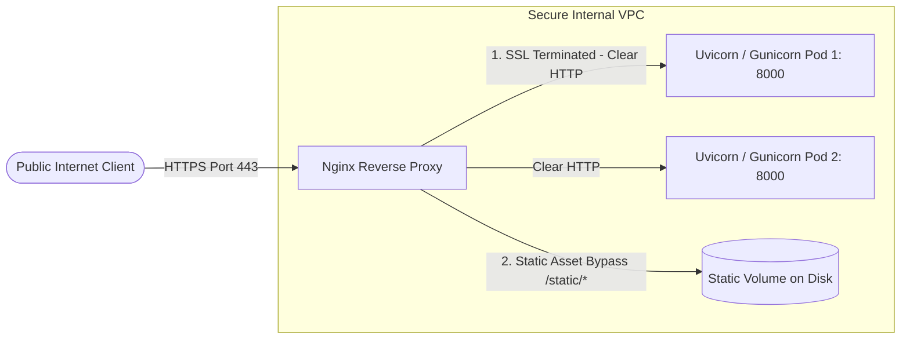

# Nginx & Reverse Proxy Architecture Interview Guide

## Module Overview
This guide covers **Nginx**, **Forward Proxy vs Reverse Proxy**, SSL/TLS Termination, Load Balancing algorithms, static file caching, and configuring Nginx as a reverse proxy in front of Gunicorn and Uvicorn.

---

## Visual Architecture: Nginx Reverse Proxy & SSL Termination



---

## Questions & Comprehensive Solutions

### NGX-BAS-001: Forward Proxy vs Reverse Proxy

**Comparison Table:**

| Feature | Forward Proxy | Reverse Proxy (Nginx) |
| :--- | :--- | :--- |
| **Who it Represents** | Represents the **Client** to the outside internet | Represents the **Origin Servers** to the clients |
| **Location** | Positioned in front of clients (corporate office network, VPN) | Positioned in front of application backend servers |
| **Primary Purpose** | Anonymity, content filtering, corporate security, blocking sites | Load balancing, SSL termination, caching, DDoS protection |
| **Visibility** | Client explicitly configures the proxy; server thinks the proxy made the request | Client has no idea a proxy exists; client thinks it is speaking directly to the website |

---

### NGX-INT-002: Production `nginx.conf` for FastAPI / Django (Uvicorn / Gunicorn)

```nginx
upstream fastapi_backend {
    # Load balances across multiple internal ASGI worker containers
    least_conn; # Routes to container with fewest active connections
    server web1:8000 max_fails=3 fail_timeout=10s;
    server web2:8000 max_fails=3 fail_timeout=10s;
}

server {
    listen 80;
    server_name api.mycompany.com;
    # Redirect all insecure HTTP to secure HTTPS
    return 301 https://$host$request_uri;
}

server {
    listen 443 ssl http2;
    server_name api.mycompany.com;

    # SSL / TLS Certificate Configuration
    ssl_certificate /etc/letsencrypt/live/api.mycompany.com/fullchain.pem;
    ssl_certificate_key /etc/letsencrypt/live/api.mycompany.com/privkey.pem;
    ssl_protocols TLSv1.2 TLSv1.3;
    ssl_ciphers HIGH:!aNULL:!MD5;

    # 1. High-Performance Static File Serving (bypasses Python backend)
    location /static/ {
        alias /app/static/;
        expires 30d;
        add_header Cache-Control "public, no-transform";
    }

    # 2. Reverse Proxy to Python ASGI / WSGI Application
    location / {
        proxy_pass http://fastapi_backend;
        
        # Preserve original client IP and protocol headers
        proxy_set_header Host $host;
        proxy_set_header X-Real-IP $remote_addr;
        proxy_set_header X-Forwarded-For $proxy_add_x_forwarded_for;
        proxy_set_header X-Forwarded-Proto $scheme;

        # WebSocket Support (Connection Upgrade)
        proxy_http_version 1.1;
        proxy_set_header Upgrade $http_upgrade;
        proxy_set_header Connection "upgrade";

        # Timeouts
        proxy_connect_timeout 60s;
        proxy_read_timeout 60s;
    }
}
```
