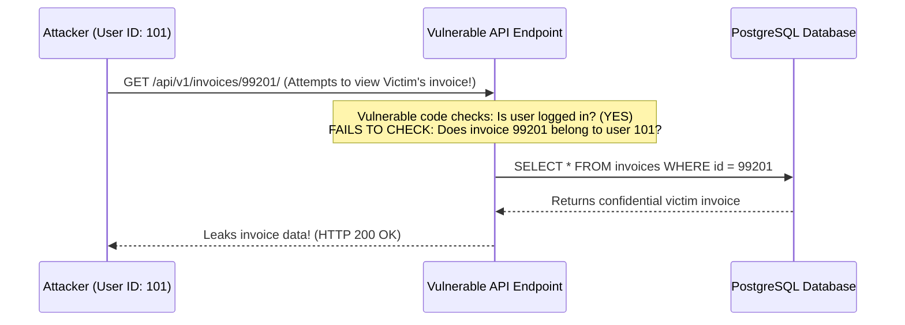

# API Security & OWASP API Top 10 Interview Guide

## Module Overview
This module covers modern **API Security**, the **OWASP API Top 10 Vulnerabilities**, **Broken Object Level Authorization (BOLA)**, and **CORS misconfigurations**.

---

## Visual Summary: Broken Object Level Authorization (BOLA - OWASP API #1)



---

## The OWASP API Top 10 Vulnerabilities Explained

### 1. API 1: Broken Object Level Authorization (BOLA / IDOR)
- **What it is:** An endpoint accepts an ID from the user (e.g. `GET /users/5/profile`) and returns the object without verifying that the logged-in user actually owns that object.
- **Fix in FastAPI:** Always enforce ownership in database queries:
  ```python
  # SECURE: Enforces that the item belongs to the authenticated user!
  item = db.query(Item).filter(Item.id == item_id, Item.user_id == current_user.id).first()
  if not item:
      raise HTTPException(status_code=404, detail="Item not found")
  ```

### 2. API 2: Broken Authentication
- **What it is:** Weak password policies, unencrypted JWT transmission, missing refresh token invalidation on logout, or credential stuffing vulnerability.

### 3. API 4: Unrestricted Resource Consumption (DDoS & Scraping)
- **What it is:** Missing rate limits, allowing clients to request massive payloads (`?limit=1000000`) or upload 5GB files, exhausting memory and CPU.
- **Fix:** Enforce maximum page limits (`max_limit=100`), file upload size caps, and Redis-backed rate limiting.

### 4. API 8: Security Misconfiguration (CORS Wildcard)
- **Anti-Pattern:** Setting `Access-Control-Allow-Origin: *` while allowing credentials (`Allow-Credentials: true`). This allows malicious websites to steal user session cookies via AJAX requests!
- **Fix:** Explicitly whitelist trusted frontend domains only:
  ```python
  from fastapi.middleware.cors import CORSMiddleware
  
  app.add_middleware(
      CORSMiddleware,
      allow_origins=["https://app.mycompany.com"], # NEVER '*' in production with credentials
      allow_credentials=True,
      allow_methods=["GET", "POST", "PUT", "DELETE"],
      allow_headers=["*"],
  )
  ```
