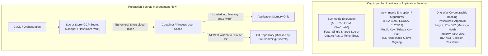

# Application Security & Cryptographic Engineering

A comprehensive engineering guide to software supply chain security, secrets management, cryptographic protocols (AES-256, RSA, ECC, Argon2id), and dependency vulnerability auditing.

---

## Architecture: Cryptographic Triad & Secrets Management



---

## Interview Questions & Answers

### SEC-BAS-001: What is Software Supply Chain Security and how do you audit dependencies?

#### 1. Simple Explanation
Modern software applications are made of 10% custom business logic and 90% open-source third-party dependencies (PyPI packages like `requests`, `fastapi`, `pydantic`). If any third-party library has a security vulnerability or is compromised by malicious actors (typosquatting or dependency confusion), your entire production infrastructure is exposed. Software Supply Chain Security means continuously auditing, pinning, and verifying all third-party code.

#### 2. Easy Example
If a restaurant buys tomato sauce from a vendor and that sauce is contaminated, customers get sick even if the restaurant's kitchen is clean. Similarly, an unpatched vulnerability in an indirect logging dependency (like Log4j) exposes your app even if your own code is flawless.

#### 3. One-Line Interview Answer
Software Supply Chain Security enforces cryptographic package hash verification (`pip-tools`, `poetry.lock`), automated vulnerability scanning (`pip-audit`, Trivy, Dependabot), and Software Bill of Materials (SBOM) generation to mitigate upstream dependency risks.

#### 4. Detailed Technical Explanation
1. **Common Supply Chain Attack Vectors:**
   - **Typosquatting:** Publishing malicious packages with names similar to popular ones (e.g., `reqeusts` or `colorama-v2`).
   - **Dependency Confusion:** Pushing a malicious package to public PyPI with the same name as a private internal corporate package with a higher version number.
   - **Compromised Maintainer Account:** An attacker takes over a trusted developer's credentials and publishes a compromised release.
2. **Defensive Practices:**
   - **Lockfiles with Hashes:** Always pin exact versions with SHA-256 integrity hashes (`pip compile --generate-hashes`).
   - **Automated CI/CD Scans:** Run `pip-audit` or `safety check` in GitHub Actions on every pull request to block known CVEs.
   - **SBOM (Software Bill of Materials):** Generate CycloneDX or SPDX JSON manifests (`cyclonedx-py`) cataloging all libraries, licenses, and hashes for regulatory compliance.

#### 5. Practical Implementation
```bash
# Automated CI/CD dependency vulnerability pipeline

# 1. Install pip-audit (official PyPA advisory database scanner)
pip install pip-audit

# 2. Audit current virtual environment for known CVEs
pip-audit --desc on

# 3. Audit specific pinned requirements file and fail build if severity is HIGH or CRITICAL
pip-audit -r requirements.txt --fail-on high

# 4. Generate CycloneDX SBOM for production release artifacts
pip install cyclonedx-bom
cyclonedx-py requirements requirements.txt -o sbom.json
```

#### 6. Real-World Scenarios
- **X-Raying PyPI in CI/CD:** A PR submitted by a junior engineer upgraded `urllib3` to a version flagged with CVE-2023-45803. The GitHub Actions workflow running `pip-audit --fail-on high` blocked the PR from merging into `main`, preventing vulnerable code from reaching production.

---

### SEC-INT-002: How do you prevent sensitive data leaks and manage production secrets securely?

#### 1. Simple Explanation
Secrets include database passwords, API keys, TLS certificates, and JWT signing keys. The most common catastrophic security mistake is hardcoding secrets in source code, committing them to GitHub, or saving them inside Docker images. Secrets must be stored in encrypted secret vaults and injected into application processes as environment variables at runtime.

#### 2. Easy Example
You wouldn't tape your house key to your front door for the cleaners to see. You put the key in a digital lockbox (Secret Manager) and give the cleaner an expiring one-time digital passcode to unlock it.

#### 3. One-Line Interview Answer
Never store credentials in code or version control; use dedicated KMS/Vault stores (GCP Secret Manager, HashiCorp Vault), inject secrets into memory via environment variables or ephemeral volumes, and enforce pre-commit secret detection hooks (`git-secrets`, `trufflehog`).

#### 4. Detailed Technical Explanation
1. **Secrets Hierarchy of Safety:**
   - *Worst:* Hardcoded in Python source code (committed to git history).
   - *Bad:* Hardcoded in `Dockerfile` (visible via `docker history`).
   - *Acceptable for Local Dev:* `.env` file excluded by `.gitignore`.
   - *Production Standard:* Injected dynamically from an enterprise secrets store (GCP Secret Manager, AWS Secrets Manager, HashiCorp Vault) into container environment variables or mounted RAM disks (`tmpfs`).
2. **Preventing Leaks in Git:**
   - Use pre-commit hooks running `gitleaks` or `trufflehog` to scan staged files for regex patterns matching AWS access keys, OpenAI API keys, and private keys before a commit can be created.
   - If a secret is ever committed, consider it **permanently compromised**: immediately rotate/revoke the credential; rewriting git history does not guarantee attackers haven't already cloned it.

#### 5. Practical Implementation
```python
# Loading secrets securely from GCP Secret Manager at runtime
import os
from google.cloud import secretmanager

def get_secret(secret_id: str, project_id: str, version_id: str = "latest") -> str:
    """
    Fetches secret directly from Google Cloud Secret Manager.
    Fails cleanly without exposing the secret value in logs.
    """
    if secret_id in os.environ:
        return os.environ[secret_id]

    client = secretmanager.SecretManagerServiceClient()
    name = f"projects/{project_id}/secrets/{secret_id}/versions/{version_id}"
    
    response = client.access_secret_version(request={"name": name})
    payload = response.payload.data.decode("UTF-8")
    return payload
```

#### 6. Real-World Scenarios
- **The $10,000 AWS Bill Incident:** A developer committed an AWS root access key inside a test file to a public GitHub repo. Within 3 minutes, automated web scrapers detected the key and spawned hundreds of high-end GPU instances for cryptocurrency mining. Implementing pre-commit `gitleaks` rules and IAM role-based authentication prevents this entire class of vulnerability.

---

### SEC-ADV-003: What are the differences between symmetric encryption, asymmetric encryption, and cryptographic hashing?

#### 1. Simple Explanation
- **Symmetric Encryption (AES-256):** One shared key locks and unlocks data. Very fast. Used to encrypt sensitive database records or user files.
- **Asymmetric Encryption (RSA, ECC):** Two mathematically linked keys. A **Public Key** (which anyone can have) encrypts data, and a private **Private Key** (kept secret) decrypts it. Also used for digital signatures.
- **Cryptographic Hashing (Argon2id, bcrypt, SHA-256):** A one-way mathematical function. You can turn a password into a hash, but you cannot reverse the hash back into the password.

#### 2. Easy Example
- **Symmetric:** A lockbox with a single physical key. Both sender and receiver must have an identical copy of the key.
- **Asymmetric:** A padlock (public key) that anyone can click shut, but only the owner holds the master key (private key) to open it.
- **Hashing:** Grinding raw potatoes into mashed potatoes. Easy to mash, mathematically impossible to reconstruct the raw potato from the mash.

#### 3. One-Line Interview Answer
Symmetric encryption uses a single shared secret for high-throughput bulk encryption; asymmetric uses a public/private keypair for key exchange and signatures; and cryptographic hashing produces one-way, irreversible digests with work factors tuned for password storage (Argon2id).

#### 4. Detailed Technical Explanation
| Feature | Symmetric (AES-256-GCM) | Asymmetric (RSA / ECC) | Cryptographic Hash (Argon2id / bcrypt) |
| :--- | :--- | :--- | :--- |
| **Key Type** | Single Shared Key (256-bit) | Public Key + Private Key | No Key (Uses Salt + Work Factor) |
| **Direction** | Two-way (Encrypt / Decrypt) | Two-way (Encrypt / Decrypt / Sign) | Strictly One-way (Irreversible) |
| **Primary Use** | Database encryption at rest, token payload encryption | TLS handshakes, JWT digital signatures, SSH auth | Password storage, message integrity (HMAC) |
| **Performance** | Extremely fast (Hardware AES-NI acceleration) | Slow (~100x slower than AES) | Intentionally slow (Memory-hard to prevent GPU/ASIC brute-forcing) |

#### 5. Practical Implementation
```python
# Production AES-256-GCM authenticated encryption in Python
import os
from cryptography.hazmat.primitives.ciphers.aead import AESGCM

class SecureFieldEncryption:
    def __init__(self, key_bytes: bytes):
        assert len(key_bytes) == 32, "Key must be exactly 32 bytes (256 bits)"
        self.aesgcm = AESGCM(key_bytes)

    def encrypt(self, plaintext: str, associated_data: str = "") -> bytes:
        nonce = os.urandom(12)  # 96-bit nonce standard for GCM
        ciphertext = self.aesgcm.encrypt(
            nonce,
            plaintext.encode("utf-8"),
            associated_data.encode("utf-8")
        )
        return nonce + ciphertext

    def decrypt(self, payload: bytes, associated_data: str = "") -> str:
        nonce = payload[:12]
        ciphertext = payload[12:]
        decrypted_bytes = self.aesgcm.decrypt(
            nonce,
            ciphertext,
            associated_data.encode("utf-8")
        )
        return decrypted_bytes.decode("utf-8")

# Demonstration
key = AESGCM.generate_key(bit_length=256)
cipher = SecureFieldEncryption(key)
encrypted = cipher.encrypt("Sensitive SSN: 123-45-6789", associated_data="user_id_42")
decrypted = cipher.decrypt(encrypted, associated_data="user_id_42")
assert decrypted == "Sensitive SSN: 123-45-6789"
```

#### 6. Real-World Scenarios
- **Storing Passwords with SHA-256 Flaw:** A legacy system hashed passwords with plain `SHA-256(password + salt)`. An attacker dumped the database and cracked 80% of passwords in hours because modern GPUs can compute billions of SHA-256 hashes per second. Upgrading to **Argon2id** (the OWASP gold standard) forced attackers to allocate 64MB of RAM per hash attempt, rendering mass GPU cracking economically and computationally impossible.
