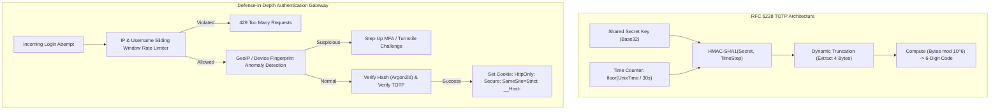

# Authentication Security, Sessions & Bot Mitigation

A comprehensive guide to Multi-Factor Authentication (MFA / TOTP), session hijacking defenses, secure cookie attributes, and mitigating brute-force/credential stuffing attacks.

---

## Architecture: TOTP Protocol & Multi-Layer Authentication Defense



---

## Interview Questions & Answers

### AUTH-BAS-001: How does Multi-Factor Authentication (MFA / 2FA) work using TOTP?

#### 1. Simple Explanation
Multi-Factor Authentication verifies user identity through at least two different categories:
1. *Something you know:* Password.
2. *Something you have:* Smartphone running an authenticator app (Google Authenticator, 1Password).
3. *Something you are:* Biometrics (fingerprint/FaceID).

**Time-Based One-Time Password (TOTP - RFC 6238):** The server and the user's phone share a secret key. Every 30 seconds, both independently generate the exact same 6-digit code using the current clock time.

#### 2. Easy Example
Think of two synchronized wristwatches with identical secret decoder rings: every 30 seconds, both dial a number. Because both watches keep identical time, their decoders produce the exact same 6-digit passcode without ever needing an internet connection on the phone.

#### 3. One-Line Interview Answer
TOTP generates short-lived 6-digit passcodes by hashing a shared base32 secret with a 30-second UNIX epoch time counter using HMAC-SHA1 and dynamic truncation per RFC 6238.

#### 4. Detailed Technical Explanation
1. **Enrollment Phase:**
   - Server generates a cryptographically random 160-bit shared secret (e.g., base32 encoded: `JBSWY3DPEHPK3PXP`).
   - Server renders an `otpauth://` URI encoded inside a QR code:
     `otpauth://totp/AcmeApp:alice@example.com?secret=JBSWY3DPEHPK3PXP&issuer=AcmeApp`.
   - The user scans the QR code; the phone stores the secret in its secure enclave.
2. **Verification Formula:**
   - Counter: $T = \lfloor \frac{\text{current\_time} - T_0}{X} \rfloor$, where $X = 30$ seconds and $T_0 = 0$.
   - Compute HMAC: $H = \text{HMAC-SHA1}(\text{Secret}, T)$.
   - Dynamic Truncation: Take the last 4 bits of the 20-byte hash as an offset $O$. Extract 4 bytes starting at offset $O$, mask off the sign bit, and calculate $\text{result} \pmod{10^6}$ to yield a 6-digit number.
3. **Clock Drift Tolerance:**
   Servers must allow a time window of $\pm 1$ step (verifying $T-1$, $T$, and $T+1$) to compensate for small network delays or slight client clock desynchronization.

#### 5. Practical Implementation
```python
# Implementing RFC 6238 TOTP verification in Python using pyotp
import pyotp
import time

def setup_totp_for_user(username: str):
    # 1. Generate base32 secret
    secret = pyotp.random_base32()
    
    # 2. Build provisioning URI for QR code
    totp = pyotp.TOTP(secret)
    provisioning_uri = totp.provisioning_uri(name=username, issuer_name="ProductionApp")
    
    return secret, provisioning_uri

def verify_totp_code(secret: str, user_submitted_code: str) -> bool:
    totp = pyotp.TOTP(secret)
    # valid_window=1 allows codes from 30 seconds before and 30 seconds after
    is_valid = totp.verify(user_submitted_code, valid_window=1)
    return is_valid

# Demo
user_secret, qr_uri = setup_totp_for_user("alice@example.com")
current_code = pyotp.TOTP(user_secret).now()
print(f"Generated Current 6-digit Code: {current_code}")
assert verify_totp_code(user_secret, current_code) is True
assert verify_totp_code(user_secret, "000000") is False
```

#### 6. Real-World Scenarios
- **Replay Attack Defense:** An attacker intercepts a legitimate TOTP code over insecure Wi-Fi. If the attacker submits it within the 30-second window, the server could authenticate them. Defense: The server must store used tokens in Redis with a 90-second TTL; if an incoming code was already consumed for that user ID, reject it immediately as a replay.

---

### AUTH-INT-002: How do you prevent session hijacking and configure secure cookie attributes?

#### 1. Simple Explanation
Session hijacking occurs when an attacker steals a user's active session token (cookie) and impersonates them without knowing their password. This happens via Cross-Site Scripting (XSS), network sniffing, or Cross-Site Request Forgery (CSRF). Secure cookie configuration guarantees that cookies cannot be read by malicious JavaScript, are only sent over encrypted HTTPS, and are strictly isolated to the issuing domain.

#### 2. Easy Example
Think of a VIP concert wristband. If the wristband is made of paper and loose (insecure cookie), anyone can slip it off your arm. A secure cookie is like a tamper-evident wristband that can only be seen under special UV light (HTTPS) and self-destructs if taken outside the building (`HttpOnly`, `SameSite=Strict`).

#### 3. One-Line Interview Answer
Mitigate session hijacking by setting `HttpOnly`, `Secure`, and `SameSite=Strict` cookie flags, prefixing cookies with `__Host-`, rotating session IDs on privilege escalation, and binding sessions to TLS fingerprints.

#### 4. Detailed Technical Explanation
1. **Critical Cookie Attributes:**
   - **`HttpOnly`:** Prohibits client-side JavaScript (`document.cookie`) from reading the cookie. Completely neutralizes session theft via XSS.
   - **`Secure`:** Instructs browsers to transmit the cookie strictly over TLS/HTTPS connections, never plain HTTP.
   - **`SameSite=Strict`:** Prevents the browser from sending the cookie in cross-site requests (e.g., following a link from an external email or website). Prevents Cross-Site Request Forgery (CSRF). `SameSite=Lax` is acceptable for user-facing links.
   - **`__Host-` Prefix:** Cookie name starts with `__Host-session_id`. Enforces: must be set with `Secure`, must originate from HTTPS, must NOT include a `Domain` attribute (strictly scoped to the exact host, preventing subdomain injection attacks), and `Path` must be `/`.
2. **Session Rotation:**
   When a user logs in, logs out, changes passwords, or elevates privileges, destroy the old session identifier and generate a fresh cryptographically random 256-bit token to prevent **Session Fixation attacks**.

#### 5. Practical Implementation
```python
# Secure Session Cookie configuration in FastAPI
from fastapi import FastAPI, Response, Depends, HTTPException, status
import secrets

app = FastAPI()

def generate_secure_session_token() -> str:
    # 256-bit cryptographically secure random URL-safe string
    return secrets.token_urlsafe(32)

@app.post("/login")
def login(response: Response):
    # Authenticate credentials here...
    session_id = generate_secure_session_token()

    # Set cookie with maximum security posture
    response.set_cookie(
        key="__Host-session_id",
        value=session_id,
        max_age=3600 * 8,       # 8 hours expiration
        httponly=True,           # Inaccessible to JavaScript (XSS defense)
        secure=True,             # Transmitted strictly over HTTPS
        samesite="strict",       # Mitigates CSRF completely
        path="/"                 # Mandatory for __Host- prefix
    )
    return {"message": "Authenticated successfully"}
```

#### 6. Real-World Scenarios
- **Subdomain Cookie Tampering Attack:** An attacker compromises an abandoned marketing blog at `blog.example.com` and sets a wildcard cookie `Domain=.example.com; name=session_id`. When the user visits the core banking app at `bank.example.com`, the browser sends the attacker's fixed cookie. Using the `__Host-` prefix prevents this because browsers reject `Domain` parameters on `__Host-` cookies.

---

### AUTH-ADV-003: How do you defend authentication endpoints against brute-force attacks and credential stuffing?

#### 1. Simple Explanation
- **Brute Force:** Trying thousands of passwords against a single username (e.g., `admin`).
- **Credential Stuffing:** Automated bots taking millions of leaked username/password combinations from previous data breaches and testing them against your login endpoint.
- **Defense:** Multi-layered rate limiting (by IP, by account, and global), account lockouts with exponential backoff, CAPTCHA challenges, and IP reputation scoring.

#### 2. Easy Example
If an automated bank teller machine detects someone entering the wrong PIN 5 times, it temporarily disables the card and alerts security. If 1,000 requests hit the ATM in 1 second, the firewall blocks the IP before the bank database is touched.

#### 3. One-Line Interview Answer
Defend authentication endpoints with dual-key sliding-window rate limiting (IP address + targeted username), fail2ban/WAF threat intelligence, progressive delays (tarpitting), and non-revealing error messages.

#### 4. Detailed Technical Explanation
1. **Dual-Key Rate Limiting:**
   - *Key 1 (IP based):* Limit requests to max 10 attempts per minute per IP address.
   - *Key 2 (Account based):* Limit requests to max 5 failed attempts per 15 minutes per username. This prevents distributed botnets (rotational residential proxies) from brute-forcing a single account across thousands of unique IP addresses.
2. **Preventing Username Enumeration:**
   - Login responses must return identical HTTP 401 statuses and identical timing for both "user does not exist" and "incorrect password".
   - Always execute a dummy password hash computation (e.g., `argon2.verify(dummy_hash, password)`) when a username is not found in the database. Otherwise, attackers measure response time differences (5ms vs 80ms) to harvest valid usernames.
3. **Progressive Backoff (Tarpitting):**
   - For consecutive failed attempts, delay responses exponentially (1s, 2s, 4s, 8s). This destroys bot concurrency and throughput without disrupting legitimate users.

#### 5. Practical Implementation
```python
# Redis Sliding-Window Rate Limiter for Authentication
import time
import redis

redis_client = redis.Redis(host="localhost", port=6379, db=0)

def check_login_rate_limit(ip_address: str, username: str) -> bool:
    """
    Dual-key rate limiter using Redis sorted sets (sliding window).
    Returns True if request allowed, False if rate limited.
    """
    now = time.time()
    pipe = redis_client.pipeline()

    # Rule 1: Max 10 attempts per minute per IP
    ip_key = f"rl:auth:ip:{ip_address}"
    # Rule 2: Max 5 failed attempts per 15 minutes per targeted account
    user_key = f"rl:auth:user:{username.lower()}"

    # Clean old records outside sliding windows
    pipe.zremrangebyscore(ip_key, 0, now - 60)
    pipe.zcard(ip_key)

    pipe.zremrangebyscore(user_key, 0, now - 900)
    pipe.zcard(user_key)

    results = pipe.execute()
    ip_count = results[1]
    user_count = results[3]

    if ip_count >= 10 or user_count >= 5:
        return False  # Rate limit exceeded

    # Record current attempt
    record_pipe = redis_client.pipeline()
    record_pipe.zadd(ip_key, {str(now): now})
    record_pipe.expire(ip_key, 65)
    record_pipe.zadd(user_key, {str(now): now})
    record_pipe.expire(user_key, 905)
    record_pipe.execute()

    return True
```

#### 6. Real-World Scenarios
- **Distributed Botnet Credential Stuffing:** An e-commerce platform suffered 50,000 login attempts per minute coming from 40,000 distinct IP addresses across 60 countries. Standard single-IP rate limiters failed because each IP only sent 1 or 2 requests. The dual-key username-based rate limiter triggered immediately, locking targeted accounts and requiring email verification tokens, completely blunting the credential stuffing campaign.
