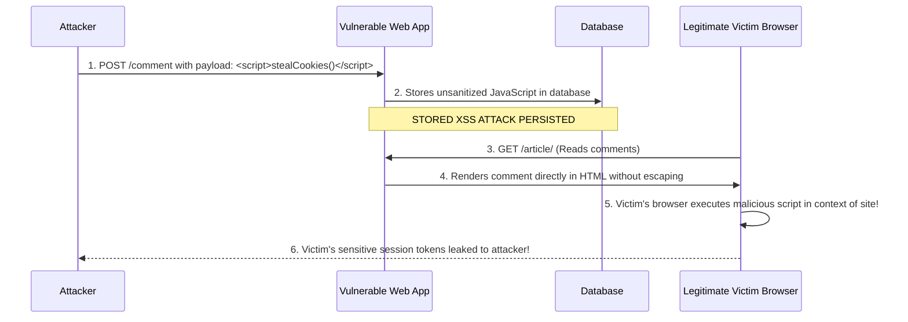

# Web Application Security & OWASP Top 10 Guide

## Module Overview
This module covers fundamental **Web Application Security**, including **SQL Injection (SQLi)**, **Cross-Site Scripting (XSS)**, **CSRF**, and **Critical HTTP Security Headers**.

---

## Visual Architecture: Stored vs Reflected Cross-Site Scripting (XSS)



---

## Critical Web Vulnerabilities & Defenses

### 1. Cross-Site Scripting (XSS)
- **Stored XSS:** Malicious script is saved in the database (e.g. blog comments, user bio) and executed by every user who views that page.
- **Reflected XSS:** Malicious script is reflected off the web server in an immediate error message or search query parameter (`?q=<script>...`).
- **Defense:**
  1. Context-aware output encoding / HTML escaping (automatic in Django & React).
  2. Implement a strict **Content Security Policy (CSP)** header disallowing inline scripts (`script-src 'self'`).
  3. Store authentication tokens in **`HttpOnly` cookies** so JavaScript `document.cookie` cannot read them!

---

### 2. Modern HTTP Security Headers Checklist

```http
# 1. Enforce HTTPS only for 1 year (including subdomains)
Strict-Transport-Security: max-age=31536000; includeSubDomains; preload

# 2. Prevent Clickjacking (disallow embedding in iframes)
X-Frame-Options: DENY

# 3. Prevent MIME-type sniffing
X-Content-Type-Options: nosniff

# 4. Strict Content Security Policy
Content-Security-Policy: default-src 'self'; script-src 'self'; object-src 'none';

# 5. Control Referrer header data leakage
Referrer-Policy: strict-origin-when-cross-origin
```
