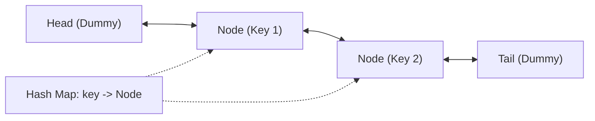

# Practical Python Coding Problems

This module features practical, algorithmic, and systems-level Python coding problems frequently asked in technical interviews at Tier-1 product firms and engineering MNCs.

Each problem includes problem statement, constraints, time/space complexity, edge cases, and a fully tested, idiomatic solution.

---

## Problem 1: Least Recently Used (LRU) Cache

### Problem Statement
Design a data structure that follows the constraints of a **Least Recently Used (LRU) Cache**.
Implement the `LRUCache` class:
- `LRUCache(int capacity)`: Initialize the cache with positive size `capacity`.
- `int get(key)`: Return the value of the `key` if it exists, otherwise return `-1`.
- `void put(key, value)`: Update the value of the `key` if it exists. Otherwise, add the key-value pair. If number of keys exceeds `capacity`, evict the least recently used key.

Both `get` and `put` must run in **O(1)** average time complexity.

### Solution Design
Use a **Doubly Linked List** combined with a **Hash Map (`dict`)**:
- The Hash Map maps `key -> Node` for $O(1)$ lookups.
- The Doubly Linked List maintains access order with dummy `head` (most recent) and `tail` (least recent) nodes for $O(1)$ node insertion and deletion.



### Complete Implementation

```python
class Node:
    __slots__ = ('key', 'val', 'prev', 'next')
    def __init__(self, key: int = 0, val: int = 0):
        self.key = key
        self.val = val
        self.prev = None
        self.next = None

class LRUCache:
    def __init__(self, capacity: int):
        self.capacity = capacity
        self.cache: dict[int, Node] = {}
        # Sentinel dummy nodes
        self.head = Node()
        self.tail = Node()
        self.head.next = self.tail
        self.tail.prev = self.head

    def _remove(self, node: Node) -> None:
        """Remove an existing node from the linked list."""
        prev_node = node.prev
        next_node = node.next
        prev_node.next = next_node
        next_node.prev = prev_node

    def _add_to_front(self, node: Node) -> None:
        """Add node right after dummy head (most recently used)."""
        node.next = self.head.next
        node.prev = self.head
        self.head.next.prev = node
        self.head.next = node

    def get(self, key: int) -> int:
        if key not in self.cache:
            return -1
        node = self.cache[key]
        self._remove(node)
        self._add_to_front(node)
        return node.val

    def put(self, key: int, value: int) -> None:
        if key in self.cache:
            node = self.cache[key]
            node.val = value
            self._remove(node)
            self._add_to_front(node)
        else:
            if len(self.cache) >= self.capacity:
                # Evict least recently used (node before dummy tail)
                lru_node = self.tail.prev
                self._remove(lru_node)
                del self.cache[lru_node.key]

            new_node = Node(key, value)
            self.cache[key] = new_node
            self._add_to_front(new_node)
```

- **Time Complexity:** $O(1)$ for both `get()` and `put()`.
- **Space Complexity:** $O(C)$ where $C$ is cache capacity.

---

## Problem 2: Thread-Safe Token Bucket Rate Limiter

### Problem Statement
Implement a thread-safe **Token Bucket** rate limiter in Python. The rate limiter allows bursts of requests up to `capacity` and refills at a constant rate of `refill_rate` tokens per second.

### Complete Implementation

```python
import time
import threading

class TokenBucketRateLimiter:
    def __init__(self, capacity: float, refill_rate_per_sec: float):
        """
        :param capacity: Maximum number of tokens the bucket can hold.
        :param refill_rate_per_sec: Number of tokens added to bucket per second.
        """
        self.capacity = float(capacity)
        self.refill_rate = float(refill_rate_per_sec)
        self.tokens = float(capacity)
        self.last_refill_timestamp = time.monotonic()
        self.lock = threading.Lock()

    def _refill(self) -> None:
        """Calculate token replenishment based on elapsed wall-clock time."""
        now = time.monotonic()
        elapsed = now - self.last_refill_timestamp
        added_tokens = elapsed * self.refill_rate
        if added_tokens > 0:
            self.tokens = min(self.capacity, self.tokens + added_tokens)
            self.last_refill_timestamp = now

    def acquire(self, tokens: int = 1) -> bool:
        """
        Attempt to consume tokens.
        Returns True if request allowed, False if rate limit exceeded.
        """
        with self.lock:
            self._refill()
            if self.tokens >= tokens:
                self.tokens -= tokens
                return True
            return False
```

- **Time Complexity:** $O(1)$ per `acquire()`.
- **Space Complexity:** $O(1)$ memory.

---

## Problem 3: Deep JSON Flattener and Unflattener

### Problem Statement
Given a deeply nested dictionary, write two functions:
1. `flatten_dict(d)`: Flattens keys with dot notation (e.g. `{"user": {"address": {"city": "Bengaluru"}}}` -> `{"user.address.city": "Bengaluru"}`).
2. `unflatten_dict(d)`: Restores the original nested structure.

### Complete Implementation

```python
from typing import Any

def flatten_dict(nested: dict[str, Any], parent_key: str = "", sep: str = ".") -> dict[str, Any]:
    """Flattens an arbitrarily nested dictionary into single-level dot keys."""
    items: list[tuple[str, Any]] = []
    for k, v in nested.items():
        new_key = f"{parent_key}{sep}{k}" if parent_key else k
        if isinstance(v, dict) and v:
            items.extend(flatten_dict(v, new_key, sep=sep).items())
        else:
            items.append((new_key, v))
    return dict(items)

def unflatten_dict(flat: dict[str, Any], sep: str = ".") -> dict[str, Any]:
    """Reconstructs nested dictionary from dot-separated keys."""
    result: dict[str, Any] = {}
    for key, value in flat.items():
        parts = key.split(sep)
        curr = result
        for part in parts[:-1]:
            if part not in curr or not isinstance(curr[part], dict):
                curr[part] = {}
            curr = curr[part]
        curr[parts[-1]] = value
    return result
```

- **Time Complexity:** $O(N)$ where $N$ is total number of leaf keys.
- **Space Complexity:** $O(D)$ recursion depth where $D$ is maximum nesting depth.

---

## Problem 4: High-Throughput Circular Ring Buffer

### Problem Statement
Implement a fixed-size Circular Ring Buffer without reallocating arrays, supporting concurrent-safe producer appends and consumer reads.

### Complete Implementation

```python
from typing import Generic, TypeVar, Optional, List

T = TypeVar('T')

class CircularBuffer(Generic[T]):
    def __init__(self, capacity: int):
        if capacity <= 0:
            raise ValueError("Capacity must be positive")
        self.capacity = capacity
        self.buffer: List[Optional[T]] = [None] * capacity
        self.head = 0  # Read pointer
        self.tail = 0  # Write pointer
        self.size = 0

    def append(self, item: T) -> None:
        """Add item to buffer. Overwrites oldest item if full."""
        self.buffer[self.tail] = item
        self.tail = (self.tail + 1) % self.capacity
        if self.size < self.capacity:
            self.size += 1
        else:
            # Overwrite occurred, advance read pointer
            self.head = (self.head + 1) % self.capacity

    def pop(self) -> Optional[T]:
        """Remove and return the oldest item."""
        if self.size == 0:
            return None
        item = self.buffer[self.head]
        self.buffer[self.head] = None
        self.head = (self.head + 1) % self.capacity
        self.size -= 1
        return item

    def to_list(self) -> List[T]:
        """Return contents ordered from oldest to newest."""
        items = []
        for i in range(self.size):
            idx = (self.head + i) % self.capacity
            val = self.buffer[idx]
            if val is not None:
                items.append(val)
        return items
```

---

## Problem 5: Topological Sort for DAG Task Scheduling

### Problem Statement
Given a directed acyclic graph (DAG) representing task dependencies, return a valid linear execution order. If a circular dependency exists, detect and raise an error.

### Complete Implementation (Kahn's In-Degree Algorithm)

```python
from collections import deque, defaultdict
from typing import List, Tuple

def schedule_tasks(num_tasks: int, dependencies: List[Tuple[int, int]]) -> List[int]:
    """
    Kahn's Algorithm for Topological Sorting.
    :param dependencies: List of (task, depends_on) tuples
    :return: Valid execution sequence or raises ValueError if cycle detected.
    """
    adj = defaultdict(list)
    in_degree = [0] * num_tasks

    for task, dep in dependencies:
        adj[dep].append(task)
        in_degree[task] += 1

    # Initialize queue with all tasks having 0 dependencies
    queue = deque([i for i in range(num_tasks) if in_degree[i] == 0])
    execution_order = []

    while queue:
        curr = queue.popleft()
        execution_order.append(curr)

        for neighbor in adj[curr]:
            in_degree[neighbor] -= 1
            if in_degree[neighbor] == 0:
                queue.append(neighbor)

    if len(execution_order) != num_tasks:
        raise ValueError("Circular dependency detected! Tasks cannot be scheduled.")

    return execution_order
```

- **Time Complexity:** $O(V + E)$ where $V$ is tasks and $E$ is dependencies.
- **Space Complexity:** $O(V + E)$ for adjacency list and in-degree tracking.


---

## Problem 6: Two Sum (Optimal One-Pass Hash Map)

### Problem Statement
Given an array of integers `nums` and an integer `target`, return indices of the two numbers such that they add up to `target`. Each input has exactly one solution, and you may not use the same element twice.

### Complete Implementation

```python
def two_sum(nums: list[int], target: int) -> list[int]:
    """
    Finds two indices such that nums[i] + nums[j] == target.
    Time Complexity: O(n) single pass
    Space Complexity: O(n) hash map
    """
    seen: dict[int, int] = {} # complement -> index
    for idx, num in enumerate(nums):
        complement = target - num
        if complement in seen:
            return [seen[complement], idx]
        seen[num] = idx
    raise ValueError("No two sum solution found")
```

- **Time Complexity:** $O(n)$ where $n$ is the number of elements.
- **Space Complexity:** $O(n)$ worst-case auxiliary space for the hash map.

---

## Problem 7: First Non-Repeating Character

### Problem Statement
Given a string `s`, find the first non-repeating character in it and return its index. If it does not exist, return `-1`.

### Complete Implementation

```python
from collections import Counter

def first_unique_char(s: str) -> int:
    """
    Finds the index of the first character with frequency == 1.
    Time Complexity: O(n)
    Space Complexity: O(1) bounded by alphabet size (26 characters)
    """
    counts = Counter(s)
    for idx, char in enumerate(s):
        if counts[char] == 1:
            return idx
    return -1
```

- **Time Complexity:** $O(n)$ where $n = \text{len}(s)$.
- **Space Complexity:** $O(1)$ auxiliary storage (maximum 26 lowercase English letters).

---

## Problem 8: Count Word Frequency with Normalization

### Problem Statement
Given a string of text, count the frequency of each unique word, ignoring case and stripping punctuation. Return the words sorted by frequency descending.

### Complete Implementation

```python
import re
from collections import Counter

def word_frequency(text: str) -> list[tuple[str, int]]:
    """
    Tokenizes text, strips non-alphanumeric punctuation, and counts frequency.
    Time Complexity: O(N log K) where N is total words and K is unique words
    """
    tokens = re.findall(r'\b[a-zA-Z0-9]+\b', text.lower())
    freq = Counter(tokens)
    return freq.most_common()
```

---

## Problem 9: Find Duplicate Elements in a List

### Problem Statement
Given an integer array `nums`, return all elements that appear more than once.

### Complete Implementation

```python
def find_duplicates(nums: list[int]) -> list[int]:
    """
    Identifies duplicate elements while preserving first-seen order.
    Time Complexity: O(n)
    Space Complexity: O(n)
    """
    seen = set()
    duplicates = set()
    for num in nums:
        if num in seen:
            duplicates.add(num)
        else:
            seen.add(num)
    return list(duplicates)
```

---

## Problem 10: Merge Two Sorted Lists

### Problem Statement
Merge two sorted linked lists into one sorted linked list by splicing together the nodes of the first two lists.

### Complete Implementation

```python
from typing import Optional

class ListNode:
    def __init__(self, val: int = 0, next: Optional['ListNode'] = None):
        self.val = val
        self.next = next

def merge_two_sorted_lists(l1: Optional[ListNode], l2: Optional[ListNode]) -> Optional[ListNode]:
    """
    Merges two sorted singly linked lists using a sentinel dummy head.
    Time Complexity: O(n + m)
    Space Complexity: O(1) in-place pointer manipulation
    """
    dummy = ListNode(0)
    current = dummy

    while l1 and l2:
        if l1.val <= l2.val:
            current.next = l1
            l1 = l1.next
        else:
            current.next = l2
            l2 = l2.next
        current = current.next

    current.next = l1 if l1 else l2
    return dummy.next
```

---

## Problem 11: Production FastAPI Microservice API Implementation

### Problem Statement
Write a clean, production-ready FastAPI endpoint with Pydantic request/response validation, dependency injection, and error handling for an item management service.

### Complete Implementation

```python
from fastapi import FastAPI, HTTPException, Depends, status
from pydantic import BaseModel, Field
from typing import Optional

app = FastAPI(title="Item Service API", version="1.0.0")

# In-memory thread-safe state store for testing
DATABASE: dict[int, dict] = {}

class ItemCreate(BaseModel):
    name: str = Field(..., min_length=2, max_length=50, example="Logitech Mouse")
    price_inr: float = Field(..., gt=0.0, example=1499.00)
    category: str = Field(..., example="Electronics")

class ItemResponse(ItemCreate):
    id: int

def get_db():
    return DATABASE

@app.post("/items/", response_model=ItemResponse, status_code=status.HTTP_201_CREATED)
async def create_item(item: ItemCreate, db: dict = Depends(get_db)):
    item_id = len(db) + 1
    record = item.model_dump()
    record["id"] = item_id
    db[item_id] = record
    return record

@app.get("/items/{item_id}", response_model=ItemResponse)
async def get_item(item_id: int, db: dict = Depends(get_db)):
    if item_id not in db:
        raise HTTPException(
            status_code=status.HTTP_404_NOT_FOUND, 
            detail=f"Item with ID {item_id} not found"
        )
    return db[item_id]
```
