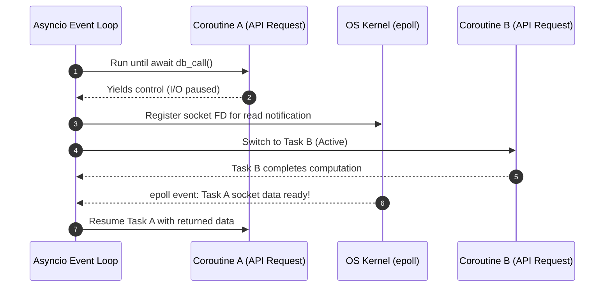
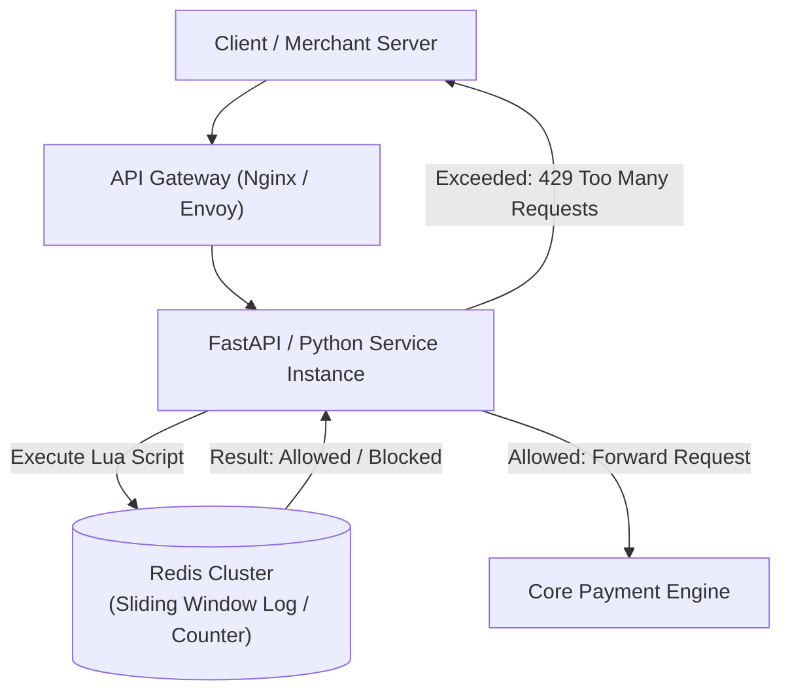

# Mid-Level Software Engineer Mock Interview (2–5 Years Experience)

**Target Roles:** SDE-2, Senior Backend Engineer, Python Backend Specialist  
**Target Companies:** Indian Product Unicorns (Swiggy, Zomato, Razorpay, CRED, Meesho, Blinkit) & High-Growth Startups  
**Interview Duration:** 60 Minutes  
**Focus Areas:** Asynchronous Python, ORM Optimization, Database Indexing, Caching Architectures, System Design  

---

## Interview Rubric & Scoring Criteria

| Dimension | Weight | Target Competency for SDE-2 Level |
|---|---|---|
| **Python Internals & Async** | 25% | Deep grasp of Asyncio event loop, GIL trade-offs, and ASGI vs WSGI. |
| **Database & Indexing** | 25% | B-Tree mechanics, composite indexing, transaction isolation, and query plans. |
| **System Design & Caching** | 30% | Practical architecture, cache invalidation, rate limiting, and failure modes. |
| **Production Troubleshooting** | 10% | Investigating latency, deadlocks, connection leaks, and high CPU. |
| **Engineering Maturity** | 10% | Defending technical choices, measuring trade-offs, and cost-effective scaling. |

---

## Section 1: Async Python & Framework Internals (15 Minutes)

### Question 1.1: Asyncio Event Loop & Concurrency Mechanics
**Interviewer:**  
"In FastAPI or modern Python backend engineering, we often write `async def`. Can you explain what happens under the hood when Python executes an `await` expression? Does `asyncio` make CPU-heavy operations run faster?"

**Candidate Answer:**  
"No, `asyncio` does not make CPU-heavy operations faster; in fact, it can add slight overhead. `asyncio` provides **cooperative multitasking for I/O-bound operations** running on a single operating system thread.

Under the hood:
1. The **Event Loop** manages a queue of runnable tasks.
2. When a coroutine hits an `await asyncio.sleep()` or `await db_session.execute()`, the coroutine pauses its execution and yields control back to the event loop.
3. The event loop registers the file descriptor with the kernel's I/O multiplexer (`epoll` on Linux, `kqueue` on macOS).
4. While the database or network socket is waiting for bytes, the event loop runs other ready coroutines on the same thread.
5. Once the OS signals that data is ready on the socket, the event loop resumes the paused coroutine at the exact bytecode point it left off.

If you run CPU-bound work (like image compression or hashing) inside an `async def`, it blocks the single OS thread running the event loop. No other coroutines can advance during that time. For CPU-bound tasks, we must offload execution to a `ProcessPoolExecutor` or Celery background worker."



> **Interviewer Evaluation:** **Exceeds Expectations (5/5).** Flawlessly explained OS multiplexing (`epoll`), single-thread event loop execution, and correctly pointed out that CPU-bound operations block the loop.

---

## Section 2: Database Indexing & Query Tuning (15 Minutes)

### Question 2.1: Composite B-Tree Index Column Ordering
**Interviewer:**  
"Suppose we have a table `payments` with 10 million rows. We have the following query:

```sql
SELECT id, amount, status, created_at 
FROM payments 
WHERE merchant_id = 'merchant_123' 
  AND status = 'SUCCESS' 
  AND created_at >= '2026-11-01'
ORDER BY created_at DESC;
```

We want to create a composite B-Tree index. What should the exact order of columns in the index be, and why?"

**Candidate Answer:**  
"The optimal composite index column order is:
```sql
CREATE INDEX idx_payments_perf ON payments (merchant_id, status, created_at DESC);
```

**Reasoning (The Equality-First Rule):**
1. **Equality Columns First:** A B-Tree index works like a telephone directory. You must place columns queried with equality (`=`) first. Both `merchant_id` and `status` use exact equality matches, filtering the search tree down to a continuous range.
2. **Range Column Last:** The range condition (`created_at >= ...`) must come **after** all equality columns. Once a range scan begins on a B-Tree, subsequent indexed columns cannot be used to narrow the index traversal.
3. **Ordering Match:** Putting `created_at DESC` at the end satisfies the `ORDER BY created_at DESC` clause directly from the index, eliminating an expensive in-memory or disk-based `Sort` node in the execution plan."

> **Interviewer Evaluation:** **Strong Pass (5/5).** Mastered the Equality-Range-Order principle of composite B-Tree indexing.

---

## Section 3: System Design — Distributed Rate Limiter (20 Minutes)

### The Challenge
**Interviewer:**  
"Design a distributed rate limiter for Razorpay's public API. We need to limit each merchant API key to **1,000 requests per minute**. The system handles 100,000 QPS across 50 API server instances."

### Candidate Architectural Walkthrough



#### 1. Algorithm Selection: Sliding Window Counter
"A simple Fixed Window algorithm suffers from the **boundary burst problem** (twice the limit at the boundary). A Sliding Window Log stores exact timestamps in Redis ZSET, but consumes too much memory at high QPS ($O(N)$ memory per merchant).

Therefore, I recommend the **Sliding Window Counter** algorithm. It combines the low memory overhead of fixed windows ($O(1)$ memory) with the accuracy of sliding windows by weighting the count of the previous window and the current window:

$$\text{Current Count} = \text{Count}_{\text{current}} + \text{Count}_{\text{prev}} \times (1 - \text{fraction of current minute elapsed})$$

#### 2. Atomic Redis Execution using Lua Script
To prevent race conditions between checking the count and incrementing it, we execute an atomic Lua script on the Redis cluster:

```lua
-- KEYS[1]: Current window key (e.g. rate:merchant_123:2026112110)
-- KEYS[2]: Previous window key (e.g. rate:merchant_123:2026112109)
-- ARGV[1]: Max limit (1000)
-- ARGV[2]: Weight of previous window (e.g. 0.45)

local current_count = tonumber(redis.call('get', KEYS[1]) or '0')
local prev_count = tonumber(redis.call('get', KEYS[2]) or '0')
local estimated_requests = current_count + (prev_count * tonumber(ARGV[2]))

if estimated_requests >= tonumber(ARGV[1]) then
    return 0 -- Denied (Rate limit exceeded)
else
    redis.call('incr', KEYS[1])
    if current_count == 0 then
        redis.call('expire', KEYS[1], 120) -- 2-minute TTL
    end
    return 1 -- Allowed
end
```

#### 3. Handling Redis Failures (Resilience & Fallback)
"If the Redis cluster is unreachable or experiences network partition, the rate limiter should **fail open** (log a critical alert to Datadog/Sentry and allow the request through) rather than failing closed and blocking legitimate payment traffic, while triggering alerts for DDoS investigation."

> **Interviewer Evaluation:** **Exceeds Expectations (5/5).** Outstanding trade-off analysis between fixed window, sliding log, and sliding counter. Implemented atomic Lua script and addressed failure resilience.

---

## Final Assessment & Summary

- **Overall Recommendation:** **Strong Hire (SDE-2 / Senior Backend Engineer)**
- **Candidate Strengths:** Exceptional understanding of low-level async execution, deep relational database indexing mastery, and practical distributed system design.
- **Level Recommendation:** Upper SDE-2 or early Tech Lead.
