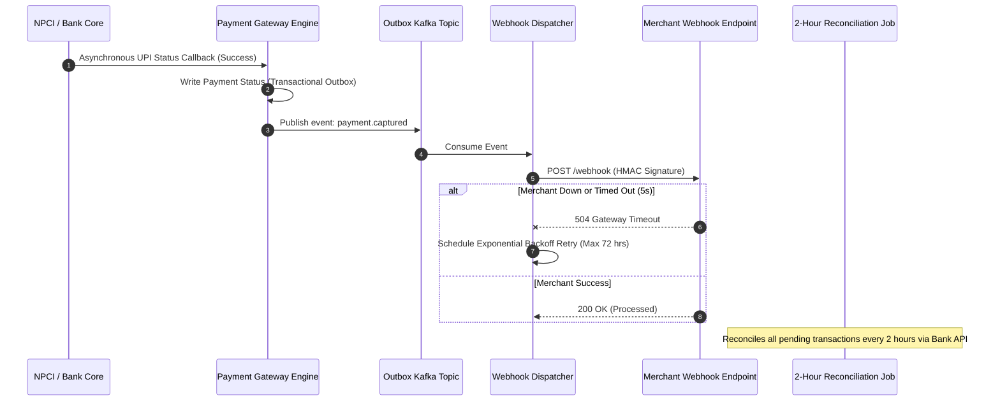
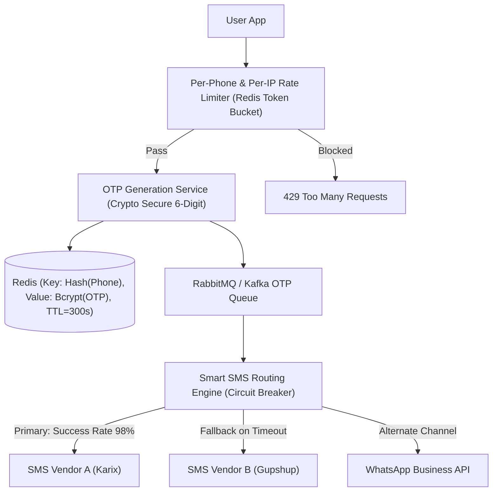

# High-Scale Scenario-Based Technical Interviews

This module contains comprehensive, production-grade scenario interview questions with detailed architectural solutions tailored to the unique engineering challenges of the **Indian technology ecosystem** and global internet platforms.

---

## Scenario 1: UPI Payment Webhook Failure & Multi-Tier Banking Reconciliation

### Context
A FinTech payment gateway (e.g., Razorpay, PhonePe, Cashfree) processes millions of UPI transactions daily. In India, UPI transactions involve multiple hops:
`Customer Mobile App -> NPCI (National Payments Corporation of India) -> Remitter Bank -> Beneficiary Bank -> Payment Aggregator -> Merchant API Webhook`.

### Problem Statement
During festive sales, 15% of merchant webhooks fail due to merchant server timeouts, network dropouts, or banking aggregator latency. Some merchants receive duplicate callbacks, while others receive delayed success callbacks up to 4 hours later.

Design a resilient, fault-tolerant **Webhook Delivery and Reconciliation Engine**.



### Architectural Solution
1. **Transactional Outbox Pattern:** Never write to the database and send webhooks in a naive HTTP call. Commit the payment status and an outbox event in the same atomic database transaction.
2. **Exponential Backoff with Jitter:** Retry failed webhooks across an exponential schedule with randomized jitter to prevent thundering herds:
   $$T_{\text{retry}} = \min(T_{\text{max}}, 2^{\text{attempt}} \times \text{base}) + \text{jitter}$$
3. **Idempotency Headers:** Send `X-Razorpay-Event-Id` and `X-Razorpay-Signature` with every callback so merchants can deduplicate safely.
4. **End-of-Day NPCI Reconciliation:** A scheduled cron reconciles all unconfirmed transactions by querying NPCI / Bank Settlement MIS files directly.

---

## Scenario 2: High-Throughput OTP Generation & Delivery Surge during Diwali Sales

### Context
During flash sales, 50,000 customers request SMS OTPs per second to log in. Telecom carriers (Jio, Airtel, Vi) enforce Indian TRAI DLT (Distributed Ledger Technology) template matching regulations and experience severe network congestion.

### Problem Statement
Design an OTP generation, verification, and multi-vendor delivery system that guarantees:
- Fast OTP delivery (< 5 seconds delivery p95).
- Protection against SMS toll fraud and bot-driven SMS pumping attacks.
- High availability even if a primary SMS gateway (e.g. Gupshup, Karix) fails completely.

### Architectural Solution



#### Security & Compliance Rules
- **Cryptographic Hashing:** Never store plaintext OTPs in Redis. Store `bcrypt(otp)` or `HMAC-SHA256(phone, otp, salt)` with a 5-minute TTL.
- **DLT Compliance:** Pre-register SMS header and message templates with TRAI DLT portals.
- **Circuit Breaker Pattern:** If Vendor A's delivery latency exceeds 3 seconds for 5 consecutive calls, trip the circuit and automatically divert traffic to Vendor B or WhatsApp Business API.

---

## Scenario 3: Indian GST Multi-Tier Invoicing & Financial Accounting Engine

### Context
All business transactions in India must comply with the Goods and Services Tax (GST) council framework.

### Business Rules
1. **Intra-State Supply (Buyer and Seller in the same state):** Split tax equally into **CGST** (Central GST) and **SGST** (State GST).
2. **Inter-State Supply (Buyer and Seller in different states):** Apply **IGST** (Integrated GST) in full.
3. **Rounding Rules:** GST regulations require rounding taxes to two decimal places per line item using half-up arithmetic.
4. **Immutability:** Once an invoice number is issued, it cannot be deleted or altered. Corrections require a credit note or debit note.

### Production Implementation (Python `decimal.Decimal` Precision)

```python
from decimal import Decimal, ROUND_HALF_UP
from enum import Enum
from pydantic import BaseModel
from typing import List

class SupplyType(str, Enum):
    INTRA_STATE = "INTRA_STATE"
    INTER_STATE = "INTER_STATE"

class LineItem(BaseModel):
    item_id: str
    description: str
    quantity: int
    unit_price_inr: Decimal
    gst_rate_percent: Decimal  # e.g., Decimal("18.00")

class GSTTaxBreakup(BaseModel):
    taxable_amount: Decimal
    cgst_rate: Decimal
    cgst_amount: Decimal
    sgst_rate: Decimal
    sgst_amount: Decimal
    igst_rate: Decimal
    igst_amount: Decimal
    total_tax: Decimal
    grand_total: Decimal

def compute_gst_invoice(
    seller_state_code: str,
    buyer_state_code: str,
    items: List[LineItem]
) -> GSTTaxBreakup:
    """
    Computes Indian GST invoice with financial Decimal precision.
    Prevents floating-point rounding errors.
    """
    is_intra_state = (seller_state_code == buyer_state_code)
    TWO_PLACES = Decimal("0.01")

    total_taxable = Decimal("0.00")
    total_cgst = Decimal("0.00")
    total_sgst = Decimal("0.00")
    total_igst = Decimal("0.00")

    for item in items:
        item_taxable = (item.quantity * item.unit_price_inr).quantize(TWO_PLACES, rounding=ROUND_HALF_UP)
        total_taxable += item_taxable

        if is_intra_state:
            half_rate = (item.gst_rate_percent / Decimal("2")).quantize(TWO_PLACES)
            cgst = (item_taxable * (half_rate / Decimal("100"))).quantize(TWO_PLACES, rounding=ROUND_HALF_UP)
            sgst = (item_taxable * (half_rate / Decimal("100"))).quantize(TWO_PLACES, rounding=ROUND_HALF_UP)
            total_cgst += cgst
            total_sgst += sgst
        else:
            igst = (item_taxable * (item.gst_rate_percent / Decimal("100"))).quantize(TWO_PLACES, rounding=ROUND_HALF_UP)
            total_igst += igst

    total_tax = total_cgst + total_sgst + total_igst
    grand_total = total_taxable + total_tax

    return GSTTaxBreakup(
        taxable_amount=total_taxable,
        cgst_rate=Decimal("9.00") if is_intra_state else Decimal("0.00"),
        cgst_amount=total_cgst,
        sgst_rate=Decimal("9.00") if is_intra_state else Decimal("0.00"),
        sgst_amount=total_sgst,
        igst_rate=Decimal("18.00") if not is_intra_state else Decimal("0.00"),
        igst_amount=total_igst,
        total_tax=total_tax,
        grand_total=grand_total
    )
```

---

## Scenario 4: Swiggy/Zomato Hyperlocal Delivery Driver Matching & Tracking

### Problem Statement
When a customer in Indiranagar, Bengaluru places a food order, the backend must find the top 5 nearest available delivery partners within a 3km radius, notify them, and stream live delivery partner GPS coordinates to the customer's mobile app.

### Architecture
1. **Driver Location Ingestion:** Drivers emit GPS ping every 5 seconds over persistent WebSocket/MQTT connections.
2. **Spatial Indexing via Redis GEO:** Store driver locations using `GEOADD drivers:active <longitude> <latitude> <driver_id>`.
3. **Nearest Driver Search:** Query available drivers within 3km using `GEORADIUS drivers:active <customer_lon> <customer_lat> 3 km WITHDIST ASC`.
4. **Live Location Broadcast:** Ingested driver coordinates are published to Redis Pub/Sub, from which WebSocket servers push coordinates to the customer's mobile app in real time.
