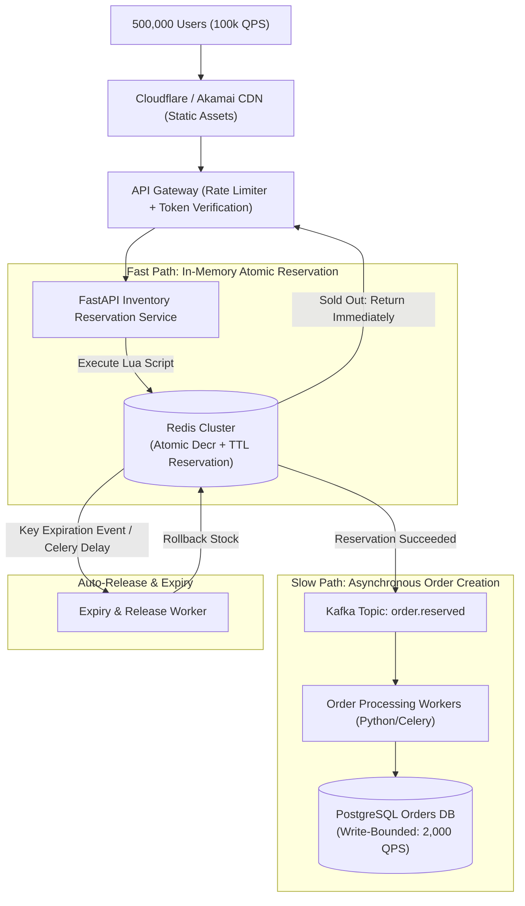

# Senior / Staff Architect Mock Interview (5–10+ Years Experience)

**Target Roles:** Senior Software Engineer (SDE-3), Staff Software Engineer, Backend Architect  
**Target Companies:** Top-Tier Product Companies (Flipkart, Amazon India, PhonePe, Google, Uber, Razorpay)  
**Interview Duration:** 60 Minutes  
**Focus Areas:** High-Scale Distributed Systems, Strong Consistency vs High Availability, Data Partitioning, Failure Modes & Resilience  

---

## Interview Rubric & Architectural Competencies

| Competency | Weight | Staff / Architect Evaluation Criteria |
|---|---|---|
| **Distributed Architecture** | 30% | Decomposing monolithic bottlenecks, event-driven decoupling, and asynchronous queues. |
| **Data Consistency & Isolation** | 25% | Multi-region replication lag, CAP/PACELC trade-offs, two-phase commits vs Sagas. |
| **Resilience & Fault Tolerance** | 20% | Circuit breakers, bulkhead patterns, self-healing, graceful degradation under 10x traffic. |
| **Cost & Scalability Modeling** | 15% | Estimating QPS, network bandwidth, storage IOPS, and memory sizing realistically. |
| **Technical Leadership** | 10% | Navigating ambiguity, driving consensus, and prioritizing business constraints. |

---

## System Design Challenge: High-Concurrency Flash Sale Inventory Engine

### The Problem Statement
**Interviewer:**  
"During the **Flipkart Big Billion Days** or a smartphone flash sale, 10,000 units of a heavily discounted flagship phone are released at exactly 12:00:00 PM. **500,000 users** simultaneously click 'Buy Now' within the first 5 seconds (100,000 QPS).

Design an inventory allocation and checkout pipeline that guarantees:
1. **Zero overselling:** Exactly 10,000 units are sold—not one unit more.
2. **Sub-100ms response time:** Users receive immediate feedback whether they secured an item.
3. **Cart expiration & auto-release:** Users have 10 minutes to complete UPI/Credit Card payment. If payment fails or expires, inventory returns to the pool immediately.
4. **Resilience to database crashes:** The relational database must not collapse under the 100,000 QPS surge."

---

### Candidate Architectural Solution



---

### Step 1: Deconstructing the Throughput Bottleneck
**Candidate:**  
"A traditional relational database (PostgreSQL/MySQL) executing `UPDATE inventory SET stock = stock - 1 WHERE id = 1 AND stock > 0` will lock the exact same physical database row for all 100,000 concurrent requests.
Because row locks serialize execution, database transactions will queue up, lock wait timeouts will trigger, connection pools will saturate, and the database will crash within 500 milliseconds.

Therefore, we must **decouple the real-time reservation (Fast Path) from permanent order persistence (Slow Path)**."

---

### Step 2: The Fast Path — Atomic Redis In-Memory Reservation
**Candidate:**  
"We manage inventory in a high-availability **Redis Cluster**. Because Redis runs single-threaded per shard in-memory, operations executed via a Redis Lua script are **strictly atomic and execute in microseconds**.

#### The Atomic Lua Reservation Script:
```lua
-- KEYS[1]: inventory:stock:iphone16
-- KEYS[2]: inventory:reserved:user_set
-- ARGV[1]: user_id
-- ARGV[2]: quantity (1)

-- 1. Prevent duplicate reservation by the same user
if redis.call('sismember', KEYS[2], ARGV[1]) == 1 then
    return -1 -- User already reserved a unit
end

-- 2. Check available stock
local current_stock = tonumber(redis.call('get', KEYS[1]) or '0')
if current_stock < tonumber(ARGV[2]) then
    return 0 -- Sold out!
end

-- 3. Atomically decrement stock and record user reservation
redis.call('decrby', KEYS[1], ARGV[2])
redis.call('sadd', KEYS[2], ARGV[1])
return 1 -- Reservation successful
```

**Interviewer Probing:**  
"What happens if the Redis master node crashes immediately after decrementing stock, before replicating to the replica?"

**Candidate Answer:**  
"Redis replication is asynchronous by default. If the master crashes, a failover to a replica might lose the last few milliseconds of decrements.
To make this enterprise-grade:
1. **Redis Enterprise Active-Active CRDTs or `WAIT` command:** We can require synchronous replication to at least 1 replica before returning, accepting an extra 2ms latency.
2. **Reconciliation Audit:** Every successful reservation emits a persistent event to an append-only **Apache Kafka** cluster with `acks=all`. The Kafka event log serves as the immutable ground truth for audit and recovery."

---

### Step 3: The 10-Minute Payment Expiry & Rollback Mechanism
**Interviewer:**  
"How do you handle the 10-minute payment timeout if the customer never completes their UPI payment?"

**Candidate Answer:**  
"We avoid using Redis Key Expiration (`keyspace notifications`) as the primary trigger because Redis keyspace events are not guaranteed to fire in real time under heavy load (expired keys are evicted lazily).

Instead, we use a **Delayed Message Queue** pattern:
1. When a reservation succeeds, the service produces a delayed task to a Celery/RabbitMQ delayed exchange or Kafka scheduled topic with a 10-minute delay: `check_order_payment(order_id)`.
2. At $T + 10$ minutes, the worker inspects the database:
   - If payment status is `PAID`, no action is needed.
   - If payment is still `INITIATED` or `FAILED`, the worker cancels the order and executes a compensating transaction in Redis:
     ```lua
     redis.call('incrby', 'inventory:stock:iphone16', 1)
     redis.call('srem', 'inventory:reserved:user_set', user_id)
     ```
3. This is an application of the **Saga Pattern** with compensating actions."

---

### Step 4: The Slow Path — Asynchronous Database Writes
**Candidate:**  
"The 10,000 successful reservations are published to a Kafka topic `order.reserved`.
A pool of backend consumer workers consumes events from Kafka and writes the final order rows into PostgreSQL in batched inserts (`INSERT INTO orders VALUES (...), (...)`).
PostgreSQL now handles a predictable, smooth write load of 1,000–2,000 QPS rather than 100,000 QPS, completely protecting database health."

---

## Final Assessment & Summary

- **Overall Recommendation:** **Strong Hire (Staff Software Engineer / Backend Architect)**
- **Candidate Strengths:** Masterful understanding of distributed state, decoupled asynchronous architectures, rock-solid failure analysis, and deep familiarity with payment flows.
- **Interviewer Feedback:** "Candidate demonstrated clear mastery of high-scale concurrency bottlenecks and proposed an industry-standard dual-path architecture."
