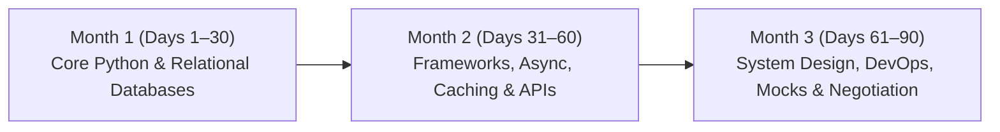

# Technical Interview Preparation Strategies & Roadmap

A systematic, disciplined preparation strategy is the difference between feeling overwhelmed and entering an interview with complete technical confidence. This guide provides a battle-tested **90-Day Preparation Roadmap**, live coding tactics, and negotiation principles.

---

## The 90-Day Master Preparation Plan

---

### Month 1 (Days 1–30): Core Language Mastery & Database Fundamentals

#### Days 1–10: Python Core & Memory Internals
- Master Python memory model: `id()`, `is` vs `==`, reference counting, cyclic garbage collection (`gc` module).
- Deep-dive into CPython data structures: `dict` hash tables (open addressing, compact dicts), `list` dynamic array resizing, `set` implementation.
- OOP & Magic methods: `__new__` vs `__init__`, `__slots__` memory savings, method resolution order (C3 linearization).
- Functional patterns: Closures, decorators (parameterized & class-based), generators, iterators, and the `itertools` library.

#### Days 11–20: Data Structures & Algorithms in Python
- Implement core data structures from scratch: Singly & Doubly Linked Lists, Binary Search Trees, Min/Max Heaps (`heapq`), Graph adjacency lists.
- Master algorithmic patterns: Two Pointers, Sliding Window, Monotonic Stack, BFS/DFS tree & graph traversals, Binary Search, and Dynamic Programming.
- Target: Solve 2–3 problems daily with clean, idiomatic Python code.

#### Days 21–30: Relational Databases (PostgreSQL / MySQL)
- Relational schema design: Normalization (1NF, 2NF, 3NF, BCNF) and when to selectively denormalize for read-heavy systems.
- Indexes: B-Tree internal structure, Composite index column ordering rules, Partial indexes, GiST/GIN for full-text and geospatial.
- Query optimization: Reading `EXPLAIN (ANALYZE, BUFFERS)`, identifying sequential scans, removing N+1 queries.
- Transactions & Concurrency: ACID properties, Dirty reads, Non-repeatable reads, Phantom reads, Isolation levels (`READ COMMITTED`, `REPEATABLE READ`, `SERIALIZABLE`), and Row-level locking (`FOR UPDATE`).

---

### Month 2 (Days 31–60): Backend Frameworks, Concurrency & Messaging

#### Days 31–45: FastAPI, Django & Async Concurrency
- Asynchronous programming: `asyncio` event loop mechanics, coroutines, tasks, futures, `asyncio.gather()`, and avoiding event loop stalls.
- FastAPI: Dependency Injection system (`Depends`), Pydantic v2 validation and serialization, ASGI middleware architecture, exception handlers.
- Django & DRF: MVT architecture, ORM `select_related` vs `prefetch_related`, Serializer validation lifecycle, ViewSets, and custom permissions.

#### Days 46–60: Caching, Queues & Distributed Messaging
- Redis: Key-value operations, Hashes, Sets, Sorted Sets (ZSET), Lists, TTL eviction policies (`allkeys-lru`, `volatile-ttl`), persistence (RDB vs AOF).
- Cache design: Cache-Aside, Write-Through, Write-Behind, Cache Stampede / Thundering Herd prevention (XFetch, single-flight mutex).
- Task queues (Celery & RabbitMQ): Task lifecycles, broker vs result backend, task retries with exponential backoff, dead-letter exchanges (DLX), worker prefetch counts, idempotent task execution.

---

### Month 3 (Days 61–90): System Design, DevOps & Live Mocks

#### Days 61–75: System Design & Distributed Systems
- Scalability principles: Horizontal vs Vertical scaling, Stateless backends, Load balancers (L4 vs L7, round robin, least connections).
- High-level system designs: URL Shortener, Distributed Rate Limiter, Notification Engine, Flash Sale Inventory Reservation, Hyperlocal Delivery Tracking.
- Distributed consistency: CAP theorem, PACELC theorem, Eventual consistency, Read-your-own-writes consistency, Idempotency keys.

#### Days 76–85: DevOps, Cloud & Observability
- Linux essentials: Process inspection (`ps`, `top`, `htop`), network inspection (`netstat`, `ss`, `curl`), file manipulation (`grep`, `awk`, `sed`).
- Containers & Deployment: Docker multi-stage builds, Docker Compose, Nginx reverse proxy configuration, Gunicorn/Uvicorn process topology.
- CI/CD & Observability: GitHub Actions pipelines, Prometheus metrics, Grafana dashboards, structured JSON logging, Sentry error tracking.

#### Days 86–90: Live Mocks & Behavioral Polish
- Conduct at least 3 full-length mock interviews with senior engineering peers.
- Polish your 5 core STAR behavioral stories.
- Prepare your reverse-interview questions for engineering hiring managers.

---

## Live Coding Interview Execution Tactics

When solving a problem on a shared whiteboard or live IDE (CoderPad, HackerRank):
1. **Never Start Coding Immediately:** Spend the first 3–5 minutes asking clarifying questions (input bounds, negative numbers, empty arrays, duplicate values).
2. **State the Naive Brute-Force Solution First:** Mention the naive $O(N^2)$ solution and its complexity. This guarantees you have a baseline solution.
3. **Propose the Optimized Solution:** Explain your data structure choice (e.g. "We can trade $O(N)$ space using a Hash Map to bring time down to $O(N)$").
4. **Code with Modular, Clean Functions:** Use meaningful variable names (`slow_ptr`, `char_freq`) instead of single-letter names (`a`, `b`, `x`).
5. **Dry-Run with an Example:** Trace your code manually through a simple test case line by line before clicking "Run".

---

## Salary Negotiation for Indian & Global Tech Roles

1. **Never Give the First Number Early:** If an HR recruiter asks for your expected CTC in the initial phone screen, defer politely:
   > *"I'm focused on finding the right technical and cultural fit first. Once we confirm that I am the right candidate for the team, I am confident we can agree on a competitive market package based on the standard bands for this role."*
2. **Understand Total Compensation (CTC Breakdown):**
   - **Fixed Base:** Guaranteed monthly cash (the most important number).
   - **Performance Bonus / Variable:** Typically paid annually (80–100% realization rate).
   - **ESOPs / RSUs:** Equity vesting schedule (standard 4-year vest with 1-year cliff: 25% per year).
   - **Joining / Retention Bonus:** Upfront cash that can bridge gap differences.
3. **Negotiating with Multiple Offers:**
   - Multiple concurrent offers provide maximum leverage.
   - Always negotiate professionally, highlighting enthusiasm for the engineering mission while grounding requests in market compensation benchmarks.
