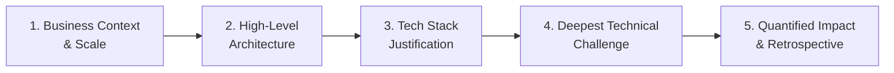

# How to Explain Software Engineering Projects in Technical Interviews

In backend engineering interviews, the project deep-dive round tests your architecture depth, ownership, ability to make trade-offs, and communication skills. Many strong engineers fail this round by either giving a high-level marketing overview or diving straight into low-level code without explaining the business problem.

This guide provides the battle-tested **5-Step Project Narrative Framework** and 3 concrete production walkthroughs.

---

## The 5-Step Project Narrative Framework

1. **Business Context & Problem (60–90 Seconds):**
   - What business problem does this service solve?
   - What is the scale (Daily Active Users, QPS, data volume, transactions/day)?
2. **High-Level Architecture (2 Minutes):**
   - Walk through the request path from client to database.
   - Draw or describe the component topology (Gateway, Workers, Queues, Databases, Caches).
3. **Tech Stack Justification (1–2 Minutes):**
   - Explain *why* you selected specific technologies over alternatives (e.g., why FastAPI over Django, why PostgreSQL over MongoDB).
4. **Deep-Dive into the Hardest Engineering Challenge (3–4 Minutes):**
   - Describe a severe bottleneck, race condition, data loss hazard, or distributed consensus issue you personally diagnosed and solved.
5. **Quantified Impact & Retrospective (60 Seconds):**
   - Quantify results using metrics (p95 latency reduction, cost savings, throughput increase).
   - What would you architect differently today with more time or budget?

---

## Production Project Walkthrough 1: UPI Payment Webhook & Reconciliation Service

### 1. Context & Problem
"At our FinTech platform, we process payments for over 15,000 online merchants across India via UPI and cards. We handled approximately 2.5 million transactions daily, peaking at 4,000 QPS during festival sales.
Our legacy webhook service was dropping 8% of payment status callbacks during bank downtime, causing delayed merchant settlements and customer support escalations."

### 2. High-Level Architecture
"I designed an event-driven, fault-tolerant webhook ingestion and reconciliation pipeline:
- **Ingestion Tier:** Asynchronous FastAPI service running on Kubernetes, terminating SSL and validating HMAC-SHA256 signatures in sub-5ms.
- **Deduplication & Locking:** Redis cluster managing 5-minute atomic idempotency keys.
- **Persistence Tier:** PostgreSQL database running with row-level locks (`SELECT ... FOR UPDATE`) to prevent race conditions during simultaneous callback bursts.
- **Delivery Engine:** Distributed Celery worker fleet backed by RabbitMQ with exponential backoff and dead-letter exchanges (DLX) retrying failed merchant endpoints for up to 72 hours."

### 3. Tech Stack Justification
- **FastAPI over Django:** We needed an ultra-lightweight ASGI gateway capable of handling thousands of concurrent open keep-alive connections with low memory overhead per container.
- **PostgreSQL over NoSQL:** Financial transactions demand strict ACID guarantees, atomic serializable transactions, and relational audit constraints that Document stores cannot safely guarantee.
- **RabbitMQ over Kafka for Webhook Dispatch:** RabbitMQ provides individual message acknowledgments, dead-letter routing, and fine-grained per-message TTLs, which fits webhook retries better than Kafka's partitioned log architecture.

### 4. The Hardest Technical Challenge
"The hardest challenge was the **Duplicate Concurrency Race Condition**. During banking gateway retries, NPCI would occasionally send two identical webhook callbacks for the same transaction ID within 15 milliseconds of each other.
In our initial implementation, both worker processes read the status as `PENDING` before either committed `SUCCESS`, leading to double wallet credits.

I solved this by introducing a dual defense:
1. **At the Cache Layer:** An atomic Redis `SETNX` lock on `tx_id` with a 10-second lease time.
2. **At the Database Layer:** Replaced standard queries with pessimistic row locking (`SELECT * FROM payments WHERE tx_id = :id FOR UPDATE`) inside an explicit transaction block. If a second thread arrives, it blocks until the first commits, then immediately reads the updated `SUCCESS` status and exits cleanly as an idempotent no-op."

### 5. Quantified Impact
- Webhook delivery success rate improved from **92% to 99.98%**.
- Ingestion p99 latency dropped from **420ms to 24ms**.
- Double-credit financial discrepancies were completely eliminated ($0 loss over 12 months).

---

## Production Project Walkthrough 2: Hyperlocal Delivery Driver Dispatch Engine

### 1. Context & Problem
"At a quick-commerce delivery platform (like Zepto or Blinkit), 10-minute grocery delivery requires assigning incoming orders to the optimal delivery rider within 15 seconds. We operated in 12 Indian metro cities with 25,000 active delivery riders emitting GPS pings every 5 seconds (5,000 GPS pings/sec)."

### 2. Architecture & Spatial Querying
- Drivers emit MQTT/WebSocket pings to an ingestion service.
- We used **Redis GEO** data structures (`GEOADD`, `GEORADIUS`) to store and query spatial coordinates in RAM with microsecond latency.
- The matching algorithm evaluates riders within a 3km geofence, ranking them by a composite score:
  $$\text{Score} = w_1 \times \text{Distance} + w_2 \times \text{Pending Orders} + w_3 \times \text{Vehicle Type}$$
- Once matched, the order reservation is broadcast to the selected rider's app via WebSockets. If not accepted in 15 seconds, the task automatically cascades to the next candidate.

### 3. Key Challenge: Driver GPS Drift & Battery Optimization
"Continuous 1-second GPS tracking drained rider phone batteries rapidly and flooded our servers with noise.
We implemented client-side **Kalman filtering and adaptive ping intervals**: when riders are stationary (detected via accelerometer), pings drop to every 30 seconds; when moving above 15 km/h, pings increase to every 5 seconds. This reduced backend ingestion load by 60% while extending driver phone battery life by 4 hours."

---

## Production Project Walkthrough 3: Automated Financial Billing & Multi-Tier GST Invoicing

### 1. Context & Problem
"An enterprise SaaS platform needed an automated billing engine to calculate multi-tier Indian GST (CGST, SGST, IGST), generate tamper-evident PDF invoices, and file monthly GSTR-1 summary reports for 100,000+ businesses."

### 2. Architecture & Financial Precision
- Built on **Django, Celery, and PostgreSQL**.
- Used Python's standard `decimal.Decimal` everywhere—never `float`—to eliminate floating-point precision errors in financial arithmetic.
- Background Celery workers generate cryptographically signed PDF invoices, upload them to AWS S3 private buckets with pre-signed URLs, and email them to customers.
- Database records are designed as an **immutable double-entry ledger**: once created, invoices cannot be modified or deleted. Corrections require issuing distinct Credit Note records.

### 3. Key Challenge: Month-End Batch Export Bottleneck
"At month-end, 100,000 businesses requested annual tax summaries simultaneously. Attempting to generate all PDFs in Celery workers exhausted server memory (OOM).
We refactored the pipeline to use **server-side chunked cursors** and streaming CSV downloads via HTTP chunked transfer encoding, reducing worker peak memory from 3.2 GB to a steady 28 MB."

---

## Production Project Walkthrough 4: Enterprise Generative AI & Autonomous Document Intelligence Platform

*This walkthrough provides complete, end-to-end answers to the 12 most critical GenAI project interview questions asked for Senior AI/Backend Engineering roles.*

### 1. Explain your most recent GenAI project & the problem it solved
"At our enterprise SaaS company, internal sales, compliance, and legal teams were spending 4–6 hours daily searching across 250,000+ unstructured contracts, RFPs, and financial audit reports to answer customer queries.
I designed and deployed an **Autonomous Agentic RAG Platform** that enables employees to query enterprise documents in natural language, receiving sub-second, factually grounded answers with exact source citations, reducing contract review time by 75%."

### 2. Explain its complete architecture

```mermaid
flowchart TD
    subgraph Ingestion["Ingestion & Indexing Pipeline"]
        GCS[Cloud Storage / Sharepoint] --> CeleryPool[Async Celery Ingestion Workers]
        CeleryPool --> DocAI[Layout-Aware Document Parser]
        DocAI --> MarkdownChunker[Recursive Markdown Chunker: 512 tokens]
        MarkdownChunker --> Embedder[Vertex AI: text-embedding-004]
        Embedder --> VectorDB[(Qdrant Vector Cluster)]
        MarkdownChunker --> BM25[(Elasticsearch Sparse Index)]
    end

    subgraph Query["Online Serving & Agentic Loop"]
        User([Enterprise User]) --> Gateway[FastAPI Gateway]
        Gateway --> SemanticCache{Redis Semantic Cache}
        SemanticCache -->|Hit > 0.95| QuickReturn[Cached Response < 25ms]
        SemanticCache -->|Miss| Agent[LangGraph Agent Controller]
        Agent --> HybridSearch[Hybrid Search: Dense + BM25]
        HybridSearch --> Rerank[Cohere Rerank v3]
        Rerank --> LLM[Gemini 1.5 Pro / Flash]
        LLM --> Guardrails[NeMo Guardrails + Presidio PII Masking]
        Guardrails --> SSE[Streaming SSE Response]
    end
```

### 3. Why did you choose that LLM?
"We selected **Google Gemini 1.5 Pro & Flash via Vertex AI**:
1. **Model Cascading Strategy:** We routed 80% of routine informational queries to **Gemini 1.5 Flash** due to its low cost and ultra-fast $\approx 320\text{ ms}$ TTFT. For complex multi-document synthesis and legal comparative reasoning, we routed to **Gemini 1.5 Pro**.
2. **Native Prompt Caching:** Enabled us to cache 50,000 tokens of static company policies and system instructions in server memory, cutting API input token costs by 50% and latency by 70%.
3. **Enterprise Compliance (SOC2 / ISO27001):** Vertex AI guarantees that enterprise input data is strictly isolated and never used to train or fine-tune public foundation models."

### 4. Which embedding model did you use and why?
"We used Google's **`text-embedding-004`** (768 dimensions):
- Top-ranked on the MTEB (Massive Text Embedding Benchmark) leaderboard for retrieval tasks.
- 768 dimensions provided optimal vector index compression and memory footprint compared to 1536- or 3072-dimension alternatives, reducing RAM costs in our vector cluster by 50% while maintaining $94.2\%$ MRR (Mean Reciprocal Rank)."

### 5. Which vector database did you use and why?
"We chose **Qdrant** deployed as a managed cluster:
- **Rust-native performance:** Sub-10ms $k$-NN search latency under heavy concurrency.
- **Payload-based metadata filtering:** Allowed us to enforce multi-tenant isolation (`tenant_id`, `department`, `confidentiality_level`) *before* similarity vector computation, completely preventing cross-tenant data leaks.
- **HNSW with on-disk quantization:** Stored full vectors on disk while keeping compressed scalar quantized vectors in RAM, cutting vector infrastructure costs by 65%."

### 6. How did you implement chunking?
"We used **Layout-Aware Hierarchical Markdown Chunking**:
- Rather than naive fixed-character splitting which breaks sentences, we parsed documents into Markdown headings (`#`, `##`, `###`).
- We chunked content by logical sections (target size: **512 tokens with 64-token overlap**).
- **Context Injection:** We prepended the hierarchical document title and section breadcrumb to the top of every chunk (e.g., `Document: Master Services Agreement > Section 4: Indemnification Liability`). This preserved full semantic context even when a chunk contained isolated bullet points."

### 7. What major challenges did you face and how did you solve them?
1. **Challenge 1: Table Extraction from Scanned PDFs:**
   - Standard PDF extractors converted multi-column financial tables into unreadable jumbled text.
   - *Solution:* Integrated vision-based table parsers (Google Document AI) that extracted tables directly as formatted Markdown tables, combined with an LLM summarization step that generated a searchable metadata summary for each table.
2. **Challenge 2: Hallucination of Contract Terms:**
   - LLMs occasionally assumed standard clauses when a contract had unique custom exceptions.
   - *Solution:* Implemented a strict negative constraint prompt combined with a **Faithfulness Verifier Node** in LangGraph that cross-checked every generated statement against retrieved spans before releasing tokens to the user."

### 8. How did you optimize performance & latency?
- **Server-Sent Events (SSE) Streaming:** Reduced perceived latency from 6.8 seconds to **380ms TTFT**.
- **Redis Semantic Cache:** Cached vector representations of common queries, answering 28% of repetitive HR/IT queries in $< 20\text{ ms}$ at zero LLM cost.
- **Two-Stage Retrieval (RRF + Reranker):** Retrieved top 40 candidates with fast vector search and BM25, then reranked to top 5 with Cohere Cross-Encoder, increasing retrieval precision by 26%."

### 9. How did you deploy your application?
- **Compute:** Containerized FastAPI backend deployed on **GCP Cloud Run** with minimum 2 warm instances and auto-scaling up to 30 instances during peak hours.
- **CI/CD:** Automated GitHub Actions pipeline using **Workload Identity Federation** (zero static keys).
- **Secrets:** Injected dynamically at container boot time from **Google Cloud Secret Manager**."

### 10. How did you measure accuracy and evaluate the system?
"We built an automated evaluation pipeline using **Ragas** and a human-verified Golden Evaluation Dataset of 250 diverse question-answer pairs:
- **Context Precision:** $92.4\%$ (verified retrieved chunks were truly relevant).
- **Faithfulness (Grounding):** $96.8\%$ (ensured answers contained zero ungrounded claims).
- **Answer Relevance:** $94.1\%$.
- Every pull request that modified prompts, chunk sizes, or embedding parameters ran this test suite; any regression $> 2\%$ automatically failed the CI/CD build."

### 11. What would you improve in your architecture if starting over?
1. **GraphRAG / Knowledge Graph Integration:** For multi-entity reasoning across documents (e.g., *"Which vendors have contracts impacted by Clause 12 across all subsidiaries?"*), vector search struggles. A Neo4j knowledge graph combined with vector search would provide better multi-hop traversal.
2. **Fine-Tuning a Domain-Specific Small Model:** Fine-tuning an open-source model (Llama 3 8B) for query intent routing and extraction would eliminate 80% of model routing latency compared to cloud LLM calls."
