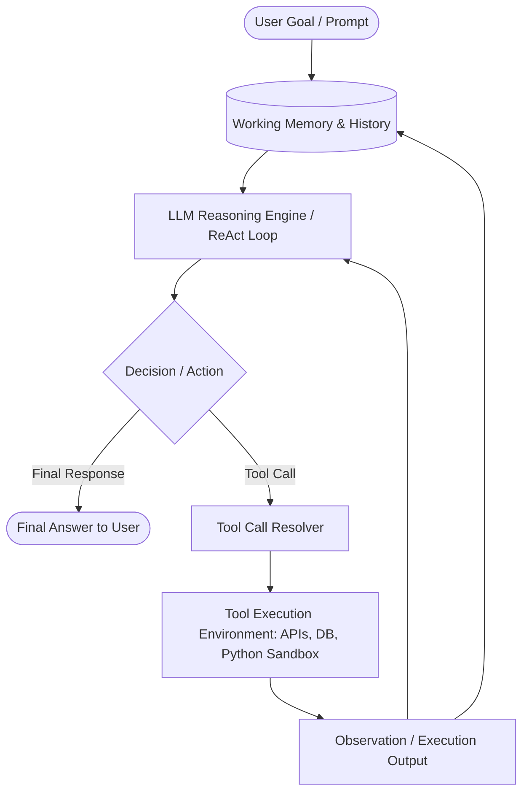
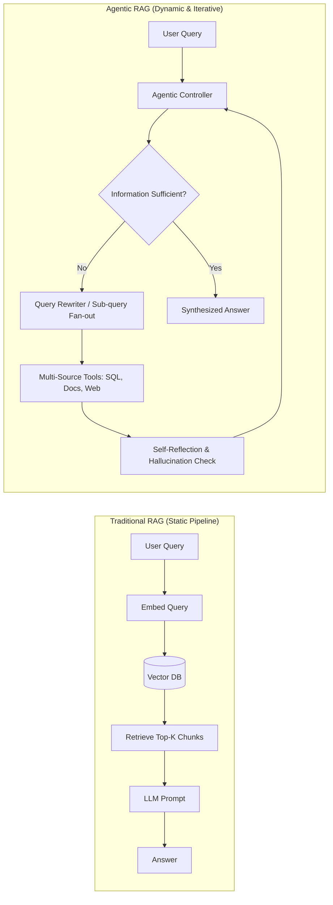
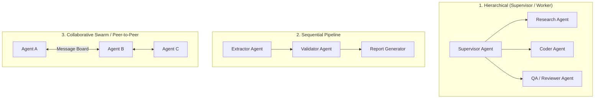
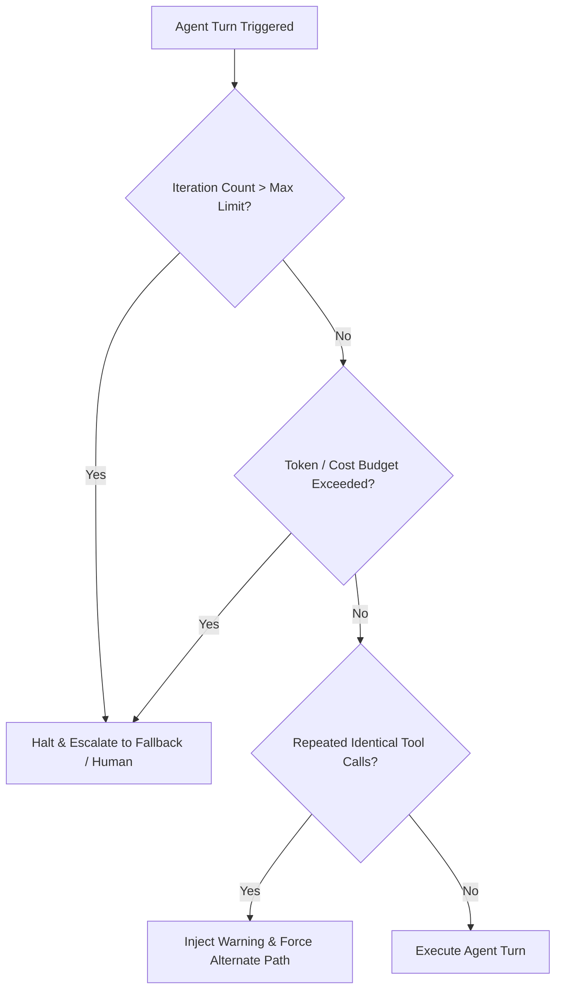
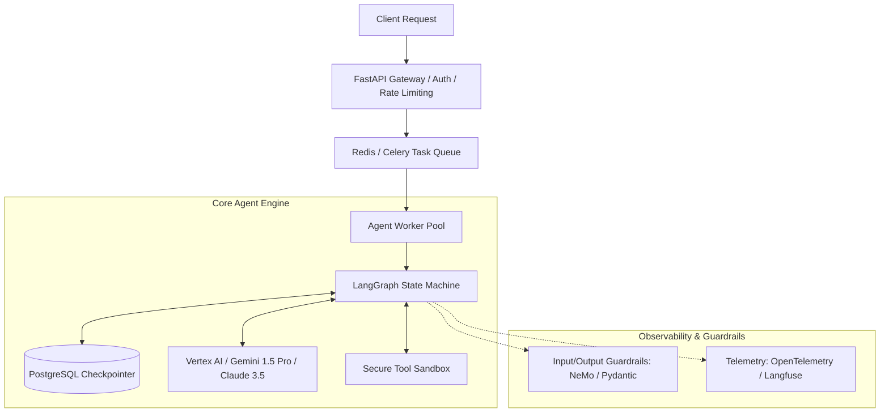

# Agentic AI & Autonomous Systems Interview Guide

## Module Overview
This module covers modern **Agentic AI**, **Autonomous LLM Agents**, **Tool Calling**, **Multi-Agent Architectures**, and **Production Orchestration (LangGraph / CrewAI / AutoGen)**. These concepts represent the highest-priority interview expectations for Senior Backend, GenAI, and AI System Architects.

---

## Architecture: Autonomous AI Agent Execution Lifecycle



---

## Questions & Comprehensive Solutions

### AG-BAS-001: What is Agentic AI?

**One-Line Answer:**  
**Agentic AI** refers to AI systems designed with autonomous reasoning, planning, and goal-directed execution capabilities that iteratively perceive context, make decisions, execute external actions (tools), and adjust plans based on feedback without requiring step-by-step human intervention.

**Detailed Explanation:**  
Unlike passive generative models that operate strictly in a single prompt-response turn, Agentic AI exhibits **agency**—the capacity to act toward an objective over multiple autonomous steps. An agentic system loops through:
1. **Perception:** Interpreting user instructions and environmental observations.
2. **Reasoning & Planning:** Breaking complex goals into directed acyclic graphs (DAGs) or sequential sub-tasks.
3. **Action (Tool Calling):** Interacting with external databases, APIs, code runners, or web searchers.
4. **Reflection & Self-Correction:** Evaluating tool execution outcomes and retrying or branching if unexpected results occur.

**Important Points:**
- **ReAct Pattern:** Combines *Reasoning* (thought generation) with *Acting* (tool invocation) in an iterative loop: `Thought -> Action -> Action Input -> Observation -> Thought -> Final Answer`.
- **Agency Spectrum:** Ranges from basic deterministic routers (low agency) to fully autonomous multi-agent swarms with dynamic planning (high agency).

> **Production Note:** In enterprise systems (e.g., automated refunds or insurance claim triage), boundless autonomy is dangerous. Production Agentic AI is almost always constrained by structured schemas (Pydantic), deterministic state machines (LangGraph), and strict token/depth budgets.

---

### AG-BAS-002: What is the difference between an AI Agent and an LLM?

**Comparison Table:**

| Dimension | Large Language Model (LLM) | AI Agent |
| :--- | :--- | :--- |
| **Nature** | Passive statistical next-token predictor | Active, stateful computational system |
| **Execution Flow** | Single turn (input prompt $\rightarrow$ output tokens) | Multi-turn feedback loop (Reason $\rightarrow$ Act $\rightarrow$ Observe $\rightarrow$ Repeat) |
| **External World Access**| None (isolated snapshot of pre-trained weights) | Active (reads DBs, executes Python, sends emails, calls REST APIs) |
| **Memory** | Stateless across API requests (ephemeral context window) | Short-term (in-context working memory) + Long-term (vector DB, Redis, SQL) |
| **Error Recovery** | Cannot self-correct after token generation finishes | Detects execution errors and dynamically adjusts subsequent actions |

<u>Interview Tip:</u> Think of the LLM as the *CPU / Reasoning Core* and the AI Agent as the *entire operating computer* (complete with memory, I/O devices, storage, and control unit).

---

### AG-BAS-003: What is the difference between Agentic AI and Traditional RAG?



**Key Differences:**
1. **Routing:** Traditional RAG queries a single vector database unconditionally. Agentic RAG dynamically routes queries between SQL databases, semantic search, live web search, or internal APIs based on intent.
2. **Iterative Refinement:** If retrieved context is irrelevant or conflicting, Agentic RAG rewrites the search query or expands search depth (Self-RAG / Corrective RAG), whereas traditional RAG blindly outputs based on the initial retrieval.
3. **Multi-Hop Reasoning:** Traditional RAG fails on questions like *"Compare Q3 revenue of Company A with Company B"*. Agentic RAG breaks this into two sub-searches, computes the difference, and validates the answer.

---

### AG-BAS-004: What is Tool Calling / Function Calling?

**One-Line Answer:**  
**Tool calling** is a structured mechanism where the LLM is provided with JSON schema definitions of callable functions and outputs a structured JSON payload specifying a function name and arguments instead of prose text.

**Step-by-Step Data Flow:**
1. The developer passes a system prompt, user prompt, and an array of tool specifications (name, description, parameters schema) to the LLM API.
2. The LLM analyzes the query and determines that external computation or real-time data is required.
3. The LLM outputs `finish_reason: "tool_calls"` with arguments in JSON: `{"name": "get_stock_price", "arguments": {"symbol": "INFY.NS"}}`.
4. The application backend intercepts this response, parses arguments, executes the local Python/DB function securely, and obtains the result.
5. The application appends a new message with `role: "tool"` containing the stringified result and calls the LLM again.
6. The LLM consumes the tool output and synthesizes the final user-facing response.

**Python Code Implementation:**

```python
from typing import Any
import json

# 1. Tool Definition conforming to JSON Schema
TOOLS_SCHEMA = [
    {
        "type": "function",
        "function": {
            "name": "check_account_balance",
            "description": "Fetches current savings account balance for a given customer ID",
            "parameters": {
                "type": "object",
                "properties": {
                    "customer_id": {"type": "string", "description": "Unique 10-digit customer ID"}
                },
                "required": ["customer_id"]
            }
        }
    }
]

# 2. Local Python implementation
def check_account_balance(customer_id: str) -> dict[str, Any]:
    # Production DB query simulation
    return {"customer_id": customer_id, "balance_inr": 248500.50, "currency": "INR"}

# 3. Execution Dispatcher
AVAILABLE_TOOLS = {"check_account_balance": check_account_balance}

def execute_tool_call(tool_name: str, arguments_json: str) -> str:
    if tool_name not in AVAILABLE_TOOLS:
        return json.dumps({"error": f"Unknown tool: {tool_name}"})
    try:
        args = json.loads(arguments_json)
        handler = AVAILABLE_TOOLS[tool_name]
        result = handler(**args)
        return json.dumps(result)
    except Exception as e:
        return json.dumps({"error": f"Tool execution failed: {str(e)}"})
```

---

### AG-INT-005: How does an AI agent decide which tool to call?

**Detailed Explanation:**  
The decision process relies on **in-context semantic relevance and function docstrings**:
1. **Description Embedding Matching:** During generation, the LLM pays high attention to the `"description"` fields of the JSON schemas provided in the system context.
2. **Few-Shot Prompting:** When tool ambiguity exists (e.g., `query_sql_db` vs `query_vector_store`), few-shot exemplars in the system prompt instruct the model on boundary criteria.
3. **Constrained Decoding / Tool Choice Modes:**
   - `tool_choice="auto"`: The model decides autonomously between generating text or calling one or more tools.
   - `tool_choice="required"`: Forces the model to call at least one tool.
   - `tool_choice={"type": "function", "function": {"name": "specific_tool"}}`: Forces deterministic execution of an exact function.

<u>Interview Tip:</u> Emphasize that **tool description quality is as critical as prompt engineering**. Vague descriptions like `"searches stuff"` cause tool hallucination; detailed descriptions with clear input constraints and examples ensure precise tool resolution.

---

### AG-INT-006: What is Multi-Agent Architecture?

**One-Line Answer:**  
A **Multi-Agent Architecture** is a distributed design pattern where multiple specialized agents—each with distinct system prompts, limited toolsets, and scoped responsibilities—collaborate to solve complex workflows that exceed the context or reliability of a single generalist agent.

**Architectural Patterns:**



**Why Multi-Agent over Single-Agent?**
- **Context Window Economy:** Specialized agents receive only the domain-specific tools and system instructions they need, preventing prompt dilution and token bloat.
- **Modularity & Debuggability:** If the SQL generator produces bad queries, only the SQL agent's prompt/tooling needs tuning without destabilizing the customer-facing summarizer.
- **Separation of Concerns:** Mirrors real-world software teams (Product Manager $\rightarrow$ Backend Engineer $\rightarrow$ Code Reviewer).

---

### AG-INT-007: How do agents communicate with each other?

**Communication Paradigms:**
1. **Shared State Blackboard (e.g., LangGraph State):**
   - Agents communicate by reading and mutating a centralized, typed state object.
   - Example: Agent A appends `research_notes` to the state dictionary; Agent B reads `research_notes` and writes `code_draft`.
2. **Direct Message Passing (Actor Model / Chat History):**
   - Agents pass structured messages (`HumanMessage`, `AIMessage`, `ToolMessage`) directly to each other in a dialogue format (e.g., AutoGen conversations).
3. **Event Broker / Pub-Sub (Distributed Systems):**
   - In production microservices, agents communicate asynchronously over message brokers (RabbitMQ, Kafka, Redis Streams) using CloudEvents or JSON envelopes containing `task_id`, `agent_source`, and `payload`.

---

### AG-INT-008: What is an Orchestration Framework?

**One-Line Answer:**  
An **orchestration framework** is runtime infrastructure that manages agent execution lifecycle, state transitions, tool dispatching, human-in-the-loop interruptions, checkpointing, and error recovery.

**Core Responsibilities:**
- **State Management:** Tracking variables, memory, and conversation artifacts across agent turns.
- **Control Flow:** Enforcing sequential chains, conditional branching, cyclical loops, and parallel executions.
- **Durability & Fault Tolerance:** Checkpointing execution state to durable storage (PostgreSQL / Redis) so an agent workflow can survive process crashes or wait days for human approval.

---

### AG-INT-009: What is the difference between LangChain and LangGraph?

**Comparison Matrix:**

| Feature | LangChain (Chains / Runnables) | LangGraph |
| :--- | :--- | :--- |
| **Control Flow Model** | Directed Acyclic Graphs (DAGs) / Linear Chains | Cyclical Graphs (Cyclic Directed Graphs with Loops) |
| **Execution Loop** | Hardcoded internal loops (`AgentExecutor` - deprecated) | First-class developer-controlled loops with explicit termination conditions |
| **State Persistence** | Transient memory helpers (`ConversationBufferMemory`) | Built-in durable state persistence via Checkpointers (`PostgresSaver`, `MemorySaver`) |
| **Human-in-the-Loop** | Clunky external callbacks | Native breakpoints (`interrupt_before`, `interrupt_after`) |
| **Multi-Agent Coordination** | Difficult, requires custom glue code | Native multi-actor graph nodes with conditional edge routing |

<u>Interview Tip:</u> State clearly that LangChain was designed for linear pipelines, whereas **LangGraph was purpose-built for agentic, multi-turn, stateful, and cyclic workflows**.

---

### AG-ADV-010: How do you prevent infinite agent loops?



**Five Production Safeguards:**
1. **Strict Recursion Limit:** Configure hard recursion limits (e.g., `recursion_limit=15` in LangGraph). If the counter trips, raise a `GraphRecursionError` and trigger graceful degradation.
2. **Cycle / Repetition Detection:** Maintain an MD5 hash of recent `(tool_name, arguments)` tuples. If the exact same call occurs twice with the same output, intervene by appending an environmental warning: *"You are repeating tool call X without progress. Try an alternate strategy."*
3. **Timeout & Cost Budgets:** Wrap agent invocations with global timeouts (`asyncio.wait_for(timeout=45.0)`) and token counter middleware that stops execution if total input/output tokens exceed a hard financial threshold (e.g., $0.20 per transaction).
4. **Deterministic Exit Paths:** Design conditional graph edges that force the execution to move to a summarizer or escalation node after $N$ tool attempts.
5. **Human-in-the-Loop Interruption:** If confidence scores drop below a threshold after 3 attempts, suspend the graph and notify human operators.

---

### AG-ADV-011: How do you maintain agent memory?

**Memory Hierarchy in Production:**

1. **Short-Term Memory (In-Context / Working Memory):**
   - Active scratchpad stored inside the prompt's `messages` list.
   - **Compaction Technique:** When context approaches limit, run background summarization or token-bounded sliding windows (`trim_messages`).
2. **Long-Term Episodic Memory:**
   - Records past conversations and completed workflows.
   - Implemented via a Vector Database (Pinecone, Qdrant, Milvus) storing past conversations tagged with metadata (`user_id`, `session_date`). At the start of a session, query the vector DB for top-$k$ relevant past episodes.
3. **Long-Term Semantic & Entity Memory:**
   - Structured user profiles and persistent facts stored in PostgreSQL or Knowledge Graphs (Neo4j).
   - Example: *"User preferred currency: INR; Account tier: Platinum"*. Automatically updated by an auxiliary extraction agent.

---

### AG-ADV-012: How do you handle failures during tool execution?

**Production Resiliency Strategies:**
1. **Feedback Injection (Self-Healing Code/Tooling):**
   - Never crash the agent when a tool raises an exception. Catch the exception and return it as the `ToolMessage` content:  
     `"Error: Postgres query failed: syntax error at or near 'FORM'. Review SQL syntax and retry."`
   - The LLM consumes the stack trace, identifies the typo (`FORM` $\rightarrow$ `FROM`), and generates a corrected query.
2. **Exponential Backoff & Jitter:** For transient network failures (e.g., HTTP 429/503), apply standard retry decorators (Tenacity / Resilience4j) *before* returning control to the agent.
3. **Fallback Tools:** If primary API fails permanently, register a secondary tool (e.g., fallback from real-time pricing API to cached end-of-day database table).
4. **Circuit Breaking:** If an external third-party tool fails 5 times consecutively, trip the circuit breaker and instruct the agent via prompt alteration that the tool is temporarily unavailable.

---

### AG-ADV-013: How do you implement Human-in-the-Loop (HITL)?

**One-Line Answer:**  
**Human-in-the-Loop** pause-and-resume execution ensures high-risk actions (e.g., processing refunds, deleting databases, sending external emails) are validated by a human supervisor before irreversible side-effects occur.

**Step-by-Step Execution Flow (LangGraph Pattern):**
1. The agent reaches a high-risk tool node (`execute_wire_transfer`).
2. The orchestrator encounters a breakpoint (`interrupt_before=["execute_wire_transfer"]`).
3. The graph state is serialized and persisted to durable storage (e.g., `PostgreSQL` checkpoint table).
4. A webhook or push notification alerts a human reviewer with the proposed action arguments (`recipient`, `amount_inr`).
5. Execution halts; no server processes or threads remain blocked.
6. The human approves, edits, or rejects the action via an admin dashboard.
7. The dashboard triggers `graph.resume(thread_id, state_update)` to execute the tool with validated arguments or redirect flow to a rejection branch.

---

### AG-ADV-014: How do you manage agent state?

**Production Best Practices:**
1. **Immutability & Reducers:**
   - Use strongly-typed schemas (Pydantic models or `typing.TypedDict`).
   - Define custom reducer functions for lists:
     ```python
     from typing import Annotated, TypedDict
     import operator

     class AgentState(TypedDict):
         messages: Annotated[list[str], operator.add] # Appends rather than overwriting
         current_user: str
         attempts_remaining: int
     ```
2. **Durable Checkpointing:**
   - Use persistent checkpointers backed by PostgreSQL (`PostgresSaver`) or Redis. Every graph step generates a unique `checkpoint_id`, enabling full audit trails, time-travel debugging, and fault recovery.
3. **State Partitioning:**
   - Separate public client state from private agent scratchpads so internal reasoning traces (`thought` tokens) are not accidentally leaked to external client APIs.

---

### AG-ADV-015: How would you build a production-grade AI agent?

**Complete Architectural Blueprint:**



**Key Pillars of Enterprise Production Readiness:**
1. **Safety & Guardrails:** Validate inputs against prompt injections and outputs against schema violations before returning results to clients.
2. **Asynchronous Architecture:** Long-running agent reasoning must never block HTTP threads. Use FastAPI to return a `202 Accepted` with a `job_id` and stream progress via WebSockets or Server-Sent Events (SSE).
3. **Observability & Tracing:** Instrument every tool call, latency, and token cost with OpenTelemetry or Langfuse to monitor regressions and token expenses.
4. **Sandboxed Execution:** Run arbitrary code generation tools in isolated microVMs (gVisor, Firecracker, or Docker containers with dropped Linux capabilities) to prevent server takeover.
