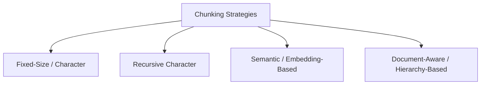
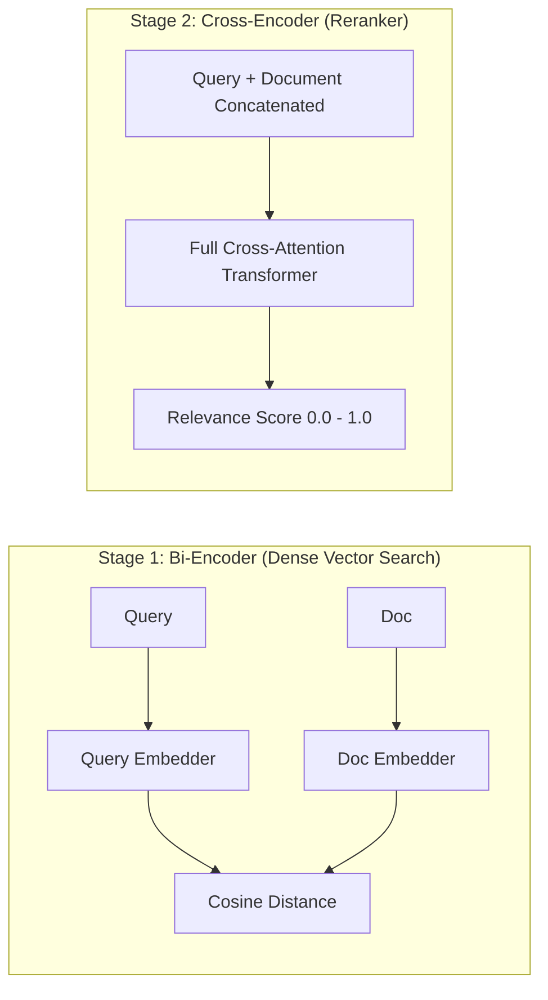

# Retrieval-Augmented Generation (RAG) & Vector Search Interview Guide

## Module Overview
This module covers modern **Retrieval-Augmented Generation (RAG)**, **Vector Databases**, **Embeddings**, **Chunking Strategies**, **Hybrid Search**, **Reranking**, and **Hallucination Mitigation**.

---

## Complete Production RAG Architecture

```mermaid
flowchart TD
    subgraph Ingestion_Pipeline["1. Offline Ingestion Pipeline"]
        Docs[Raw Documents: PDF, DOCX, Markdown, SQL] --> Extract[Document Parser & Cleaners]
        Extract --> Chunk[Chunking Engine: Recursive / Semantic]
        Chunk --> Embed[Embedding Model: text-embedding-004]
        Embed --> VectorDB[(Vector DB: Qdrant / Pgvector / Pinecone)]
        Chunk --> BM25[(Sparse Index: Elasticsearch / BM25)]
    end

    subgraph Query_Pipeline["2. Online Query Pipeline"]
        UserQuery([User Query]) --> PreProcess[Query Rewriting & HyDE]
        PreProcess --> EmbedQuery[Embed Query]
        EmbedQuery --> DenseSearch[Dense Vector Search]
        PreProcess --> SparseSearch[BM25 Keyword Search]
        
        DenseSearch --> Fusion[Reciprocal Rank Fusion - RRF]
        SparseSearch --> Fusion
        
        Fusion --> TopK[Top-K Candidates: 50 chunks]
        TopK --> Rerank[Cross-Encoder Reranker: Cohere / BGE]
        Rerank --> FilteredContext[Top-N Relevant Chunks: 5 chunks]
        
        FilteredContext --> PromptAssembly[Context-Augmented Prompt]
        UserQuery --> PromptAssembly
        PromptAssembly --> LLM[LLM: Gemini / Claude / GPT]
        LLM --> Response([Grounded Response with Citations])
    end
```



---

## Questions & Comprehensive Solutions

### RAG-BAS-001: What is RAG (Retrieval-Augmented Generation)?

**One-Line Answer:**  
**Retrieval-Augmented Generation (RAG)** is an AI architecture that enhances LLM generation by dynamically retrieving relevant facts, domain knowledge, or private enterprise documents from an external storage system and passing them into the LLM context prompt during inference.

**Why RAG over Fine-Tuning?**
1. **Dynamic & Instant Updates:** Knowledge bases update in real-time by inserting or deleting chunks in a database without spending thousands of dollars on retraining.
2. **Deterministic Grounding & Auditability:** LLM responses can cite exact source documents (`file_name`, `page_number`), making factual verification trivial.
3. **Strict Access Control (ACL):** Document-level authorization rules can filter search results based on the logged-in user's role before feeding data to the LLM.
4. **Zero Training Latency:** No model weight updates or GPU cluster provisioning required.

---

### RAG-BAS-002: Explain the complete RAG architecture from end-to-end.

**Step-by-Step Data Flow:**

1. **Document Ingestion:**
   - Text extraction from heterogeneous formats (PDFs, HTML, Confluence).
   - Text normalization (removing noise, stripping HTML boilerplate, normalizing unicode).
2. **Chunking & Tokenization:**
   - Breaking documents into coherent passages (e.g., 512 tokens with 50-token overlap).
3. **Vector Embedding:**
   - Passing chunks through an embedding model (e.g., Google `text-embedding-004` or `text-embedding-3-large`) to generate dense floating-point vectors ($D=768$ or $1536$).
4. **Indexing & Metadata Storage:**
   - Storing vector embeddings in a vector database paired with payload metadata (`doc_id`, `department`, `author`, `updated_at`).
5. **Runtime Query Processing:**
   - User inputs a natural language question. The system embeds the query using the *exact same* embedding model.
6. **Similarity Retrieval:**
   - The vector DB executes an Approximate Nearest Neighbor (ANN) search (HNSW or IVFFlat) to extract top-$K$ chunks with highest cosine similarity.
7. **Reranking:**
   - A cross-encoder model scores and re-orders the candidates to ensure the most semantically pertinent passages sit at the top.
8. **Prompt Augmentation & Synthesis:**
   - The selected chunks are formatted into an instruction prompt with strict constraints: *"Answer strictly based on the context below. If unsure, say 'I do not have sufficient information'"*.
9. **Generation:**
   - The LLM streams the grounded answer along with exact document citations.

---

### RAG-BAS-003: What are Embeddings?

**One-Line Answer:**  
An **embedding** is a high-dimensional dense vector of numerical floats that maps semantic, syntactic, and conceptual meaning of text into continuous vector space, where distance correlates directly with conceptual relatedness.

**Mathematical Representation:**
$$v \in \mathbb{R}^D \quad \text{where } D \in \{768, 1536, 3072\}$$

```python
# Conceptual Example of Embedding Distance
from numpy import dot
from numpy.linalg import norm

def cosine_similarity(v1: list[float], v2: list[float]) -> float:
    return dot(v1, v2) / (norm(v1) * norm(v2))

# "King" and "Queen" vectors have cosine similarity near ~0.85
# "King" and "Banana" vectors have cosine similarity near ~0.15
```

**Key Characteristics:**
- **Dense vs Sparse:** Modern embeddings are *dense* (almost all elements are non-zero floats representing latent dimensions), unlike sparse vectors (TF-IDF/BM25) where dimensions represent vocabulary words.
- **Model Pairing Requirement:** The query vector **must** be generated by the exact same model and dimensionality that generated the stored document vectors.

---

### RAG-BAS-004: What is a Vector Database?

**One-Line Answer:**  
A **Vector Database** is an engine engineered to store, index, and query billions of high-dimensional vector embeddings with low latency using **Approximate Nearest Neighbor (ANN)** search algorithms.

**Comparison of Vector Database Architectures:**

| Technology | Category | Indexing Algorithms | Best Used For |
| :--- | :--- | :--- | :--- |
| **Qdrant** | Native Vector DB (Rust) | HNSW, Inverted Index | High throughput, production filtering, on-prem / cloud |
| **pgvector** | PostgreSQL Extension | HNSW, IVFFlat | Existing relational Postgres stack, ACID transactions, relational joins |
| **Pinecone** | Managed Cloud-Native SaaS | Proprietary HNSW variant | Zero DevOps overhead, fast prototyping, serverless billing |
| **Milvus** | Distributed Cluster Engine | HNSW, IVF_PQ, SCaNN | Billion-scale enterprise search, multi-node clustering |

<u>Interview Tip:</u> For most startups and mid-size companies, **`pgvector` on existing PostgreSQL** is the optimal choice because it prevents data duplication between SQL and vector systems, preserving ACID guarantees and simplifying compliance.

---

### RAG-BAS-005: What is Semantic Search?

**One-Line Answer:**  
**Semantic search** queries data by conceptual meaning and user intent rather than matching literal keywords, enabling retrieval even when the user's vocabulary differs completely from the document text.

**Keyword Search vs Semantic Search Example:**
- Query: *"How do I fix a flat tire?"*
- Document: *"Procedure for replacing a punctured automotive tube with a spare."*
- **Keyword Search (BM25):** Fails ($0$ matching keywords).
- **Semantic Search (Vector):** High vector cosine similarity ($\sim 0.88$) because the semantic concepts align in vector space.

---

### RAG-INT-006: What is Chunking and why is it mandatory?

**One-Line Answer:**  
**Chunking** is the process of partitioning large continuous documents into smaller, semantically coherent text segments suitable for embedding and LLM context constraints.

**Why Chunking is Mandatory:**
1. **Embedding Context Windows:** Embedding models have hard token limits (e.g., 512, 2048, or 8192 tokens). Exceeding this limit drops or truncates text.
2. **Semantic Dilution:** Embedding a 50-page PDF into a single vector compresses all diverse topics into one noisy average vector, destroying precision.
3. **Retrieval Precision:** Chunking enables the retriever to extract the single exact paragraph answering the user's question, reducing token cost and distraction.

---

### RAG-INT-007: What are the different Chunking Strategies?

**Overview of 4 Core Strategies:**



1. **Fixed-Size Chunking:**
   - Splits text strictly every $N$ characters/tokens.
   - *Downside:* Breaks sentences and code blocks in half, destroying context.
2. **Recursive Character Chunking (Industry Standard):**
   - Attempts to split recursively by natural structural boundaries: paragraphs (`\n\n`), then sentences (`\n`), then words (` `), falling back to characters only when necessary.
3. **Semantic Chunking:**
   - Computes embeddings for consecutive sentences and measures cosine distance between adjacent sentences. When distance exceeds a threshold (indicating a topic shift), a new chunk is started.
4. **Document-Aware / Hierarchy Chunking:**
   - Leverages Markdown `#` headers, HTML tags, or JSON keys to split content by logical sections. The header title is prepended to every child chunk to preserve context.

---

### RAG-INT-008: How do you decide Chunk Size and Chunk Overlap?

**Decision Framework:**

| Content Type | Recommended Chunk Size | Recommended Overlap | Rationale |
| :--- | :--- | :--- | :--- |
| **API Reference / Code** | 200 – 400 tokens | 30 – 50 tokens | Functions and parameter descriptions are dense and discrete. |
| **Legal / Compliance Docs** | 500 – 800 tokens | 100 – 150 tokens | Legal clauses require surrounding qualifications and context. |
| **General Articles / Blogs** | 400 – 600 tokens | 50 – 100 tokens | Optimal balance between sentence continuity and embedding specificity. |

**The Role of Overlap:**
- **Chunk overlap** duplicates trailing tokens of Chunk $N$ into the beginning of Chunk $N+1$.
- **Why?** It prevents semantic discontinuity where a critical fact spans the boundary between two adjacent chunks.

---

### RAG-INT-009: What is Cosine Similarity and how does it compare to Euclidean Distance and Dot Product?

**Mathematical Comparison:**

| Metric | Formula | Behavior | Best Used When |
| :--- | :--- | :--- | :--- |
| **Cosine Similarity** | $\cos(\theta) = \frac{A \cdot B}{\|A\| \|B\|}$ | Measures angle between vectors (ignores magnitude, bounded $[-1, 1]$) | Normalized or unnormalized text embeddings |
| **Dot Product** | $A \cdot B = \sum A_i B_i$ | Measures angle and magnitude | Fast search when all embeddings are normalized to unit length ($\|A\|=1$) |
| **Euclidean Distance ($L_2$)** | $d = \sqrt{\sum (A_i - B_i)^2}$ | Measures straight-line distance in space | Clustering, geometric spatial embeddings |

> **Production Optimization Tip:** When vectors are normalized to unit length ($L_2$ norm $= 1$), **Cosine Similarity is mathematically identical to Dot Product**. Dot product requires fewer floating-point operations ($O(D)$ multiplications and additions without square root divisions), yielding substantial performance gains in high-QPS production systems.

---

### RAG-INT-010: What is Hybrid Search?

**One-Line Answer:**  
**Hybrid Search** combines **Dense Vector Retrieval** (semantic context) with **Sparse Lexical Retrieval** (BM25 / exact keyword matching), merging results using **Reciprocal Rank Fusion (RRF)**.

**Why Hybrid Search is Essential:**
- Pure vector search struggles with:
  - Exact part numbers (`Part #X789-B`)
  - Unique product IDs (`UPI-TXN-984214`)
  - Specific acronyms or code variables (`ValueError`)
- BM25 finds exact literal matches with $100\%$ precision, while vector search captures synonyms and natural paraphrasing.

**Reciprocal Rank Fusion (RRF) Formula:**
$$RRF\_Score(d \in D) = \sum_{m \in M} \frac{1}{k + r_m(d)}$$
*(Where $k \approx 60$ is a smoothing constant, and $r_m(d)$ is the rank of document $d$ in system $m$)*.

---

### RAG-INT-011: What is Reranking and why is it used?

**One-Line Answer:**  
**Reranking** is a two-stage retrieval pattern where a lightweight retriever quickly fetches a wide candidate pool (e.g., top 50 chunks), and an accurate **Cross-Encoder** deep-learning model scores and re-orders the candidates, passing only the top 5 to the LLM.

**Bi-Encoder vs Cross-Encoder:**



- **Bi-Encoder:** Fast ($O(1)$ vector distance lookups), but cannot model complex query-document word interactions.
- **Cross-Encoder:** High latency, but computes full cross-attention across all query and document token pairs. Placing it as a second stage yields maximum accuracy within acceptable latency budgets ($< 80\text{ ms}$).

---

### RAG-ADV-012: How do you improve Retrieval Accuracy in Production?

**Top 5 Enterprise Techniques:**
1. **HyDE (Hypothetical Document Embeddings):**
   - Ask the LLM to generate a hypothetical answer to the user query. Embed the *hypothetical answer* instead of the short question. The generated passage sits closer in vector space to the true answer document.
2. **Parent Document Retrieval / Small-to-Big Retrieval:**
   - Embed small chunks (128 tokens) for fine-grained search matching. When a match is found, retrieve its larger parent document (1024 tokens) or section to pass to the LLM context.
3. **Query Expansion & Multi-Query Generation:**
   - Use an LLM to generate 3 semantic variations of the user's question, execute searches in parallel, and deduplicate results.
4. **Metadata Pre-Filtering:**
   - Filter by tenant ID, date range, or department *before* running ANN vector search.
5. **Contextual Compression:**
   - Strip irrelevant sentences from retrieved chunks before prompt assembly to reduce LLM distraction.

---

### RAG-ADV-013: What is Metadata Filtering and how does it prevent security breaches?

**One-Line Answer:**  
**Metadata filtering** restricts vector similarity search to documents matching specific structured attribute filters (e.g., `tenant_id == 'flipkart'`, `security_clearance >= 3`, `created_year >= 2024`).

**Implementation in Qdrant / Pgvector:**

```python
# Pgvector SQL with combined metadata and vector filter
query = """
SELECT id, chunk_text, 1 - (embedding <=> :query_vector) AS similarity
FROM document_chunks
WHERE organization_id = :org_id 
  AND access_role = ANY(:user_roles)
ORDER BY embedding <=> :query_vector
LIMIT 5;
"""
```

**Security Impact:** Prevents **cross-tenant data leakage** in multi-tenant SaaS platforms. Without metadata pre-filtering, a user could perform a similarity search and inadvertently retrieve private vector embeddings belonging to another customer.

---

### RAG-ADV-014: How do you handle large documents (100+ page PDFs, financial reports)?

**Production Handling Pipeline:**
1. **Layout-Aware Parsing:**
   - Never use naive text extractors (`pypdf`) on structured documents. Use layout-aware parsers (e.g., Unstructured, LlamaParse, or Google Document AI) to preserve Markdown tables, image captions, and column reading order.
2. **Table Extraction & LLM Summarization:**
   - Financial tables turn into gibberish when split by raw character counts. Extract tables as Markdown or HTML, generate an LLM summary of the table, embed the summary for search, and link it back to the raw table.
3. **Hierarchical Document Indexing:**
   - Create a Document Summary Index. The search first identifies the 3 relevant chapters/pages, then searches chunks only within those chapters.

---

### RAG-ADV-015: How do you reduce Hallucinations in RAG?

**Five Architectural Guardrails:**
1. **Strict System Instructions & Negative Constraints:**
   - Prompt constraint: *"Answer strictly using only the provided context. If the answer cannot be deduced directly from the text, state: 'Information not available in repository context.' Do not assume or extrapolate."*
2. **Context Relevance & Grounding Auditing (RAG Triad):**
   - Use automated evaluation frameworks (**Ragas** or **TruLens**) measuring:
     - **Context Precision:** Are retrieved chunks actually relevant?
     - **Faithfulness:** Does the generated response rely exclusively on the retrieved context?
     - **Answer Relevance:** Does the response address the original query?
3. **Citation & Span Verification:**
   - Require the LLM to output exact substring quotes supporting each assertion. Verify with an automated regex/string checker that the quoted span actually exists in the retrieved context.
4. **Self-Correction & Fallback (Self-RAG):**
   - A second lightweight model evaluates the generated answer against the context. If unsupported claims are detected, the system triggers a query refinement loop or informs the user.
5. **Temperature Tuning:**
   - Set LLM temperature to `0.0` or `0.1` for RAG applications to minimize stochastic token sampling and enforce deterministic factual output.
