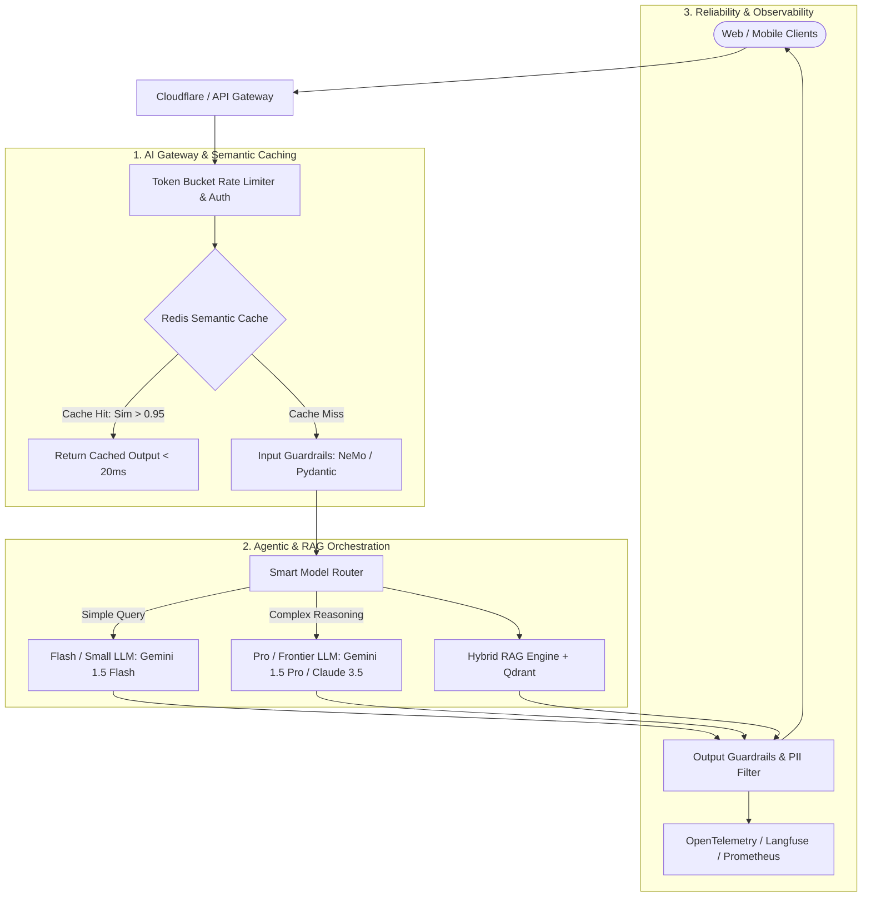
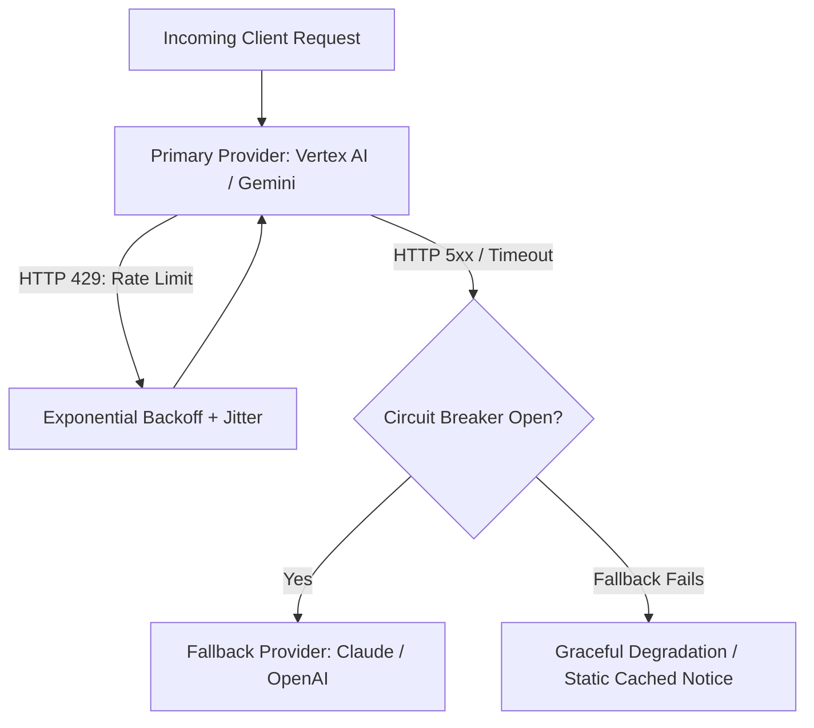
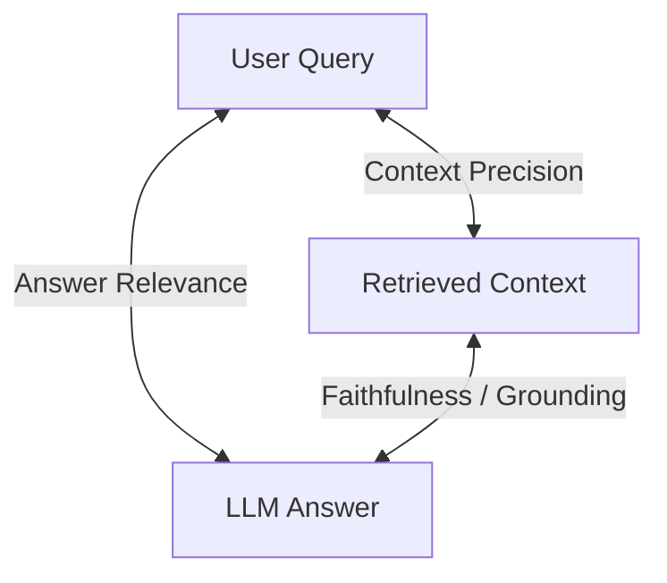
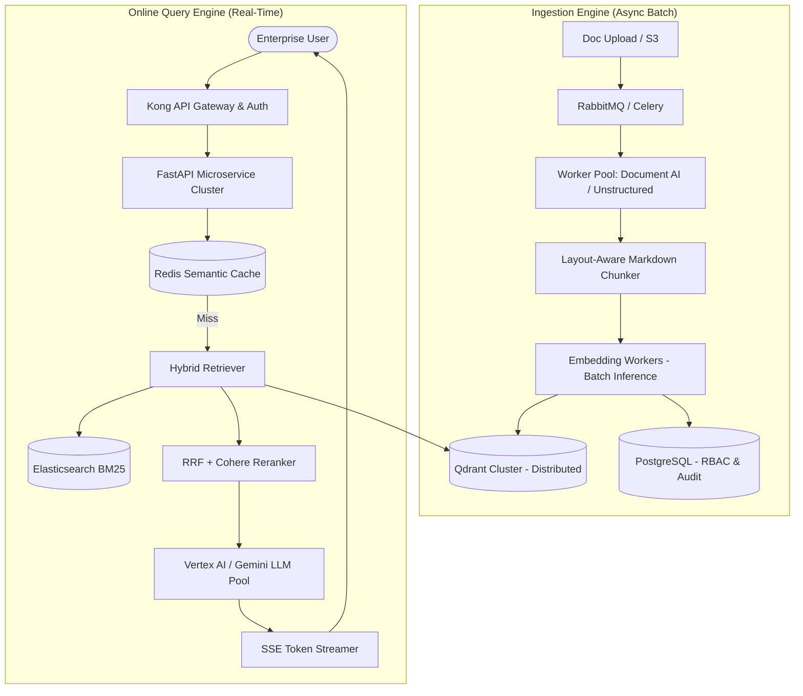

# Production GenAI & LLM System Design Interview Guide

## Module Overview
This module covers **Production GenAI Architecture**, **Latency Optimization (TTFT vs Throughput)**, **Token Budgeting**, **Enterprise Guardrails**, **Evaluation Pipelines (Ragas)**, and **Scalable Document Q&A System Design**.

---

## High-Level Architecture: Production Enterprise GenAI Platform

---

## Questions & Comprehensive Solutions

### GENAI-ADV-001: How do you reduce LLM response latency in production?

**One-Line Answer:**  
Latency is optimized across two dimensions: **Time To First Token (TTFT)** and **Total Generation Time**, using streaming, semantic caching, speculative decoding, and model tiering.

**Top 6 Production Latency Optimization Techniques:**

1. **Server-Sent Events (SSE) Streaming:**
   - Instead of buffering the entire response for 5–8 seconds, stream tokens back to the user interface via SSE chunk by chunk. Users perceive the system as responsive within $\sim 400\text{ ms}$.
2. **Semantic Caching with Vector DB (e.g., GPTCache / Redis):**
   - Store past `(query, response)` pairs with query embeddings. Before calling the LLM, search the cache. If a match has cosine similarity $\ge 0.95$, return the cached response in $< 25\text{ ms}$, bypassing the LLM entirely and saving 100% of token costs.
3. **Prompt Caching:**
   - In models supporting prefix caching (Gemini, Claude, Anthropic), static system instructions, few-shot examples, and large document context are cached in server memory. Subsequent calls reusing the same prefix experience up to **80% latency reduction** and **50% cost savings**.
4. **Smart Model Routing:**
   - Route simple transactional queries (e.g., *"What is your return policy?"*) to fast, lightweight models (Gemini Flash / GPT-4o-mini, $\approx 300\text{ ms}$ TTFT). Reserve high-latency reasoning models (Gemini Pro / Claude Opus, $\approx 2.5\text{ s}$ TTFT) exclusively for complex analytical workflows.
5. **Speculative Decoding:**
   - Use a small draft model to generate candidate tokens in parallel, and have the large model verify them in a single forward pass, achieving $2\times - 3\times$ speedups.
6. **Token Trimming & Stop Sequences:**
   - Set optimal `max_tokens` and enforce early stop sequences (`\n\n`, `Observation:`) to terminate generation immediately when the required information is emitted.

---

### GENAI-ADV-002: How do you reduce token consumption and operational costs?

**Cost Reduction Architecture:**

| Technique | Mechanism | Typical Cost Reduction |
| :--- | :--- | :--- |
| **Semantic Caching** | Redis vector index caches repeated and near-duplicate queries | $20\% - 40\%$ overall spend |
| **Prompt Compression** | LLMLingua strips non-essential syntactic tokens without losing semantic meaning | $30\% - 50\%$ prompt tokens |
| **Few-Shot Dynamic Retrieval** | Inject only 2 relevant few-shot examples dynamically via vector search instead of 10 static examples | $40\% - 60\%$ system prompt tokens |
| **Model Cascading** | Try small model first with a confidence score evaluator; escalate to large model only if confidence $< 0.8$ | $50\% - 70\%$ compute budget |
| **Structured Output Formats** | Output raw minified JSON or key-value strings rather than verbose conversational padding | $15\% - 25\%$ completion tokens |

---

### GENAI-ADV-003: How do you handle LLM API failures, rate limits, and outages?

**Resilience Patterns:**

1. **Exponential Backoff with Full Jitter:**
   - Formula: $T = \text{random}(0, \min(T_{\max}, T_{\text{base}} \times 2^{\text{attempt}}))$. Avoids the "thundering herd" problem when APIs throttle under burst loads.
2. **Multi-Provider Fallback:**
   - Use unified client wrappers (LiteLLM / AI Gateway). If the primary provider (e.g., Vertex AI Gemini) encounters regional downtime, automatically route the request to a secondary provider (e.g., Anthropic Claude on AWS Bedrock).
3. **Queue-Based Asynchronous Buffering:**
   - For non-interactive background tasks, place requests into a Celery/RabbitMQ queue with token-bucket rate limiters so backend workers stay strictly within API provider quotas.

---

### GENAI-ADV-004: How do you implement Enterprise Guardrails?

**One-Line Answer:**  
**Guardrails** are programmable bidirectional boundary checks placed before (input) and after (output) the LLM to enforce safety, security, brand guidelines, and regulatory compliance.

**Key Guardrail Dimensions:**
1. **Input Guardrails (Pre-Inference):**
   - **Prompt Injection & Jailbreak Detection:** Inspect input for adversarial patterns (`"Ignore previous instructions"`, `"System mode unlocked"`).
   - **PII Masking:** Detect Aadhaar, PAN card, credit card, phone numbers using Microsoft Presidio and mask them (`[REDACTED_AADHAAR]`) before sending to cloud LLMs.
   - **Topic Bounding:** Classify whether the query relates strictly to the business domain (e.g., banking). Reject out-of-scope prompts immediately.
2. **Output Guardrails (Post-Inference):**
   - **Schema & Fact Verification:** Ensure the response parses strictly into the expected Pydantic model.
   - **Hallucination & Grounding Check:** Cross-check the answer against the retrieved context.
   - **Toxicity & Brand Voice:** Block harmful content or inappropriate tone.

---

### GENAI-ADV-005: How do you evaluate RAG quality in Production?

**The RAG Triad Evaluation Metrics (Ragas / TruLens):**

1. **Context Precision:**
   - Measures the signal-to-noise ratio in retrieved chunks. Are the top chunks actually relevant to the user query?
2. **Faithfulness (Grounding):**
   - Measures whether the output answer is mathematically and semantically derivable *exclusively* from the retrieved context without hallucination.
   - Formula: $\frac{\text{Number of verifiable claims in answer}}{\text{Total claims made in answer}}$.
3. **Answer Relevance:**
   - Measures whether the generated answer directly addresses the user's intent without superfluous filler.

**Production CI/CD Eval Automation:**
Run an automated evaluation suite using a golden dataset of 200 question-answer pairs before deploying any prompt, chunking, or embedding changes. A regression in Faithfulness below $0.90$ blocks the deployment pipeline.

---

### GENAI-ADV-006: How do you monitor AI agents in real time?

**Key Observability Metrics (The 4 Pillars of GenAI Telemetry):**
1. **Cost & Token Economics:** Track prompt vs completion tokens per user, per endpoint, and per tool call.
2. **Latency Breakdown:**
   - DNS & Connection setup time.
   - Time To First Token (TTFT).
   - Token Generation Rate (tokens/sec).
   - Tool Execution Time (e.g., SQL query duration vs LLM thinking duration).
3. **Execution Trajectory & Errors:**
   - Number of reasoning steps before completion.
   - Infinite loop frequency and forced termination triggers.
   - Tool failure and retry rates.
4. **User Feedback Signals:**
   - Explicit feedback: Thumbs up / Thumbs down.
   - Implicit feedback: User copying the response, immediate follow-up clarification, or user abandoning session.

---

### GENAI-ADV-007: How do you handle high concurrency (10,000+ concurrent users) in GenAI APIs?

**Scale Architecture:**
1. **Non-Blocking Asynchronous IO (`asyncio` + FastAPI):**
   - LLM generation is inherently I/O-bound (waiting on network sockets). Traditional synchronous frameworks (Flask/Django WSGI) block an entire OS process per request, running out of threads at $\sim 200$ connections. FastAPI with `httpx.AsyncClient` easily maintains tens of thousands of concurrent open connections on a few worker pods.
2. **Distributed Response Streaming:**
   - Stream tokens directly over HTTP chunked transfer encoding (SSE) so server RAM does not buffer long generation contexts.
3. **Global Rate Limiting & Prioritization:**
   - Implement tier-based token bucket rate limiters in Redis (e.g., Paid enterprise users receive 100 QPS; Free tier receives 5 QPS).

---

### GENAI-ADV-008: System Design: Design a Scalable Enterprise Document Q&A System

**Requirements:**
- Scale: 1,000,000 enterprise documents (PDFs, Word, PPT, SQL tables).
- Traffic: 5,000 concurrent user queries.
- Latency: First token within $600\text{ ms}$.
- Security: Role-Based Access Control (RBAC) and strict tenant data isolation.

#### 1. End-to-End System Architecture

#### 2. Key Architectural Decisions:
1. **Separation of Ingestion & Query Serving:** Ingestion spikes (e.g., uploading 50,000 employee handbooks) run via asynchronous Celery workers and never impact real-time query latency.
2. **Enterprise Multi-Tenancy:** Storage partitioning by `org_id` and document-level ACLs enforced via metadata pre-filters before vector similarity calculation.
3. **Cost & Latency Guarantee:** Redis semantic cache handles repeated questions in $< 20\text{ ms}$; streaming SSE guarantees TTFT under $500\text{ ms}$.
