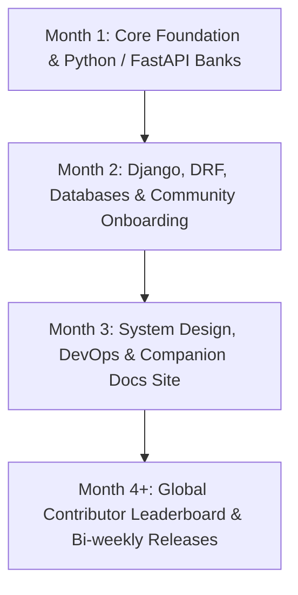

# GitHub Ranking, SEO, Discoverability & Open-Source Growth Strategy

This document establishes the discoverability, search engine optimization (SEO), community growth, and content distribution strategy for `software-engineering-interview-kit`.

---

## 1. Repository Metadata & Discoverability

### Official Repository Description
> Free open-source software engineering interview preparation kit covering Python, Django, FastAPI, DSA, PostgreSQL, Docker, DevOps, and System Design. Questions, detailed answers, coding exercises, and real-world scenarios.

### GitHub Topics (Tags)
```text
software-engineering, interview-preparation, interview-questions, python, django, fastapi, django-rest-framework, backend-development, system-design, data-structures, algorithms, postgresql, redis, docker, devops, open-source, coding-interview, cpython, microservices, cloud-computing
```

### Social Preview Image Design Brief
- **Dimensions:** 1280 x 640 px (2:1 ratio for GitHub Social Card & Open Graph).
- **Background:** Modern dark tech slate (`#0B0F19`) with subtle blueprint grid / isometric gradient accent (`#3B82F6` and `#10B981`).
- **Typography:**
  - Header (Bold, Inter/Roboto): `Software Engineering Interview Kit`
  - Subtitle: `Python • FastAPI • Django • Databases • System Design • DevOps`
  - Badges: `6,000+ Verified Questions` • `10-Point Technical Format` • `100% Open Source`
- **Branding:** Minimalist clean terminal icon with Python & cloud backend accents.

---

## 2. Analytics & Growth Monitoring Framework

Track authentic engagement using verified native analytics. **Never fabricate metrics or use automated engagement bots.**

| Metric | Tool / Source | Monitored Signal | Frequency |
|---|---|---|---|
| **GitHub Stars** | GitHub Insights / Stargazers | Organic repository bookmarking & adoption | Weekly |
| **Forks** | GitHub Insights / Network | Genuine reuse and personal study copies | Weekly |
| **Active Contributors** | GitHub Contributors graph | Real developer community participation | Monthly |
| **Pull Requests** | GitHub PRs (Merged/Closed) | Content improvements and community additions | Weekly |
| **Issues & Requests** | GitHub Issues | Questions requested, errata flagged | Weekly |
| **Discussions** | GitHub Discussions | Peer Q&A, mock interview feedback | Weekly |
| **Unique Visitors** | GitHub Traffic (Insights) | Total reach and repository visits | Weekly |
| **Search Impressions** | Google Search Console | Keyword impressions across search queries | Monthly |
| **Search Clicks** | Google Search Console | Direct organic search referrals to repo/docs | Monthly |

---

## 3. Platform-Specific Content Distribution Calendar

Content shared across developer communities must provide **standalone educational value** without aggressive self-promotion. Always adhere to community rules.

### A. Reddit (r/Python, r/backend, r/cscareerquestions, r/devops)
- **Format:** In-depth technical breakdown posts with complete answers inline, linking to the repository for the full topic bank.
- **Topics:**
  - *"How CPython's PEP 659 Adaptive Interpreter Actually Works Under the Hood (with Bytecode Dumps)"*
  - *"Why Python Reference Counting Breaks Linux Copy-On-Write in Prefork Servers (and How PEP 683 Solves It)"*
  - *"FastAPI Dependency Injection vs Class-Based Services: An Engineering Deep-Dive"*

### B. LinkedIn & Technical Career Networks
- **Format:** Carousel slides and architecture summaries targeted at mid-to-senior software engineers.
- **Topics:**
  - *"Top 10 Senior Python Backend Architecture Interview Questions (and What Interviewers Actually Look For)"*
  - *"System Design Breakdown: Designing an Asynchronous Rate Limiter with Redis & Token Bucket"*

### C. Dev.to & Hashnode
- **Format:** Comprehensive technical tutorials and guide series.
- **Topics:**
  - *"The Complete Guide to FastAPI Async Internals, Starlette, and Worker Architectures"*
  - *"Zero-Cost Exception Handling in Python 3.11+: What You Need to Know for Senior Interviews"*

### D. Hacker News (Show HN)
- **Format:** Direct, humble, value-focused submission.
- **Submission Title:** `Show HN: Software Engineering Interview Kit – 6,000+ Deep Technical Questions for Python Backends`
- **Text Body:** Explain motivation (lack of deep, senior-level Python internals preparation kits), link to repository, and ask for community feedback.

---

## 4. Monthly Growth & Delivery Roadmap



- **Month 1:** Complete Python (600 Qs) and FastAPI (600 Qs); optimize repository SEO, issue templates, and test validation suite.
- **Month 2:** Complete Django (600 Qs), DRF (600 Qs), and PostgreSQL/Databases (600 Qs); initiate community contributor recognition.
- **Month 3:** Complete System Design, Redis/Messaging, and DevOps (Docker, Linux, AWS, CI/CD); launch GitHub Pages companion site.
- **Month 4+:** Ongoing accuracy audits, mock interview scenarios, and community-driven question additions.

---

## 5. Public Launch Announcement Draft

```markdown
🚀 Announcing the Software Engineering Interview Kit!

Most technical interview preparation resources either focus on shallow syntax trivia or jump straight to generic LeetCode algorithms without covering modern backend engineering depth.

We built the **Software Engineering Interview Kit**: a 100% free, open-source repository designed to bridge that gap for Python backend developers, DevOps engineers, and distributed systems architects.

✨ What makes it different?
- **Every question follows a 10-Point Technical Standard:** One-line answer, deep technical explanation, runnable code example, CPython/system internals, production use cases, follow-up questions, common interview traps, tips, and official documentation links.
- **Covers True Production Realities:** PEP 659 adaptive interpreter, GIL free-threading (PEP 703), ASGI vs WSGI, async SQLAlchemy 2.0 sessions, Redis clustering, and containerized OOM debugging.
- **Strictly Curated & Tested:** Every code example is parsed and validated by automated CI test suites.

Explore the repository, star it for your prep, and join as a contributor:
👉 https://github.com/one-numan/software-engineering-interview-kit
```
