<div align="center">

# Software Engineering Interview Kit

### The Ultimate Production-Grade Technical Interview Preparation Repository for Python, Modern Backend Engineering, Distributed Systems & DevOps

[](.github/workflows/markdown-validation.yml)
[](LICENSE)
[](LICENSE-CODE)
[](CONTRIBUTING.md)
[](https://www.python.org/)

<p align="center">
  <a href="#table-of-contents"><strong>Explore the Kit »</strong></a>
  <br />
  <a href="#how-to-use-this-repository">How to Study</a> ·
  <a href="docs/interview-preparation-guide.md">Preparation Guide</a> ·
  <a href="ROADMAP.md">Roadmap</a> ·
  <a href="CONTRIBUTING.md">Contribute</a>
</p>

</div>

---

## Table of Contents

- [Project Overview & Vision](#project-overview--vision)
- [Key Features](#key-features)
- [Target Audience](#target-audience)
- [Technology Scope](#technology-scope)
- [Live Progress & Question Statistics](#live-progress--question-statistics)
- [Standardized 10-Point Answer Structure](#standardized-10-point-answer-structure)
- [Difficulty Level Classification](#difficulty-level-classification)
- [Complete Repository Navigation](#complete-repository-navigation)
  - [01. Python Core, Internals & Performance](#01-python-core-internals--performance)
  - [02. FastAPI Modern Framework](#02-fastapi-modern-framework)
  - [03. Django Full-Stack Web Framework](#03-django-full-stack-web-framework)
  - [04. Django REST Framework (DRF)](#04-django-rest-framework-drf)
  - [05. Databases, SQL & Index Optimization](#05-databases-sql--index-optimization)
  - [06. Redis, Celery & Event Messaging](#06-redis-celery--event-messaging)
  - [07. API Engineering & Protocols](#07-api-engineering--protocols)
  - [08. Data Structures & Algorithms in Python](#08-data-structures--algorithms-in-python)
  - [09. Computer Science Fundamentals](#09-computer-science-fundamentals)
  - [10. System Design & Software Architecture](#10-system-design--software-architecture)
  - [11. DevOps, Linux, Docker & Cloud Infrastructure](#11-devops-linux-docker--cloud-infrastructure)
  - [12. Application & API Security](#12-application--api-security)
  - [13. Practical Coding Exercises & Labs](#13-practical-coding-exercises--labs)
  - [14. Mock Interviews & Diagnostic Simulations](#14-mock-interviews--diagnostic-simulations)
  - [15. Career, Resume & Interview Strategy](#15-career-resume--interview-strategy)
- [How to Use This Repository](#how-to-use-this-repository)
- [How to Contribute](#how-to-contribute)
- [Automated Verification & CI](#automated-verification--ci)
- [License](#license)
- [Acknowledgements](#acknowledgements)

---

## Project Overview & Vision

**Software Engineering Interview Kit** is an open-source, community-driven technical preparation platform specifically built for software engineers targeting roles in Python backend engineering, cloud-native services, distributed systems, and DevOps.

Most interview preparation platforms suffer from two extremes: they are either superficial flashcard-style trivia or disjointed algorithmic puzzles disconnected from real production software engineering. This repository bridges that gap by offering:
- **Comprehensive Question Banks**: Targeting a minimum of 200 Basic, 200 Intermediate, and 200 Advanced questions per core domain (600+ questions per major topic).
- **Depth and Under-the-Hood Rigor**: Every question breaks down runtime internals (CPython bytecode, GIL mechanics, OS system calls, database page layouts, PostgreSQL MVCC, Linux cgroups).
- **Practical Production Realism**: Concrete debugging steps, production bottlenecks, architectural trade-offs, and tested code snippets.
- **Single-Page Information Density**: Consolidated Markdown files with structured tables of contents, collapsible details, and internal links—maximizing knowledge density while minimizing page jumping.

---

## Key Features

- :dart: **Standardized 10-Point Answer Blueprint**: Every interview question is broken down into 10 structured sections—from quick one-line answers for phone screens to deep runtime mechanics and interviewer follow-up questions.
- :snake: **Python-First & Backend-Focused**: Deep coverage of Python 3.10+, FastAPI, Django, DRF, PostgreSQL, Redis, Celery, Docker, Linux, and Cloud Infrastructure.
- :bar_chart: **Verifiable Integrity & Honest Metrics**: Automated CI validation scripts verify every single question, test every Python code block, validate links, and compute honest live statistics.
- :bulb: **Real-World Scenarios & Production Case Studies**: Real questions asked by Tier-1 product companies, scale-ups, and MNCs (e.g., investigating 100% PostgreSQL CPU, mitigating slow Django queries, scaling FastAPI to 10k concurrent requests).
- :triangular_ruler: **Complete End-to-End System Designs**: Detailed architectural blueprints for URL shorteners, distributed job queues, rate limiters, notification systems, and scalable REST APIs.
- :pencil2: **Interactive Mock Interviews**: Simulated junior, mid-level, and senior interview dialogs with actionable grading rubrics.

---

## Target Audience

| Candidate Profile | Experience Level | Key Focus Areas in This Kit |
|---|---|---|
| **College Graduates & Freshers** | 0 Years | Fundamentals of Python, basic SQL, CS basics, elementary DSA, resume & interview strategies |
| **Junior Developers** | 0 – 2 Years | Clean code, Python OOP, REST APIs, Git workflows, Docker basics, relational schemas |
| **Mid-Level Backend Engineers** | 2 – 5 Years | FastAPI/Django internals, async programming, caching patterns, query tuning, Celery queues |
| **Senior & Staff Engineers** | 5+ Years | High-Level & Low-Level System Design, distributed systems, PostgreSQL WAL/MVCC, kernel tuning |
| **Full-Stack Engineers** | Any | Robust API engineering, authentication/authorization (OAuth2/JWT), Docker Compose, WebSockets |
| **DevOps & Platform Engineers** | Any | Linux internals, Bash automation, container optimization, Nginx reverse proxy, CI/CD, AWS |
| **MNC & Product Firm Candidates** | Any | Scalability trade-offs, concurrency bugs, mock interview scenarios, STAR-method leadership |

---

## Technology Scope

To provide unmatched depth, this repository intentionally restricts its focus to modern Python software engineering and backend infrastructure:

```
├── Languages:             Python 3.10+ (CPython internals, typing, asyncio)
├── Backend Frameworks:    FastAPI, Django, Django REST Framework (DRF)
├── Relational Databases:  PostgreSQL (MVCC, WAL, VACUUM), MySQL, SQLite
├── In-Memory & Caching:   Redis (Data structures, persistence, Lua scripts)
├── Asynchronous Queues:   Celery, RabbitMQ (AMQP, brokers, worker pools)
├── API Protocols:         REST, HTTP/1.1, HTTP/2, HTTP/3, WebSockets, gRPC, Protobuf
├── DevOps & Containers:   Linux (Ubuntu), Bash, Git, GitHub Actions, Docker, Compose
├── Web Servers & Proxies: Nginx, Gunicorn, Uvicorn
├── Cloud Fundamentals:    AWS (EC2, S3, IAM, ALB, CloudWatch)
└── Software Engineering:  DSA in Python, SOLID, Design Patterns, HLD, LLD, OS, DBMS
```

> **Notice:** Non-Python stacks (such as Java, JavaScript/Node, PHP, or C++) are strictly excluded to keep content focused, cohesive, and deep.

---

## Live Progress & Question Statistics

Our repository strictly follows an **honest metrics policy**. We never advertise question counts that are not physically present and programmatically verified on disk.

The live status below is validated via `scripts/validate_repository.py`:

<!-- STATUS_TABLE_START -->

| Domain / Topic | Basic | Intermediate | Advanced | Total Questions | Target Status |
|---|---|---|---|---|---|
| **Python** (`PY`) | 200/200 | 200/200 | 200/200 | **600/600** | Complete :white_check_mark: |
| **FastAPI** (`FA`) | 175/200 | 175/200 | 175/200 | **525/600** | In Progress :construction: |
| **Django** (`DJ`) | 0/200 | 0/200 | 0/200 | **0/600** | Planned :clipboard: |
| **Django REST Framework** (`DRF`) | 0/200 | 0/200 | 0/200 | **0/600** | Planned :clipboard: |
| **Databases** (`DB`) | 0/200 | 0/200 | 0/200 | **0/600** | Planned :clipboard: |
| **Redis & Messaging** (`MSG`) | 0/200 | 0/200 | 0/200 | **0/600** | Planned :clipboard: |
| **API Engineering** (`API`) | 0/200 | 0/200 | 0/200 | **0/600** | Planned :clipboard: |
| **Data Structures & Algorithms** (`DSA`) | 0/200 | 0/200 | 0/200 | **0/600** | Planned :clipboard: |
| **Computer Science** (`CS`) | 0/200 | 0/200 | 0/200 | **0/600** | Planned :clipboard: |
| **System Design** (`SD`) | 0/200 | 0/200 | 0/200 | **0/600** | Planned :clipboard: |
| **DevOps** (`DEV`) | 0/200 | 0/200 | 0/200 | **0/600** | Planned :clipboard: |
| **Security** (`SEC`) | 0/200 | 0/200 | 0/200 | **0/600** | Planned :clipboard: |

<!-- STATUS_TABLE_END -->

*Progress tracking updates automatically when pull requests are validated and merged.*

---

## Standardized 10-Point Answer Structure

Every question in this repository adheres to a proven 10-point pedagogical model:

```markdown
### [ID]: [Question Title]
**Difficulty:** Basic | Intermediate | Advanced  
**Topic:** [Subtopic Name]

1. One-Line Answer            --> Immediate punchy definition for screening calls.
2. Detailed Answer            --> Technical breakdown, architectural context, and rationale.
3. Practical Example          --> Idiomatic, tested, and runnable code snippet.
4. Internal Working           --> Deep dive into CPython, OS calls, DB page storage, or protocols.
5. Real-World Use Case        --> Concrete production scenario illustrating application.
6. Interview Follow-Up        --> 2-5 questions interviewers typically ask next.
7. Common Interview Mistakes  --> Misconceptions, traps, and anti-patterns to avoid.
8. Interview Tip              --> Strategic verbal framing and delivery guidance.
9. Related Concepts           --> Cross-links to other files and questions in the repo.
10. References                --> Authoritative links to official documentation.
```

---

## Difficulty Level Classification

Questions are rigorously categorized according to [docs/difficulty-levels.md](docs/difficulty-levels.md):

```mermaid
flowchart LR
    subgraph Basic ["Basic Level (Freshers / Junior)"]
        B1["Definitions & Syntax"]
        B2["Core Operations & Types"]
        B3["Standard HTTP & Basic SQL"]
    end
    subgraph Intermediate ["Intermediate Level (Mid-Level 2-5 Yrs)"]
        I1["Runtime Mechanics & Closures"]
        I2["ORM Optimization (N+1, Indexes)"]
        I3["Asyncio, Celery & Caching"]
    end
    subgraph Advanced ["Advanced Level (Senior / Staff 5+ Yrs)"]
        A1["CPython Bytecode, GIL & GC"]
        A2["Distributed Systems & Consensus"]
        A3["Kernel Tuning, WAL & Sharding"]
    end
    Basic --> Intermediate --> Advanced
```



---

## Complete Repository Navigation

### 01. Python Core, Internals & Performance
*Comprehensive guide to the Python programming language from fundamentals to CPython internals.*
- [01-python/README.md](01-python/README.md) — Module overview, syllabus & index.
- [fundamentals.md](01-python/fundamentals.md) — Syntax, variables, scopes, LEGB rule, control flow.
- [data-types-and-collections.md](01-python/data-types-and-collections.md) — Lists, dicts, sets, tuples, collections module, comprehensions.
- [oop.md](01-python/oop.md) — Classes, inheritance, MRO, dunder methods, metaclasses, descriptors.
- [decorators-and-generators.md](01-python/decorators-and-generators.md) — Closures, functools.wraps, generator functions, send/yield.
- [concurrency-and-parallelism.md](01-python/concurrency-and-parallelism.md) — Threading, Multiprocessing, Asyncio, GIL, Task queues.
- [memory-management.md](01-python/memory-management.md) — Reference counting, cyclic GC, `__slots__`, memory profiling.
- [internals-and-performance.md](01-python/internals-and-performance.md) — CPython bytecode, dis module, PyObject, optimization.
- [advanced-python.md](01-python/advanced-python.md) — Metaprogramming, context managers, type hinting & PEP 695.

### 02. FastAPI Modern Framework
*High-performance, async-native Python web development with Pydantic and Starlette.*
- [02-fastapi/README.md](02-fastapi/README.md) — FastAPI syllabus & architecture guide.
- [fundamentals.md](02-fastapi/fundamentals.md) — ASGI, Starlette foundations, type hints, application setup.
- [routing-and-dependencies.md](02-fastapi/routing-and-dependencies.md) — APIRouter, Depends(), sub-dependencies, yield lifecycles.
- [pydantic-and-validation.md](02-fastapi/pydantic-and-validation.md) — Pydantic v2, field validators, serialization, schema generation.
- [authentication-and-security.md](02-fastapi/authentication-and-security.md) — OAuth2PasswordBearer, JWT tokens, RBAC, scopes.
- [async-and-concurrency.md](02-fastapi/async-and-concurrency.md) — `async def` vs `def` threadpools, blocking calls, background tasks.
- [middleware-and-exception-handling.md](02-fastapi/middleware-and-exception-handling.md) — Custom middlewares, CORS, custom exception handlers.
- [database-integration.md](02-fastapi/database-integration.md) — SQLAlchemy 2.0 async sessions, Alembic migrations, connection pools.
- [testing.md](02-fastapi/testing.md) — TestClient, pytest-asyncio, mocking database sessions.
- [production-and-performance.md](02-fastapi/production-and-performance.md) — Uvicorn worker clustering, Gunicorn coordination, Dockerization.

### 03. Django Full-Stack Web Framework
*Batteries-included web framework for production-scale backend systems.*
- [03-django/README.md](03-django/README.md) — Django architecture & MVT overview.
- [fundamentals.md](03-django/fundamentals.md) — Project layout, settings configuration, WSGI/ASGI handlers.
- [models-and-orm.md](03-django/models-and-orm.md) — Model relationships, migrations, QuerySet evaluation, lazy loading.
- [views-and-templates.md](03-django/views-and-templates.md) — Class-based views (CBVs), mixins, context processors.
- [middleware-and-signals.md](03-django/middleware-and-signals.md) — Request/response lifecycle, custom middleware, signals gotchas.
- [authentication-and-security.md](03-django/authentication-and-security.md) — Custom User model, session auth, CSRF, clickjacking defense.
- [caching-and-performance.md](03-django/caching-and-performance.md) — Solving N+1 queries (`select_related`, `prefetch_related`), Redis cache backend.
- [celery-integration.md](03-django/celery-integration.md) — Task scheduling, Celery beat, database transactions & task triggers.
- [testing.md](03-django/testing.md) — TestCase vs TransactionTestCase, factory_boy, pytest-django.
- [production-deployment.md](03-django/production-deployment.md) — Static files (WhiteNoise), environment security, SSL, Gunicorn.

### 04. Django REST Framework (DRF)
*Powerful toolkit for building robust, enterprise-grade Web APIs.*
- [04-django-rest-framework/README.md](04-django-rest-framework/README.md) — DRF architecture & best practices.
- [serializers.md](04-django-rest-framework/serializers.md) — ModelSerializer, nested relationships, validation hooks, `to_representation`.
- [views-and-viewsets.md](04-django-rest-framework/views-and-viewsets.md) — APIView, GenericAPIView, ModelViewSet, Custom Routers.
- [authentication-and-permissions.md](04-django-rest-framework/authentication-and-permissions.md) — Token, Session, JWT (SimpleJWT), BasePermission classes.
- [pagination-and-filtering.md](04-django-rest-framework/pagination-and-filtering.md) — PageNumberPagination, CursorPagination, django-filter backends.
- [throttling-and-versioning.md](04-django-rest-framework/throttling-and-versioning.md) — Rate limiting policies, URL/Header versioning.
- [performance-and-optimization.md](04-django-rest-framework/performance-and-optimization.md) — Serializer method field overhead, batch prefetching.
- [testing-and-security.md](04-django-rest-framework/testing-and-security.md) — APITestCase, APIClient, permission fuzzing.

### 05. Databases, SQL & Index Optimization
*Relational database mastery: SQL queries, query execution plans, indexes, and transactions.*
- [05-databases/README.md](05-databases/README.md) — Database design & comparison.
- [sql-fundamentals.md](05-databases/sql-fundamentals.md) — Joins, aggregates, window functions (`ROW_NUMBER`, `RANK`), CTEs.
- [postgresql.md](05-databases/postgresql.md) — PostgreSQL internals, MVCC, WAL, VACUUM, PgBouncer, JSONB querying.
- [mysql.md](05-databases/mysql.md) — InnoDB storage engine, clustered vs secondary indexes, redo/undo logs.
- [sqlite.md](05-databases/sqlite.md) — WAL mode, concurrency boundaries, embedded use cases.
- [indexing-and-optimization.md](05-databases/indexing-and-optimization.md) — B-Trees, Hash, GIN, GiST, covering indexes, EXPLAIN ANALYZE.
- [transactions-and-isolation.md](05-databases/transactions-and-isolation.md) — ACID properties, dirty reads, non-repeatable reads, serializable snapshot isolation.
- [database-design.md](05-databases/database-design.md) — Normalization (1NF to BCNF), denormalization, sharding, partitioning.

### 06. Redis, Celery & Event Messaging
*Caching patterns, asynchronous task processing, distributed locks, and message queues.*
- [06-redis-and-messaging/README.md](06-redis-and-messaging/README.md) — In-memory caching & distributed async architecture.
- [redis.md](06-redis-and-messaging/redis.md) — Strings, Hashes, Lists, Sets, Sorted Sets, Pub/Sub, RDB/AOF persistence, Redlock.
- [celery.md](06-redis-and-messaging/celery.md) — Task lifecycles, acknowledgment, rate limits, canvas (chains, chords, groups).
- [rabbitmq.md](06-redis-and-messaging/rabbitmq.md) — AMQP model, exchanges (direct, topic, fanout), queues, bindings, DLQs.
- [background-processing.md](06-redis-and-messaging/background-processing.md) — Idempotent tasks, failure retries with exponential backoff, worker auto-scaling.

### 07. API Engineering & Protocols
*Building resilient, modern, high-throughput APIs.*
- [07-api-engineering/README.md](07-api-engineering/README.md) — API architecture patterns.
- [rest-api.md](07-api-engineering/rest-api.md) — REST architectural constraints, idempotency, HATEOAS, HTTP methods.
- [http-and-https.md](07-api-engineering/http-and-https.md) — Headers, status codes, keep-alive, HTTP/2 multiplexing, HTTP/3 QUIC, TLS 1.3 handshake.
- [authentication-and-authorization.md](07-api-engineering/authentication-and-authorization.md) — JWT structure & verification, OAuth2 flows, PKCE, API keys.
- [api-security.md](07-api-engineering/api-security.md) — Rate limiting (Token Bucket, Leaky Bucket), CORS, SQLi/XSS mitigation.
- [websockets.md](07-api-engineering/websockets.md) — Full-duplex connections, heartbeat/ping-pong, scaling with Redis Pub/Sub.
- [grpc.md](07-api-engineering/grpc.md) — Protocol Buffers, HTTP/2 transport, streaming RPCs, gRPC vs REST.

### 08. Data Structures & Algorithms in Python
*Algorithmic mastery with idiomatic, clean Python solutions.*
- [08-data-structures-and-algorithms/README.md](08-data-structures-and-algorithms/README.md) — DSA preparation strategy.
- [arrays-and-strings.md](08-data-structures-and-algorithms/arrays-and-strings.md) — Two pointers, sliding window, prefix sums.
- [linked-lists.md](08-data-structures-and-algorithms/linked-lists.md) — Singly, doubly, cycle detection (Floyd's algorithm), reversal.
- [stacks-and-queues.md](08-data-structures-and-algorithms/stacks-and-queues.md) — Monotonic stacks, `collections.deque`, queue using stacks.
- [hash-tables.md](08-data-structures-and-algorithms/hash-tables.md) — Open addressing, chaining, collision handling, Python dict internals.
- [trees-and-graphs.md](08-data-structures-and-algorithms/trees-and-graphs.md) — BST, BFS/DFS, Dijkstra's algorithm, Topological Sort.
- [sorting-and-searching.md](08-data-structures-and-algorithms/sorting-and-searching.md) — QuickSort, MergeSort, Timsort internals, Binary Search variants.
- [recursion-and-backtracking.md](08-data-structures-and-algorithms/recursion-and-backtracking.md) — Subset generation, permutations, N-Queens.
- [dynamic-programming.md](08-data-structures-and-algorithms/dynamic-programming.md) — Memoization vs tabulation, knapsack, LCS, LIS.
- [complexity-analysis.md](08-data-structures-and-algorithms/complexity-analysis.md) — Big-O time and space complexity, amortized analysis.

### 09. Computer Science Fundamentals
*Core principles powering operating systems, computer networking, and databases.*
- [09-computer-science/README.md](09-computer-science/README.md) — CS fundamentals roadmap.
- [operating-systems.md](09-computer-science/operating-systems.md) — Process vs Thread, context switching, virtual memory, paging, deadlocks.
- [computer-networks.md](09-computer-science/computer-networks.md) — OSI vs TCP/IP model, TCP 3-way handshake, UDP, DNS resolution.
- [dbms.md](09-computer-science/dbms.md) — Relational algebra, storage engines, buffer pool managers, logging.
- [linux-fundamentals.md](09-computer-science/linux-fundamentals.md) — File descriptors, standard streams, inodes, processes, signals.

### 10. System Design & Software Architecture
*Designing large-scale, fault-tolerant, high-concurrency distributed systems.*
- [10-system-design/README.md](10-system-design/README.md) — System design framework & interview checklist.
- [fundamentals.md](10-system-design/fundamentals.md) — Latency vs throughput, CAP theorem, PACELC, consistency models.
- [low-level-design.md](10-system-design/low-level-design.md) — SOLID principles, Object-Oriented Design, UML diagrams.
- [high-level-design.md](10-system-design/high-level-design.md) — Load balancing, CDNs, API Gateways, database replication & sharding.
- [design-patterns.md](10-system-design/design-patterns.md) — Creational, Structural, and Behavioral patterns in Python.
- [distributed-systems.md](10-system-design/distributed-systems.md) — Consensus (Raft/Paxos), 2PC, Event Sourcing, Outbox pattern, CQRS.
- [scalability-and-performance.md](10-system-design/scalability-and-performance.md) — Caching strategies, backpressure, circuit breakers.
- [real-world-case-studies.md](10-system-design/real-world-case-studies.md) — URL Shortener, Notification Engine, Rate Limiter, Scalable REST API.

### 11. DevOps, Linux, Docker & Cloud Infrastructure
*Modern deployment, container orchestration, web servers, and cloud infrastructure.*
- [11-devops/README.md](11-devops/README.md) — DevOps syllabus & pipeline concepts.
- [linux-and-bash.md](11-devops/linux-and-bash.md) — Shell scripting, file permissions, `systemd`, `grep`, `awk`, `sed`, `top`/`htop`.
- [git-and-github.md](11-devops/git-and-github.md) — Git internals (`.git`, blobs, trees, commits), rebase vs merge, cherry-pick.
- [docker.md](11-devops/docker.md) — Containerization, multi-stage builds, layer caching, non-root users, security scanning.
- [docker-compose.md](11-devops/docker-compose.md) — Multi-container topologies (App + PostgreSQL + Redis + Nginx), healthchecks.
- [nginx.md](11-devops/nginx.md) — Reverse proxy configuration, load balancing algorithms, SSL/TLS termination, rate limiting.
- [gunicorn-and-uvicorn.md](11-devops/gunicorn-and-uvicorn.md) — WSGI/ASGI servers, worker architectures, memory leak handling.
- [ci-cd.md](11-devops/ci-cd.md) — Continuous Integration & Continuous Deployment pipelines, automated testing gates.
- [github-actions.md](11-devops/github-actions.md) — Workflows, action triggers, caching dependencies, matrix builds.
- [aws.md](11-devops/aws.md) — EC2, S3 bucket policies, IAM roles, Application Load Balancers (ALB), VPC basics.
- [monitoring-and-logging.md](11-devops/monitoring-and-logging.md) — Structured JSON logging, Prometheus metrics, Grafana alerts.
- [deployment-and-troubleshooting.md](11-devops/deployment-and-troubleshooting.md) — Zero-downtime deployments, debugging 502/504 Bad Gateway, memory profiling.

### 12. Application & API Security
*Building secure backend services and defending against vulnerabilities.*
- [12-security/README.md](12-security/README.md) — Security engineering roadmap.
- [web-security.md](12-security/web-security.md) — OWASP Top 10, Cross-Site Scripting (XSS), CSRF, Clickjacking.
- [application-security.md](12-security/application-security.md) — Secure password hashing (Argon2, bcrypt), timing attacks, secrets management.
- [authentication-security.md](12-security/authentication-security.md) — Token hijacking, refresh token rotation, session fixation.
- [api-security.md](12-security/api-security.md) — Mass assignment prevention, SQL injection defenses, rate limit enforcement.

### 13. Practical Coding Exercises & Labs
*Hands-on programming challenges, debugging scenarios, and backend tasks.*
- [13-coding-exercises/README.md](13-coding-exercises/README.md) — Practical exercises index.
- [python-problems.md](13-coding-exercises/python-problems.md) — Algorithmic and practical Python coding challenges with test cases.
- [sql-problems.md](13-coding-exercises/sql-problems.md) — Complex query writing, joins, aggregations, window functions.
- [debugging-exercises.md](13-coding-exercises/debugging-exercises.md) — Production bug triage (memory leaks, deadlocks, race conditions).
- [backend-practical-tasks.md](13-coding-exercises/backend-practical-tasks.md) — Build an idempotency middleware, file streaming endpoint, custom rate limiter.

### 14. Mock Interviews & Diagnostic Simulations
*Simulated realistic technical interviews across seniority levels.*
- [14-mock-interviews/README.md](14-mock-interviews/README.md) — Mock interview instructions & rubrics.
- [junior.md](14-mock-interviews/junior.md) — Junior Python Backend Engineer interview simulation.
- [intermediate.md](14-mock-interviews/intermediate.md) — Mid-Level Backend & API Engineer interview simulation.
- [senior.md](14-mock-interviews/senior.md) — Senior Backend / Distributed Systems Engineer interview simulation.
- [scenario-based-interviews.md](14-mock-interviews/scenario-based-interviews.md) — Live production triage & outage resolution round.

### 15. Career, Resume & Interview Strategy
*Actionable career engineering and behavioral interview preparation.*
- [15-interview-preparation/README.md](15-interview-preparation/README.md) — Career prep index.
- [resume-preparation.md](15-interview-preparation/resume-preparation.md) — Resume engineering for backend developers, impact metrics, action verbs.
- [behavioral-questions.md](15-interview-preparation/behavioral-questions.md) — STAR-method responses for conflict resolution, leadership, failure.
- [project-explanation.md](15-interview-preparation/project-explanation.md) — Explaining your architecture, technical decisions, and trade-offs.
- [interview-strategies.md](15-interview-preparation/interview-strategies.md) — Offer negotiation, interviewer question handling, post-interview follow-ups.

---

## How to Use This Repository

1. **Assess Your Baseline**: Check [docs/difficulty-levels.md](docs/difficulty-levels.md) and identify your target tier (Junior, Mid-Level, Senior).
2. **Follow the Preparation Guide**: Read [docs/interview-preparation-guide.md](docs/interview-preparation-guide.md) to structure an 8-week study plan.
3. **Master the One-Line Answers**: Use the one-line summaries to develop crisp, confident verbal answers during phone screens.
4. **Inspect the Code & Internals**: Copy sample snippets, run them locally, inspect bytecode with `dis.dis()`, or test queries with `EXPLAIN ANALYZE`.
5. **Simulate Mock Interviews**: Review [14-mock-interviews/](14-mock-interviews/) to practice handling interviewer follow-ups and conversational technical depth.

---

## How to Contribute

We welcome high-quality contributions from the open-source engineering community!

Please read our [CONTRIBUTING.md](CONTRIBUTING.md) for full instructions on:
- Forking and branch naming conventions.
- Formatting questions according to our [10-Point Standard Format](docs/question-format.md).
- Adhering to our zero-duplicate policy.
- Running local validation tests via `scripts/validate_repository.py`.

---

## Automated Verification & CI

We enforce content quality and documentation health using automated workflows:
- **Question ID Uniqueness**: No duplicate question IDs permitted.
- **Python Code Syntax**: All embedded Python code blocks are syntax-checked via the `ast` parser.
- **Link Integrity**: All relative Markdown cross-links are verified to exist.
- **Progress Table Sync**: Live counts in this README can be refreshed automatically with:
  ```bash
  python scripts/validate_repository.py --update-readme
  ```

---

## License

- **Documentation & Educational Content**: Released under the [MIT License](LICENSE).
- **Code Snippets & Implementations**: Released under the [MIT License](LICENSE-CODE).

---

## Acknowledgements

Special thanks to the open-source maintainers and documentation teams behind:
- [Python Software Foundation](https://docs.python.org/3/)
- [FastAPI & Tiangolo](https://fastapi.tiangolo.com/)
- [Django Software Foundation](https://docs.djangoproject.com/)
- [Django REST Framework](https://www.django-rest-framework.org/)
- [PostgreSQL Global Development Group](https://www.postgresql.org/docs/)
- [Redis Open Source Community](https://redis.io/docs/)
- [Docker Documentation](https://docs.docker.com/)

---

<div align="center">
  <b>Built with care for software engineers worldwide.</b><br />
  If this repository helps you prepare for your technical interview, consider starring ⭐ the repository!
</div>
