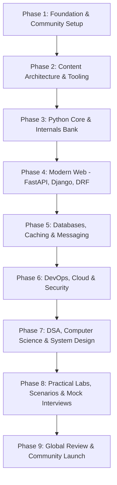

# Project Roadmap: Software Engineering Interview Kit

The vision of `software-engineering-interview-kit` is to establish the industry's most rigorous, comprehensive, open-source interview preparation platform tailored for Python backend engineers, full-stack developers, and DevOps engineers.

---

## Target Goals & Metrics

Each major domain targets 600 total questions:
- **Basic Level**: 200 Questions
- **Intermediate Level**: 200 Questions
- **Advanced Level**: 200 Questions

Plus practical coding exercises, real-world troubleshooting scenarios, full system designs, and mock interview transcripts.

---

## Phased Execution Roadmap

---

### Phase 1: Repository Foundation & Community Health (Current Phase :white_check_mark:)
- [x] Establish root project layout and domain directories.
- [x] Configure open-source licensing (MIT License and Code License).
- [x] Author comprehensive community documentation (`CONTRIBUTING.md`, `CODE_OF_CONDUCT.md`, `SECURITY.md`).
- [x] Create GitHub issue templates and pull request templates.
- [x] Create initial `README.md` with dynamic-ready tracking tables.
- [x] Create placeholder file matrix across all 15 technical domains.

### Phase 2: Content Architecture & Tooling (Current Phase :white_check_mark:)
- [x] Define standardized 10-point question template.
- [x] Define Question ID taxonomy (`[TOPIC]-[LEVEL]-[001..200]`).
- [x] Author technical level criteria in `docs/difficulty-levels.md`.
- [x] Create `scripts/validate_repository.py` to verify:
  - ID uniqueness and sequential numbering.
  - Markdown syntax and relative link health.
  - Python code block syntax validation.
  - Live statistics generation.
- [x] Set up GitHub Actions CI workflow for validation on push/PR.

---

### Phase 3: Python Core, Internals & Performance
Target: 600 Questions across 8 subtopic files.
- [ ] Fundamentals (`01-python/fundamentals.md`)
- [ ] Data Types & Collections (`01-python/data-types-and-collections.md`)
- [ ] Object-Oriented Programming (`01-python/oop.md`)
- [ ] Decorators & Generators (`01-python/decorators-and-generators.md`)
- [ ] Concurrency & Parallelism (`01-python/concurrency-and-parallelism.md`)
- [ ] Memory Management (`01-python/memory-management.md`)
- [ ] Internals & Performance (`01-python/internals-and-performance.md`)
- [ ] Advanced Python (`01-python/advanced-python.md`)

---

### Phase 4: Modern Backend Frameworks (FastAPI, Django & DRF)
Target: 1,800 Questions total (600 per framework).
- [ ] **FastAPI**:
  - Fundamentals, Routing, Pydantic v2, Async execution, Auth, WebSockets, DB session management, Testing, and Production deployment.
- [ ] **Django**:
  - MVT architecture, ORM query optimization, Views, Middleware, Signals, Auth, Caching, Celery integration, and Security best practices.
- [ ] **Django REST Framework**:
  - Serializers, ViewSets, Routers, Permissions, Throttling, Filtering, Pagination, and Optimization (`select_related`, `prefetch_related`).

---

### Phase 5: Databases, Caching & Messaging
Target: 1,200 Questions total.
- [ ] **Databases (05-databases)**:
  - SQL Fundamentals, PostgreSQL internals (MVCC, WAL, VACUUM), MySQL (InnoDB, clustering), SQLite, Indexing (B-Tree, GiST, GIN), Transactions & ACID isolation levels, Normalization & High-scale schema design.
- [ ] **Redis & Messaging (06-redis-and-messaging)**:
  - Redis data types, persistence (RDB, AOF), caching strategies, Celery task lifecycle, RabbitMQ AMQP architecture, backpressure, and distributed locking.
- [ ] **API Engineering (07-api-engineering)**:
  - RESTful constraints, HTTP/2 & HTTP/3, OAuth2 & JWT, Rate limiting algorithms (Token Bucket, Leaky Bucket), WebSockets, and gRPC with Protobuf.

---

### Phase 6: DevOps, Cloud Infrastructure & Application Security
Target: 1,200 Questions total.
- [ ] **DevOps (11-devops)**:
  - Linux internals & system calls, Bash scripting, Git branching strategies, Docker containerization & multi-stage builds, Docker Compose, Nginx reverse proxy & SSL, Gunicorn/Uvicorn process models, CI/CD with GitHub Actions, AWS essentials (EC2, S3, IAM, ALB), and Prometheus/Grafana monitoring.
- [ ] **Security (12-security)**:
  - OWASP Top 10 for APIs, SQL injection prevention, XSS/CSRF mitigation, secure token storage, cryptographic hashing, and secrets management.

---

### Phase 7: DSA, Computer Science & System Design
- [ ] **Data Structures & Algorithms (08-data-structures-and-algorithms)**:
  - Pythonic implementations of Arrays, Linked Lists, Stacks, Queues, Hash Tables, Trees, Graphs, Sorting, Dynamic Programming, and Big-O Complexity.
- [ ] **Computer Science Fundamentals (09-computer-science)**:
  - OS concepts (Process vs Thread, Context Switching, Deadlocks, Virtual Memory), Networking (TCP/IP, UDP, DNS, TLS Handshake), and DBMS fundamentals.
- [ ] **System Design (10-system-design)**:
  - LLD (SOLID, Gang of Four patterns), HLD (Microservices, Event-Driven, CAP Theorem), and end-to-end real-world designs (URL Shortener, Rate Limiter, Notification Engine, Job Queue, Scalable REST API).

---

### Phase 8: Practical Exercises, Mock Interviews & Prep Guides
- [ ] **Coding Exercises (13-coding-exercises)**:
  - Algorithmic problems, production debugging tasks, SQL query puzzles, and mini backend features.
- [ ] **Mock Interviews (14-mock-interviews)**:
  - Full-length simulated interviews: Junior, Intermediate, Senior, and scenario-based technical deep-dives.
- [ ] **Interview Preparation (15-interview-preparation)**:
  - Resume building for backend engineers, STAR-method behavioral responses, explaining complex projects, and negotiation strategies.

---

### Phase 9: Verification, Audit & Community Release
- [ ] Automated validation suite run on 100% of generated content.
- [ ] Zero broken links or invalid code snippets.
- [ ] Tagging release `v1.0.0` and opening to open-source contributions.
