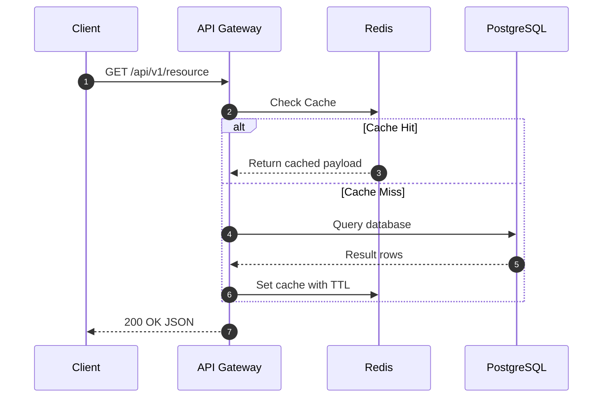

# Documentation & Content Standards: Software Engineering Interview Kit

Welcome to the definitive style, formatting, and technical quality guide for the **Software Engineering Interview Kit**.

All maintainers, contributors, and technical reviewers must adhere to the standards outlined in this document. These standards ensure that every question, scenario, diagram, and code snippet meets world-class engineering documentation benchmarks.

---

## 1. Typography & Markdown Formatting Rules

Consistent typography is critical for readability across different markdown renderers (GitHub Web, VS Code, mobile devices, terminal viewers, and documentation sites).

### 1.1 Heading Hierarchy
- **Level 1 (`#`)**: Reserved strictly for the single document title at the very top of each markdown file.
- **Level 2 (`##`)**: Major thematic sections, categories, or domain chapters (e.g., `## Basic Questions (001–075)`).
- **Level 3 (`###`)**: Individual Question identifiers and titles (e.g., `### PY-BAS-001: Python Execution Model and Bytecode Compilation`).
- **Level 4 (`####`)**: Question sub-components (e.g., `#### 1. One-Line Answer`, `#### 3. Practical Example`).
- **Level 5 & 6 (`#####`, `######`)**: Deep nested technical details inside explanations (e.g., benchmark tables, bytecode disassemblies).

### 1.2 Text Formatting
- **Bold (`**text**`)**: Use for critical keywords, key metrics, technical terms on first mention, time/space complexities (e.g., **O(1)** time, **ACID** properties, **Pydantic v2**).
- **Italic (`*text*`)**: Use for secondary emphasis, conversational hints, or explanatory notes beneath code snippets (e.g., *Note: Requires PostgreSQL 14+*).
- **Underline**: **Do NOT use raw HTML `<u>` tags or Markdown underlines.** Underlined text in web documentation is frequently confused with unvisited hyperlinks. Use bold or inline code instead.
- **Inline Code (`` `code` ``)**: Use for function names, variables, class names, HTTP verbs, status codes, CLI commands, file paths, and SQL keywords (e.g., `async def`, `select_related()`, `GET /api/v1/orders`, `200 OK`, `EXPLAIN ANALYZE`).
- **Alert Blocks**: Use GitHub-flavored Markdown alert callouts where helpful:
  ```markdown
  > [!NOTE]
  > Informational note or version compatibility detail.

  > [!TIP]
  > Practical production optimization or interview delivery tip.

  > [!WARNING]
  > Common pitfall, memory leak vulnerability, or race condition hazard.
  ```

### 1.3 Code Blocks
- **Language Identifier**: Every fenced code block must declare its language tag explicitly:
  - `python` for Python code.
  - `sql` for database queries.
  - `bash` / `sh` for terminal commands.
  - `dockerfile` for Dockerfiles.
  - `yaml` for Docker Compose, GitHub Actions, or Kubernetes manifests.
  - `json` for JSON payloads.
  - `mermaid` for diagrams.
- **Python Code Cleanliness**:
  - All Python code blocks must be valid, well-formatted Python 3.10+ syntax.
  - Code must pass Python Abstract Syntax Tree (`ast.parse`) validation with zero syntax errors.
  - Include type hints (`int`, `str`, `list[str]`, `dict[str, Any]`, `Optional[T]`) following modern PEP 585 and PEP 604 conventions.

---

## 2. The Comprehensive 14-Point Answer Architecture

To provide unmatched depth, questions in this repository follow our expanded **14-Point Answer Architecture**. This architecture guarantees that candidates understand not only basic definitions, but also low-level runtime mechanics, enterprise architectures, failure modes, and interview trade-offs.

```
┌────────────────────────────────────────────────────────────────────────┐
│                   14-Point Question Structure                          │
├────────────────────────────────────────────────────────────────────────┤
│ 1. Question ID & Title        │ Standardized taxonomy identifier       │
│ 2. Metadata                   │ Difficulty & Topic classification      │
│ 3. One-Line Answer            │ High-impact phone-screen verbal answer │
│ 4. Detailed Answer            │ In-depth theoretical & technical dive  │
│ 5. Practical Example          │ Runnable, idiomatic code snippet       │
│ 6. Internal Working           │ CPython / OS / DB execution mechanics  │
│ 7. Architecture / Data Flow   │ Visual Mermaid diagram where relevant  │
│ 8. Real-World Use Case        │ High-scale production application      │
│ 9. Failure Modes & Debugging  │ How it breaks & how to fix it          │
│ 10. Indian IT Market Context  │ Scenarios (UPI, Flipkart, Swiggy, etc.)│
│ 11. Follow-Up Questions       │ 2–5 targeted probing questions         │
│ 12. Common Interview Mistakes │ Misconceptions & anti-patterns         │
│ 13. Strategic Interview Tip   │ Communication & seniority advice       │
│ 14. Related Concepts & Links  │ Cross-references & official docs       │
└────────────────────────────────────────────────────────────────────────┘
```

### Standard Markdown Template

```markdown
### [TOPIC]-[DIFF]-[000]: [Clear, Technically Precise Question Title]

**Difficulty:** [Basic | Intermediate | Advanced]  
**Topic:** [Subtopic Category]

#### 1. One-Line Answer
A concise, punchy 1-2 sentence definition that directly answers the question without hesitation.

#### 2. Detailed Answer
A thorough technical exposition explaining:
- Core principles and foundational concepts.
- Why the architecture or language was designed in this manner.
- Engineering trade-offs (latency vs. throughput, consistency vs. availability).

#### 3. Practical Example
```python
# Fully qualified, syntactically valid Python snippet
import asyncio

async def fetch_user_balance(user_id: int) -> dict[str, float]:
    """Retrieve verified wallet balance."""
    return {"user_id": user_id, "balance_inr": 2500.50}
```
*Explanation detailing how the snippet operates and what output is generated.*

#### 4. Internal Working
Deep dive into under-the-hood runtime mechanics:
- CPython interpreter structures (`PyObject`, reference counting, freelists, GIL state).
- OS system calls (`epoll`, `kqueue`, file descriptors, copy-on-write memory).
- Database internals (PostgreSQL MVCC, WAL logs, B-Tree leaf pages, vacuuming).

#### 5. Architecture / Data Flow Diagram (Where Applicable)


#### 6. Real-World Production Use Case
Concrete enterprise scenario illustrating high-throughput or mission-critical backend usage.

#### 7. Failure Modes & Production Troubleshooting
- What breaks under stress (connection pool exhaustion, thread starvation, OOM)?
- How to diagnose via metrics (Prometheus, logs, `cProfile`) and remediate.

#### 8. Indian IT Market & Enterprise Relevance
- Relevance to high-concurrency Indian tech ecosystems (e.g., UPI payment webhooks, Razorpay callbacks, Swiggy/Zomato hyperlocal routing, Flipkart Big Billion Days flash sales, TCS/Infosys enterprise modernization).

#### 9. Interview Follow-Up Questions
1. *Probing question 1 regarding edge cases?*
2. *Probing question 2 regarding distributed scaling?*
3. *Probing question 3 regarding failure recovery?*

#### 10. Common Interview Mistakes & Anti-Patterns
- **Mistake 1**: Candidate assumes X instead of Y.
- **Mistake 2**: Outdated practice or naive implementation.

#### 11. Strategic Interview Tip
Actionable advice on how to articulate the answer, structure technical diagrams on a whiteboard, and demonstrate senior engineering judgment.

#### 12. Related Concepts & Cross-References
- [Related Module Title](../01-python/fundamentals.md#question-id)
- [Official Documentation Reference](https://docs.python.org/3/)
```

---

## 3. Mermaid Diagram Standards

Diagrams provide visual clarity for complex distributed systems, request lifecycles, and database relationships.

### 3.1 Supported Diagram Types
Only use standard, universally supported Mermaid diagram types:
1. `flowchart TD` / `flowchart LR`: For architectural pipelines, decision trees, and component workflows.
2. `sequenceDiagram`: For HTTP request-response cycles, API authentication flows, and event-driven messaging.
3. `stateDiagram-v2`: For finite state machines (e.g., Celery task states, payment transaction lifecycles).
4. `erDiagram`: For relational database schemas and table relationships.
5. `classDiagram`: For object-oriented design and design pattern implementations.

### 3.2 Diagram Syntax Rules
- **Quote Node Labels**: Always wrap node labels containing parentheses, brackets, or special characters in quotes:
  ```mermaid
  flowchart LR
      Client["Client (Mobile / Web)"] --> Nginx["Nginx Reverse Proxy (Port 443)"]
      Nginx --> ASGI["Uvicorn Workers (Gunicorn Managed)"]
  ```
- **Avoid Raw HTML in Labels**: Do not use `<br>`, `<b>`, or `<span>` tags inside Mermaid nodes. Use standard Mermaid formatting.
- **Number Sequence Steps**: Always add `autonumber` to `sequenceDiagram` definitions for easy visual reference during verbal discussions.

---

## 4. Indian IT Market Integration Standards

The Indian IT ecosystem presents unique engineering challenges characterized by massive scale, high concurrency, cost-effective infrastructure, and distinct regulatory frameworks.

When crafting or evaluating questions, contributors should incorporate the following archetypes:

| Domain | Key Concepts | Indian Enterprise Examples |
|---|---|---|
| **FinTech & Payments** | UPI Intent/Collect flows, Razorpay/Cashfree webhook idempotency, NPCI reconciliation, double-spend prevention | Razorpay, PhonePe, Paytm, CRED |
| **Hyperlocal & Logistics** | Geohashing, driver dispatching, PostGIS spatial queries, real-time WebSocket vehicle tracking | Swiggy, Zomato, Zepto, Blinkit |
| **E-Commerce Flash Sales** | Flash-sale inventory locks, high-concurrency Redis counters, queue-based checkout buffering | Flipkart (Big Billion Days), Meesho |
| **Telecom & Auth** | High-volume SMS/WhatsApp OTP bursts, DLT template routing, distributed token-bucket rate limiting | Jio, Airtel, Gupshup |
| **Compliance & Taxation** | Multi-tier GST (CGST, SGST, IGST) invoicing calculations, precision decimal arithmetic, audit logs | Zoho Books, ClearTax, Enterprise ERPs |
| **Service MNC Scale** | Large-scale legacy-to-cloud modernization, multi-tenant databases, offshore enterprise SLAs | TCS, Infosys, Wipro, HCL, Cognizant |

---

## 5. Question ID Taxonomy & Uniqueness Rules

Every question must possess a globally unique identifier formatted as:

`[TOPIC]-[LEVEL]-[INDEX]`

- **TOPIC Codes**:
  - `PY`: Python Core & Internals
  - `FAPI`: FastAPI Framework
  - `DJA`: Django Framework
  - `DRF`: Django REST Framework
  - `PG` / `DB`: Databases & PostgreSQL
  - `RED` / `CEL`: Redis & Celery
  - `API`: API Engineering
  - `DSA`: Data Structures & Algorithms
  - `CS`: Computer Science Fundamentals
  - `SD`: System Design
  - `DOC` / `OPS`: Docker & DevOps
  - `SEC`: Application Security
  - `PRAC`: Practical Coding Exercises
  - `MOCK`: Mock Interview Scenarios
- **LEVEL Codes**:
  - `BAS`: Basic (Junior / Fresher level)
  - `INT`: Intermediate (Mid-level / SDE-2 level)
  - `ADV`: Advanced (Senior / Staff Architect level)
- **INDEX**: 3-digit zero-padded integer (`001`, `002`, ..., `200`).

---

## 6. Public Repository Verification Tool

All contributors must verify their contributions before submitting a Pull Request.

Run the standalone public validator from the root directory:

```bash
# Using Python 3.10+
python tools/public/validate_repository.py
```

The tool checks:
1. **Question ID Uniqueness**: Flags duplicate IDs across the entire repository.
2. **Sequential Question Numbering**: Detects missing or skipped IDs.
3. **Question Count Verification**: Audits completed vs. pending target counts.
4. **Python Syntax Verification**: Parses every ```python``` code block using `ast.parse`.
5. **Markdown Relative Link Health**: Verifies that every cross-module relative file link points to an existing file.
6. **Mermaid Block Integrity**: Confirms valid Mermaid diagram declaration types.
7. **Empty File Audit**: Highlights 0-byte or unpopulated markdown files.

---

## 7. Pull Request & Contribution Workflow

1. **Fork & Branch**: Create a feature branch named `feat/<topic>-<scope>` (e.g., `feat/celery-distributed-locks`).
2. **Implement Content**: Follow the 14-point structure and ensure all code blocks execute cleanly.
3. **Run Validation**: Verify with `python tools/public/validate_repository.py`.
4. **Commit Guidelines**: Use Conventional Commits (`feat:`, `fix:`, `docs:`, `refactor:`).
5. **Submit PR**: Open a Pull Request targeting the `main` branch with a clear summary of additions.
